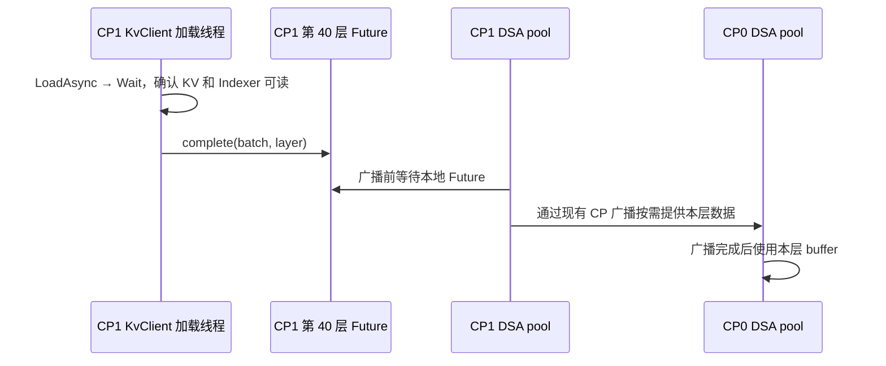

# KvClient 适配 DSA 缓存层拆分设计

状态：待实现。本文覆盖 `--enable-dsa-cache-layer-split` 下的设备布局、MR 注册、普通 PUT、EXISTS 和逐层 GET。完整副本路径沿用[现有 KvClient 设计](kv_client_linker_backend_design.md)。逐层 PUT 另行设计。

核心规则是**各 CP rank 只读写自己持有的模型层，同一逻辑页的 KV 和 Indexer 继续共用一个 ASU 数据 key 和全页 offset 布局**。GET 完成后由现有 DSA pool 广播所需的层。

## 1. 启用条件和 rank 分工

按实际创建的 pool 布局选择路径。拆层 pool 以 `layer_shard_enabled` 和自身的层范围为准。CP=1 时实际没有分片，仍走完整副本路径。兼容现有模型配置约束，拆层用于 DSA MLA 的 PD prefill、interleave CP 和 PP=1。现有参数校验对 PD 传输后端的要求继续由框架处理。

| 实际布局 | 普通 PUT | 逐层 GET |
| --- | --- | --- |
| 完整副本 | 保持现有 owner 规则。interleave CP 下由 CP0 的 attention TP rank 0 写完整页 | 各 rank 按原逻辑 GET 全部层 |
| 按 CP 拆层 | 每个 CP 组的 attention TP rank 0 写本组持有的层 | 各 rank 只 GET 本地持有的层。计算读取其他层时走现有 CP 广播 |

例如 78 层、CP=2，使用从 0 开始的模型层索引，CP0 持有 `[0, 39)`，CP1 持有 `[39, 78)`。范围沿用 `get_layer_shard_range()`，支持层数不能整除 CP 数的情况。某 rank 没有分配到层时，不注册空 buffer，也不提交空 IO，仍参加所需的调度和跨 rank 确认。

### 1.1 开启拆层后的普通 attention 前向

**Interleave CP 分的是 token 计算，cache layer split 分的是 GPU 上常驻的缓存层。** CP=2 时，可以把序列看成 CP0 计算偶数位置的 query token，CP1 计算奇数位置的 query token。两张卡会依次执行模型的每一层，各自在该层算自己负责的 query。第 40 层的缓存归 CP1，并不意味着第 40 层 attention 只在 CP1 上计算。

拿第 40 层举例，普通 prefill 前向可以分成以下几步：

1. **各 rank 计算本地 token。** 两张卡分别对本地 token 做投影。该层需要完整 token 顺序的新 KV 和 Indexer 数据时，interleave 策略通过 CP all-gather 拼回所需的序列顺序。 [Interleave 数据收集](python/sglang/srt/layers/cp/interleave.py)
2. **该层 owner 写入常驻缓存。** 新 token 对应的 MLA KV 和 Indexer 数据由 CP1 写进第 40 层的常驻 buffer。CP0 的第 40 层对应位置是零行占位，它在计算时使用临时工作 buffer。 [拆层 pool 的缓存写入](python/sglang/srt/mem_cache/dsa_cache_layer_split.py)
3. **各 rank 按需取这一层的数据。** 需要访问第 40 层已有缓存时，DSA pool 通过 CP 广播用 CP1 的常驻 buffer 填充各 rank 的临时工作 buffer。同一层的数据已在临时 buffer 内时可以直接复用。在读取 Indexer 时，pool 也可以提前准备同一层的 KV。 [拆层 pool 的广播读取](python/sglang/srt/mem_cache/dsa_cache_layer_split.py)
4. **各 rank 算自己的 attention 输出。** 本地 query 先用这一层的 Indexer 找出可访问的候选位置，再用对应的 MLA KV 做 attention。CP0 计算自己的 query，CP1 也计算自己的 query。当前层的 attention 结束后，模型可以预取下一层的 KV，尝试让广播与后续计算重叠。 [下一层 KV 预取](python/sglang/srt/layers/communicator_dsa_cp.py)

这里有两种 CP 通信。**All-gather 收集各 rank 刚算出的 token 数据，owner 广播让各 rank 访问某一层已有的缓存。** 广播可以在本轮新 token 写入前完成。如果该层的临时 KV 副本已准备好，`set_mla_kv_buffer()` 也会把本轮新 token 补进这个副本。普通前向的 GPU 间广播由 DSA pool 实现。接入 KvClient GET 后，同一层的广播源可以来自 ASU 刚恢复的数据，此时该层 owner 先等本地 GET 就绪再广播，详见第 6 节。

## 2. DevicePoolGroup、DevicePoolEntry 和内存注册

现有拆层 pool 在非持有层放零行占位，以保持原有层索引。构造 Entry 时，先按 pool 的层范围选出实际持有的 buffer，再构造 `buffer_meta`。这样零行占位不会进入行步长和页大小计算。

| 数据 | 内容 |
| --- | --- |
| `DevicePoolGroup` | 仍有 KV、Indexer 两个 Entry。`num_layers` 保留模型访问 counter 所用的层数 |
| `owned_layers` | Linker 的有序 IO 层清单，供 MR 注册、GET 和 PUT 使用 |
| `DevicePoolEntry.layer_mapping` | 记录原始层索引到本地 buffer 下标的映射。例如 CP1 的原始层 `39` 对应紧凑列表的下标 `0` |
| MR 注册 | 枚举两个 Entry 引用的有效 GPU tensor，按底层 storage 的地址、长度和设备去重，再注册 allocation |

KV 与 Indexer 继续共用同一份 slot 索引，分别换算各自的行号。GET 使用目标 slots，PUT 使用源 slots。每条 IO 根据本地 `addr` 和实际 `size` 查找覆盖该范围的 MR handle。CP 广播的临时工作 buffer 由 DSA pool 管理，直连 IO 使用 owner 自己的常驻 buffer。

零行占位可能表示非持有层，也可能是模型自身跳过了该层的 Indexer。层归属以拆层 pool 的范围为准。片段是否存在由模型布局确定。首版支持各有效层都有 KV 和 Indexer 片段的布局，遇到其他布局时明确报出原因。

## 3. 单页 key 和全局 offset

`make_cache_key(page_key)` 沿用原来的编码。KV、Indexer 和不同 CP owner 写出的片段都使用同一个数据 key。远端布局仍是全部 KV 片段在前，全部 Indexer 片段在后。

在注册 MR 之前生成 `_storage_offsets`。完整副本沿用现有构建路径。**拆层时，每个 rank 只生成自己持有层的 `(pool, layer, fragment) → remote_offset` 表项。** 每一项的值仍按全页布局计算。对连续层分片，可以按下面的方式算出本地片段的远端位置。

```text
KV offset      = 前面 CP 分片的 KV 对齐总字节数 + 本分片内的 KV 对齐偏移
Indexer offset = 全部层的 KV 对齐总字节数
                 + 前面 CP 分片的 Indexer 对齐总字节数
                 + 本分片内的 Indexer 对齐偏移
```

各层布局固定且能从模型配置确认时，直接用全局层数、原始层号和已知的片段大小计算，无需交换元数据。各层大小会变时，可以在初始化阶段交换各 CP 分片的 KV、Indexer 对齐总字节数，用于计算前缀和和 Indexer 基址。片段顺序沿用全页布局，各 rank 只存本地 IO 会查的表项。

以 78 层、每 KV 页每层 `73728` 字节、每 Indexer 页每层 `8448` 字节为例，原始层 `39` 在 CP1 本地 Entry 的下标是 `0`，远端位置仍是下面两个值。

| 片段 | ASU 对象内 offset | IO 长度 |
| --- | ---: | ---: |
| KV 原始层 `39` | `39 × 73728 = 2875392` | `73728` |
| Indexer 原始层 `39` | `78 × 73728 + 39 × 8704 = 6090240` | `8448` |

`8704` 是 `8448` 向上对齐到 512 字节后的占位步长。IO 仍传实际长度。目标 SDK 和 provider 必须支持此长度。另需核对不同 rank 使用相同的模型布局、namespace 和 ASU 路由配置。

## 4. 普通 PUT 和完成确认

1. Wrapper 锁住本次 offload 的源 slots，同一批页以一致顺序交给每个 rank。
2. 各 CP 组的写入 owner 等 `ready_event`，遍历本地 `owned_layers`，为 KV 和 Indexer 生成 `key/addr/size/offset`，一次提交本 rank 的片段。非写入 rank 保持相同的结果顺序，以 `True` 参与汇总。
3. 各写入者等待 `StoreAsync` 的任务完成，检查任务和逐条结果。调度侧沿用跨 rank 的计数及结果汇总。某个分片失败，整页保存失败。
4. 所有分片成功且 ASU 可以发布整页可读状态后，Wrapper 更新缓存树并解除源 slots 的保护。SDK 超时且 IO 未确认静默时，沿用现有资源保护和故障处理。

调度侧的 `MIN` 只汇总本次任务的结果。整页何时对其他读者可见，由下一节的存储契约决定。如果 ASU 需要显式发布，单个协调者在所有写入者成功后发布。发布失败也按整页保存失败处理，不能先把树节点标记为已保存。

## 5. EXISTS 和整页可见性

拆层模式仍按页查询。返回命中的条件是该 key 对应的所有 KV、Indexer 片段都已写完、属于同一份已发布数据且可读。这样 CP0 的前半页已经写完、CP1 的后半页尚未写完时，查询仍返回 miss。

启用前要在实际 ASU 上确认两项能力：多个客户端可以对同一 key 并发写不重叠区间，且读者只能看到已发布的完整页。如果 ASU 本身保证整页原子可见，EXISTS 继续用 `QueryAsync` 查同一个 key。如果会提前暴露 key，则要通过 ASU 提供的发布或完整性元数据区分未发布和已发布，LOOKUP 只认后者。

参考 SDK 的 `QueryAsync` 只接收 key，公开接口中没有整页发布操作。发布协议的具体接口需要和 ASU 确认。同一个普通 key 存在、各 rank 查到这个 key、或各 rank 本地 PUT 返回成功，都不足以证明其他读者能安全读取完整页。若采用独立完成标记，部署还须保证标记与数据版本绑定，并能处理数据对象淘汰、失败重试和并发写入，避免旧标记让新读者误命中。

能力未确认前保留拆层初始化限制。首次验证使用独立 namespace，完整副本模式继续使用原来的 key 和 offset。只有确认两种模式使用同一远端布局和相同的整页可见性契约后，才共享已有远端缓存。

## 6. 逐层 GET 与 CP 广播

1. Wrapper 在整页命中后分配目标 slots。各 rank 用同一页 key 和全局远端 offset，只为本地 `owned_layers` 生成描述符。
2. 加载线程提交本 rank 各持有层的 `LoadAsync`，按层号 `Wait`。某层的 KV 和 Indexer 都成功且设备可见后，完成本 rank counter 中该层对应的 Future。
3. `wait_until(layer_id - start_layer)` 继续按原始层索引定位。非持有层没有本地 ASU IO 可等，应跳过本地 Future 等待。接收 rank 通过现有广播拿到数据。
4. 该层 owner 在广播前等待自己的 GET。用第 40 层举例，CP1 等这一层在本地 GPU 上可读，然后向现有 CP 广播提供源 buffer。CP0 在广播中接收，KvClient 不增加逐层的跨 rank 屏障。



广播前的就绪检查要覆盖普通 buffer getter、Indexer 广播和 `prefetch_kv_buffer()`。当前 prefetch 有不传 counter 的调用点，也有直接发起广播的分支，应把检查收敛到 owner 实际使用源 buffer 之前。还需在从 ASU 恢复数据的批次切换时处理旧 scratch 状态，避免复用只按层号命中的旧广播结果。各 rank 仍按相同顺序进入已有 collective。

在最后一个本地 IO 完成后，加载线程可以发布本 rank 的完成通知。counter 的清理不能依赖「最后一个本地层的层号恰好是模型最后一层」。例如 CP0 在原始层 `38` 完成本地读取，模型仍会继续访问后续层。应在原有批次消费结束或统一的收尾点清理。若 owner 的 GET 失败，将异常传给本地等待者，并接入 rank 组故障处理。验收时须确认其他参与者也能退出，避免接收方一直堵在广播。

## 7. 实现顺序和验收

| 顺序 | 改动 | 验证 |
| --- | --- | --- |
| 1 | 在 `linker_pool_assembler.py` 增加拆层布局组装，在 `kvclient_direct_linker.py` 建 `owned_layers`，按全页布局生成本地 offset 表项 | CP=2 的两个 rank 各自只生成持有层的 offset 表项，只注册持有层的 buffer。两张表合起来与完整副本的远端布局一致，未持有层无 IO。覆盖层数不能整除的情况 |
| 2 | 明确目标 ASU 的并发写与发布契约，接通普通 PUT 和 EXISTS | 暂停 CP1 时同一页查询返回 miss，两片都写完并发布后才命中。覆盖单片失败、重试和数据淘汰 |
| 3 | 逐层 GET 只提交本地层，接通 counter 与拆层 pool 的广播入口 | 延迟 CP1 第 40 层 GET，确认 owner 等待后才广播。覆盖普通读取和预取、跨层 scratch 复用及失败退出 |
| 4 | 走一遍完整副本与拆层两种路径 | 完整副本仍是 CP0 单写，现有 key/offset 保持不变。拆层路径在换一组 slot 后读回，逐层比较 KV 和 Indexer 数据 |

实现参考包括[拆层 pool](python/sglang/srt/mem_cache/dsa_cache_layer_split.py)、[现有 KvClient Linker](python/sglang/srt/mem_cache/storage/kvclient/kvclient_direct_linker.py)、[公共跨 rank 收尾](python/sglang/srt/mem_cache/unified_radix_cache.py)以及[Mooncake PD 的层范围传递](python/sglang/srt/disaggregation/prefill.py)。
