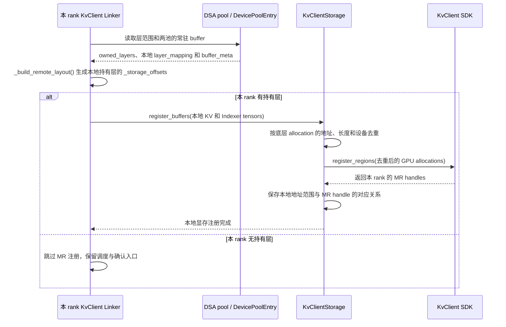
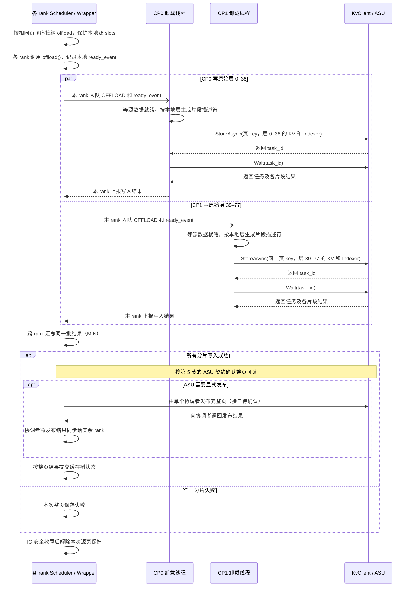
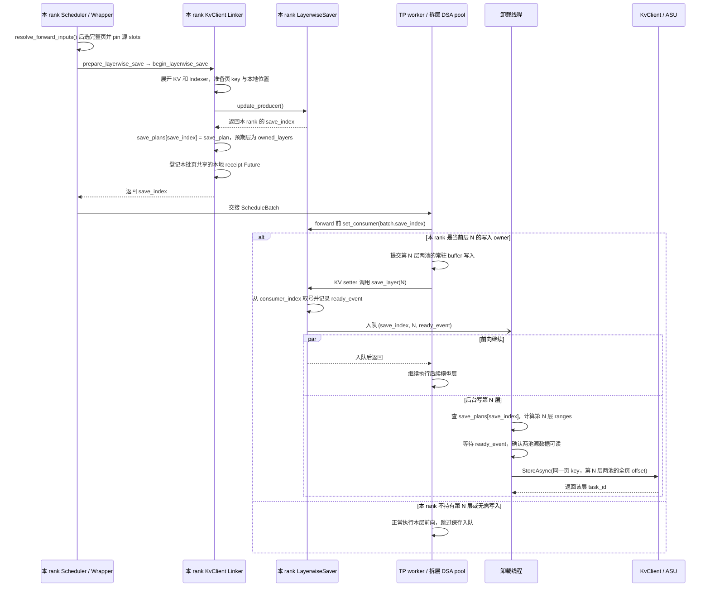
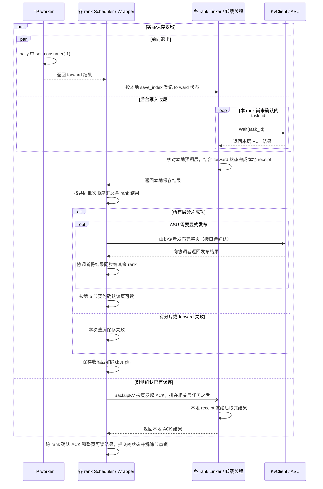
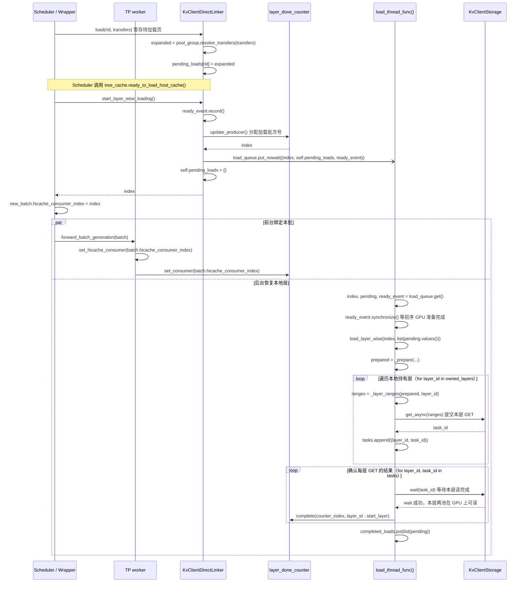
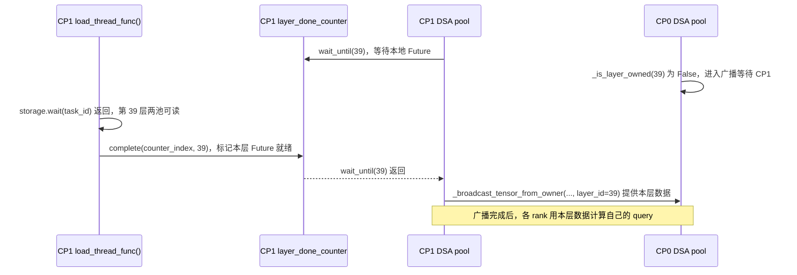

# KvClient 适配 DSA 缓存层拆分设计

状态：待实现。本文覆盖 `--enable-dsa-cache-layer-split` 下的设备布局、MR 注册、普通 PUT、逐层 PUT、EXISTS 和逐层 GET。完整副本路径沿用[现有 KvClient 设计](kv_client_linker_backend_design.md)，逐层 PUT 复用其第 8 节的 `LayerwiseSaver`、`save_plans` 和 receipt 流程。

## 1. 拆层原理和启用条件

**Interleave CP 决定每张卡算哪些 token，layer split 决定每张卡长期保留哪些层的缓存。** 开关两边都一样的是，每个 CP rank 在每个 attention 层计算自己负责的新 token 的 Q、KV 和 Indexer 数据。需要完整的新 KV 和 Indexer 数据时，各 rank 通过 all-gather 汇集各自算出的部分，并还原 token 顺序。每个 rank 仍只计算自己那部分 query 的 attention 输出。

All-gather 的结果也在每张卡的 HBM 里。区别在于后面写到哪里。`kv_buffer[layer]` 给这一层提供独立的常驻缓存，后续 forward 可以按 slot 找到这层的旧 KV。拆层时，只有该层 owner 有这份常驻 buffer。其他 rank 可以使用一层大小的 `remote_kv_buffer`，它可以装当前层，也可以被下一层覆盖。Indexer 有对应的常驻缓存和工作区。[All-gather 后恢复 token 顺序](python/sglang/srt/layers/cp/interleave.py) · [拆层 pool 的常驻 buffer 和工作区](python/sglang/srt/mem_cache/dsa_cache_layer_split.py)

### 1.1 四个 CP rank：开启和关闭 layer split

假设有 **8 个 attention 层**和**本轮新增的 8 个 token**，两种编号都从 `0` 开始。CP=4，两种设置都按照 `token 位置 % 4` 分工。下面的「常驻层」指该 rank 在 HBM 里给哪些层保留 KV 和 Indexer，各持有层都保存其完整 token 数据。

| CP rank | 每一层负责计算的新 token | 不开 layer split 的常驻层 | 开 layer split 的常驻层 |
| --- | --- | --- | --- |
| CP0 | `0、4` | `0–7` | `0–1` |
| CP1 | `1、5` | `0–7` | `2–3` |
| CP2 | `2、6` | `0–7` | `4–5` |
| CP3 | `3、7` | `0–7` | `6–7` |

拿**原始层 `2`** 举例。四张卡都执行这一层，all-gather 后都拿到 token `0–7` 的新 KV 和 Indexer。

- **不开 layer split**：CP0 到 CP3 都把这些新数据写进自己第 `2` 层的常驻缓存。后续 forward 需要这一层的旧 KV 时，各 rank 都能直接读本地 HBM。外部普通 PUT 由 CP0 写一份完整页。
- **开 layer split**：只有 CP1 把这些新数据写进第 `2` 层的常驻缓存，包含其余三个 rank 算出的 token。CP0、CP2、CP3 仍会拿到本轮 all-gather 的结果；以后需要这一层的旧数据时，由 CP1 广播到各 rank 的工作区。外部普通 PUT 由四个 owner 各写自己的层，合起来构成同一页。

### 1.2 启用条件和 rank 分工

按实际创建的 pool 布局选择路径。拆层 pool 以 `layer_shard_enabled` 和自身的层范围为准。CP=1 时实际没有分片，仍走完整副本路径。兼容现有模型配置约束，拆层用于 DSA MLA 的 PD prefill、interleave CP 和 PP=1。现有参数校验对 PD 传输后端的要求继续由框架处理。

当前 DSA interleave prefill CP 路径的有效 `attn_tp_size` 为 `1`，所以拆层示例中每个有本地层的 CP rank 都是写入 owner。现有 OceanDisk `--disaggregation-linker-notify` 要求完整副本，这里讨论的是 KvClient 的外部缓存读写。

| 实际布局 | 普通 PUT | 逐层 PUT | 逐层 GET |
| --- | --- | --- | --- |
| 完整副本 | interleave CP 下由 CP0 的 attention TP rank 0 写完整页 | 同一 owner 按层写出完整页的全部层 | 各 rank 按原逻辑 GET 全部层 |
| 按 CP 拆层 | 每个 CP 层分片的 owner 一次提交本地持有层 | 同一 owner 随前向逐层提交本地持有层 | 各 rank 只 GET 本地持有的层。计算读取其他层时走现有 CP 广播 |

后面的注册、PUT 和 GET 时序用 **78 层、CP=2** 举例。原始层索引从 `0` 开始，CP0 持有 `[0, 39)`，CP1 持有 `[39, 78)`。范围沿用 `get_layer_shard_range()`，支持层数不能整除 CP 数的情况。某 rank 没有分配到层时，不注册空 buffer，也不提交空 IO，仍参加所需的调度和跨 rank 确认。

### 1.3 开启拆层后的普通 attention 前向

在这个 CP=2 的例子里，CP0 计算偶数位置的 query，CP1 计算奇数位置的 query。拿第 40 层（原始层索引 `39`，缓存归 CP1）举例，普通 prefill 前向可以分成以下几步：

1. **各 rank 计算本地 token。** 两张卡分别对本地 token 做投影。该层需要完整 token 顺序的新 KV 和 Indexer 数据时，interleave 策略通过 CP all-gather 拼回所需的序列顺序。 [Interleave 数据收集](python/sglang/srt/layers/cp/interleave.py)
2. **该层 owner 写入常驻缓存。** 新 token 对应的 MLA KV 和 Indexer 数据由 CP1 写进第 40 层的常驻 buffer。CP0 的第 40 层对应位置是零行占位，它在计算时使用临时工作 buffer。 [拆层 pool 的缓存写入](python/sglang/srt/mem_cache/dsa_cache_layer_split.py)
3. **各 rank 按需取这一层的数据。** 需要访问第 40 层已有缓存时，DSA pool 通过 CP 广播用 CP1 的常驻 buffer 填充各 rank 的临时工作 buffer。同一层的数据已在临时 buffer 内时可以直接复用。在读取 Indexer 时，pool 也可以提前准备同一层的 KV。 [拆层 pool 的广播读取](python/sglang/srt/mem_cache/dsa_cache_layer_split.py)
4. **各 rank 算自己的 attention 输出。** 本地 query 先用这一层的 Indexer 找出可访问的候选位置，再用对应的 MLA KV 做 attention。CP0 计算自己的 query，CP1 也计算自己的 query。当前层的 attention 结束后，模型可以预取下一层的 KV，尝试让广播与后续计算重叠。 [下一层 KV 预取](python/sglang/srt/layers/communicator_dsa_cp.py)

这里有两种 CP 通信。**All-gather 收集各 rank 刚算出的 token 数据，owner 广播让各 rank 访问某一层已有的缓存。** 广播可以在本轮新 token 写入前完成。如果该层的临时 KV 副本已准备好，`set_mla_kv_buffer()` 也会把本轮新 token 补进这个副本。普通前向的 GPU 间广播由 DSA pool 实现。接入 KvClient GET 后，同一层的广播源可以来自 ASU 刚恢复的数据，此时该层 owner 先等本地 GET 就绪再广播，详见第 6 节。

## 2. DevicePoolGroup、DevicePoolEntry 和内存注册

现有拆层 pool 在非持有层放零行占位，以保持原有层索引。构造 Entry 时，先按 pool 的层范围选出实际持有的 buffer，再构造 `buffer_meta`。这样零行占位不会进入行步长和页大小计算。

| 数据 | 内容 |
| --- | --- |
| `DevicePoolGroup` | 仍有 KV、Indexer 两个 Entry。`num_layers` 保留模型访问 counter 所用的层数 |
| `owned_layers` | Linker 的有序 IO 层清单，供 MR 注册、GET 和 PUT 使用 |
| `DevicePoolEntry.layer_mapping` | 记录原始层索引到本地 buffer 下标的映射。例如 CP1 的原始层 `39` 对应紧凑列表的下标 `0` |
| MR 注册 | 枚举两个 Entry 引用的有效 GPU tensor，按底层 storage 的地址、长度和设备去重，再注册 allocation |

### 2.1 开启拆层后的 DevicePoolGroup 结构

沿用第 1.1 节的例子。模型有 8 层、CP=4，CP1 持有原始层 `2、3`。下面是接入拆层后 CP1 的 Linker 和 DevicePoolGroup 的结构示意。

```text
CP1 的 KvClientDirectLinker
├─ owned_layers = [2, 3]
└─ pool_group: DevicePoolGroup
   ├─ num_layers = 8
   └─ entry_map
      ├─ KV: DevicePoolEntry
      │  ├─ components    = [[KV 第 2 层 buffer, KV 第 3 层 buffer]]
      │  └─ layer_mapping = {2: 0, 3: 1}
      └─ INDEXER: DevicePoolEntry
         ├─ components    = [[Indexer 第 2 层 buffer, Indexer 第 3 层 buffer]]
         └─ layer_mapping = {2: 0, 3: 1}
```

`num_layers = 8` 表示模型 forward 仍然访问原始层 `0–7`。`owned_layers = [2, 3]` 表示 CP1 的 Linker 只处理第 `2、3` 层的本地 IO。比如调用 `get_prepared_layer_range_meta(locations, 2)` 时，Entry 用原始层号 `2` 查 `layer_mapping`，取到本地列表下标 `0`。非持有层的零行占位仍在底层 DSA pool 中，两个 Entry 的 `components` 只引用有实际存储的 buffer。

这个结构由 **DSA pool assembler** 组装。接入时，assembler 根据 pool 持有的层范围选取两池的 buffer，并生成 `{2: 0, 3: 1}`。`DevicePoolEntry` 复用现有的查表逻辑；不开拆层时，完整副本路径仍给两个 Entry 传入全部 8 层，映射为 `0 → 0` 到 `7 → 7`。

**初始化时序：每个 rank 注册自己的常驻 GPU buffer**



以 CP1 的原始层 `39` 为例，Entry 用本地 buffer 下标 `0` 算显存地址，Linker 用原始层号 `39` 查远端 offset。注册针对底层 GPU allocation，在初始化时执行。之后每条 IO 用本地 `addr` 和实际 `size` 查找覆盖该范围的 MR handle。GET 从目标 slots 算地址，PUT 从源 slots 算地址。KV 和 Indexer 共用 slot 索引，各自换算行号。CP 广播的临时 buffer 由 DSA pool 管理，直连 IO 使用常驻 buffer。

零行占位可能表示非持有层，也可能是模型自身跳过了该层的 Indexer。层归属以拆层 pool 的范围为准。片段是否存在由模型布局确定。首版支持各有效层都有 KV 和 Indexer 片段的布局，遇到其他布局时明确报出原因。

## 3. 单页 key 和全局 offset

`make_cache_key(page_key)` 沿用原来的编码。KV、Indexer 和不同 CP owner 写出的片段都使用同一个数据 key。远端布局仍是全部 KV 片段在前，全部 Indexer 片段在后。

在注册 MR 之前，`_build_remote_layout()` 生成 `_storage_offsets`。完整副本沿用现有构建路径。**拆层时，每个 rank 只为自己持有层的 `(pool, layer, fragment)` 建表项，表里的值是该片段在完整 ASU 页里的字节偏移。** 对连续层分片，可以按下面的方式算出本地片段的远端位置。

```text
KV offset      = 前面 CP 分片的 KV 对齐总字节数 + 本分片内的 KV 对齐偏移
Indexer offset = 全部层的 KV 对齐总字节数
                 + 前面 CP 分片的 Indexer 对齐总字节数
                 + 本分片内的 Indexer 对齐偏移
```

各层布局固定且能从模型配置确认时，直接用全局层数、原始层号和已知的片段大小计算，无需交换元数据。各层大小会变时，可以在初始化阶段交换各 CP 分片的 KV、Indexer 对齐总字节数，用于计算前缀和和 Indexer 基址。片段顺序沿用全页布局，各 rank 只存本地 IO 会查的表项。

以 78 层、每 KV 页每层 `73728` 字节、每 Indexer 页每层 `8448` 字节为例，原始层 `39` 在 CP1 本地 Entry 的下标是 `0`，远端位置仍是下面两个值。

| 片段 | ASU 对象内 offset | IO 长度 |
| --- | ---: | ---: |
| KV 原始层 `39` | `39 × 73728 = 2875392` | `73728` |
| Indexer 原始层 `39` | `78 × 73728 + 39 × 8704 = 6090240` | `8448` |

`8704` 是 `8448` 向上对齐到 512 字节后的占位步长。IO 仍传实际长度。目标 SDK 和 provider 必须支持此长度。另需核对不同 rank 使用相同的模型布局、namespace 和 ASU 路由配置。

## 4. PUT 和完成确认

### 4.1 普通 PUT

**普通 PUT 时序：CP0、CP1 分别写同一页的本地层**



两边的描述符使用相同的页 `key`，各自用源 slot 算本地 `addr` 和 MR handle，并填写该层的实际 `size` 及全页 `offset`。未提交 IO 的 rank 保持相同结果顺序，以 `True` 参与汇总。`MIN` 得到的是写入结果；若需要显式发布，还要等所有 rank 拿到发布结果后再提交树状态。发布失败按整页保存失败处理。SDK 超时且 IO 未确认静默时，继续保留源页保护。

### 4.2 逐层 PUT

启用 `layerwise_save` 后，沿用[主设计第 8 节](kv_client_linker_backend_design.md#8-put逐层保存与树侧卸载确认)的入口：Scheduler 在 forward 前准备完整页和保存计划，TP worker 绑定 `batch.save_index`，DSA setter 在本层数据写入后调用 `save_layer(layer_id)`。拆层时，**每个写入 owner 的 `save_plan` 只期待自己的 `owned_layers`**。CP0 期待层 `0–38`，CP1 期待层 `39–77`。两边为同一批逻辑页保留相同的页 key 和顺序，但各自使用本地 slots、MR handle 和 `save_index`。`save_index` 只在本 rank 查计划，跨 rank 用共同的调度顺序和页 key 对齐结果。

**图 A　每批准备一次，前向只为本地持有层入队**



例如跑到原始层 `39`，两张卡都继续执行 attention，**只有 CP1 入队该层的保存任务**。`LayerSplitDSATokenToKVPool` 的 hook 放在 owner 的常驻 KV 写入分支之后。非 owner 写临时工作区时也可能进入这个 setter，但不会触发保存。`ready_event` 必须覆盖同层 Indexer 与 KV 的写入依赖。每个预期层只入队一次。本轮没有待保存页时按主设计返回 `-1`；没有本地写入的 rank 仍按共同批次顺序参加结果确认。

**图 B　本地 receipt、整页发布和树侧 ACK**



CP0 的最后一个预期层是 `38`，可以先收尾本地 PUT，即使两张卡的 forward 都还要继续跑层 `39–77`。本地 receipt 成功要求 **本 rank 的 forward 正常退出、全部预期层都已提交且 PUT 成功**。如果未进入 forward、缺层或 PUT 失败，排空该 rank 已提交的 IO 后报告失败。未确认 IO 安全结束时继续 pin 源页。CP0 的本地成功也只覆盖层 `0–38`，必须等 CP1 的结果以及第 5 节的发布条件满足，整页才可以登记为可读。

树侧 `BackupKV → offload` 复用主设计的 ACK 路径。ACK 排在相应的本地层任务或失败收尾通知之后，确认已有 receipt。源页 pin 由实际保存路径收尾，树节点锁由 ACK 路径收尾。整页发布由保存结果的跨 rank 汇总触发，ACK 不再次提交 PUT。

## 5. EXISTS 和整页可见性

拆层模式仍按页查询。返回命中的条件是该 key 对应的所有 KV、Indexer 片段都已写完、属于同一份已发布数据且可读。这样 CP0 的前半页已经写完、CP1 的后半页尚未写完时，查询仍返回 miss。

启用前要在实际 ASU 上确认两项能力：多个客户端可以对同一 key 并发写不重叠区间，且读者只能看到已发布的完整页。如果 ASU 本身保证整页原子可见，EXISTS 继续用 `QueryAsync` 查同一个 key。如果会提前暴露 key，则要通过 ASU 提供的发布或完整性元数据区分未发布和已发布，LOOKUP 只认后者。

参考 SDK 的 `QueryAsync` 只接收 key，公开接口中没有整页发布操作。发布协议的具体接口需要和 ASU 确认。同一个普通 key 存在、各 rank 查到这个 key、或各 rank 本地 PUT 返回成功，都不足以证明其他读者能安全读取完整页。若采用独立完成标记，部署还须保证标记与数据版本绑定，并能处理数据对象淘汰、失败重试和并发写入，避免旧标记让新读者误命中。

能力未确认前保留拆层初始化限制。首次验证使用独立 namespace，完整副本模式继续使用原来的 key 和 offset。只有确认两种模式使用同一远端布局和相同的整页可见性契约后，才共享已有远端缓存。

## 6. 逐层 GET 与 CP 广播

**GET 启动时序：沿用原来的批次编号，只加载本 rank 持有的层**



图里画的是本轮有待加载页的情况。`load_layer_wise(index, list(pending.values()))` 的两个参数分别是 `counter_index` 和 `request_transfers`。`_prepare()` 接收展平后的 `request_transfers`。`storage.get_async(ranges)` 底层调用 `client.load_async`。

拆层设计新增 `owned_layers`，并让 `tasks` 显式保存 `(layer_id, task_id)`，因为 CP1 的 `tasks[0]` 对应原始层 `39`。CP0 和 CP1 都读同一页 key，分别用各自目标 slots、MR handle 和全页 offset。`ready_event` 表示前序准备已完成，每层 Future 表示该层两池已可读。CP1 的原始层 `39` 对应 Entry 下标 `0`；当 `start_layer = 0` 时，模型通过 `wait_until(39)` 等待的仍是层 `39` 的 Future。

**广播时序：模型先到原始层 `39`，CP1 的 GET 随后完成**



如果 Future 已就绪，owner 的等待直接返回。就绪检查要覆盖普通 buffer getter、Indexer 广播和 `prefetch_kv_buffer()`。当前 prefetch 有不传 counter 的调用点，也有直接发起广播的分支，应把检查收敛到 owner 实际使用源 buffer 之前。还需在从 ASU 恢复数据的批次切换时处理旧 scratch 状态，避免复用只按层号命中的旧广播结果。各 rank 仍按相同顺序进入已有 collective，KvClient 不增加逐层的跨 rank 屏障。

在最后一个本地 IO 完成后，加载线程可以发布本 rank 的完成通知。counter 的清理不能依赖「最后一个本地层的层号恰好是模型最后一层」。例如 CP0 在原始层 `38` 完成本地读取，模型仍会继续访问后续层。应在原有批次消费结束或统一的收尾点清理。若 owner 的 GET 失败，将异常传给本地等待者，并接入 rank 组故障处理。验收时须确认其他参与者也能退出，避免接收方一直堵在广播。

## 7. 实现顺序和验收

| 顺序 | 改动 | 验证 |
| --- | --- | --- |
| 1 | 在 `linker_pool_assembler.py` 增加拆层布局组装，在 `kvclient_direct_linker.py` 建 `owned_layers`，按全页布局生成本地 offset 表项 | CP=2 的两个 rank 各自只生成持有层的 offset 表项，只注册持有层的 buffer。两张表合起来与完整副本的远端布局一致，未持有层无 IO。覆盖层数不能整除的情况 |
| 2 | 明确目标 ASU 的并发写与发布契约，接通普通 PUT 和 EXISTS | 暂停 CP1 时同一页查询返回 miss，两片都写完并发布后才命中。覆盖单片失败、重试和数据淘汰 |
| 3 | 逐层 GET 只提交本地层，接通 counter 与拆层 pool 的广播入口 | 延迟 CP1 第 40 层 GET，确认 owner 等待后才广播。覆盖普通读取和预取、跨层 scratch 复用及失败退出 |
| 4 | 接通拆层逐层 PUT 和树侧 ACK | 验证 CP0 只入队 `0–38`、CP1 只入队 `39–77`，且本地层 PUT 与下一层前向重叠。延迟 CP1 时 CP0 的本地 receipt 不能让整页命中；覆盖缺层、失败排空和 ACK 不重复 PUT |
| 5 | 走一遍完整副本与拆层两种路径 | 完整副本仍是 CP0 单写，现有 key/offset 保持不变。拆层路径在换一组 slot 后读回，逐层比较 KV 和 Indexer 数据 |

实现参考包括[拆层 pool](python/sglang/srt/mem_cache/dsa_cache_layer_split.py)、[现有 KvClient Linker](python/sglang/srt/mem_cache/storage/kvclient/kvclient_direct_linker.py)、[公共跨 rank 收尾](python/sglang/srt/mem_cache/unified_radix_cache.py)以及[Mooncake PD 的层范围传递](python/sglang/srt/disaggregation/prefill.py)。
