# KvClientDirectLinker 第一版设计

状态：拟实现方案。参考 `oceandisk_pc_architecture_walkthrough.md` 的讲解顺序，以及 `ucm/store/asu/cc/asu_store.cc` 的 KvClient 调用方式。

第一版以 DSA 模型的前缀缓存适配为目标：同时保存和恢复 KV、Indexer 两个 pool；每个逻辑页一个 key，KV/Indexer 与各层使用互不重叠的远端 offset；每层 KV 与 Indexer 就绪后放行该层计算；模型执行侧提交每层 KV/Indexer 生产计算后记录 event 并排队，后台等待该层数据就绪后写出。先验证单卡，再验证 TP 多卡。必须支持逐层 IO/计算重叠；暂不包含 MTP draft、SWA 和 PD 通知。

## 1. 整体流程：把设备 KV 保存到外部，再按需读回

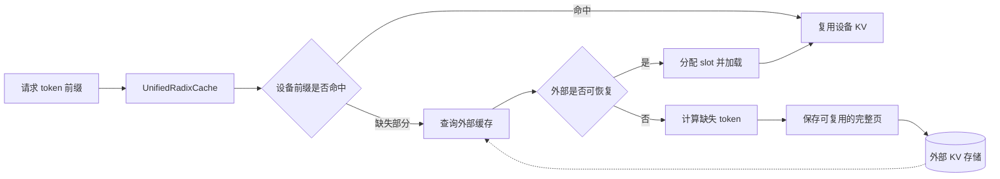

KV 数据在设备 pool 和外部存储之间传输；Python 线程只组织描述符、提交任务及处理结果，不增加 CPU host cache 层。

## 2. 模块职责与调用关系

先区分两个已有对象：

- **UnifiedRadixCache 管缓存。** 记录哪些前缀已有 KV、数据所在的设备 slots，并管理节点和内存回收。
- **UnifiedCacheLinkerWrapper 组织外部存取。** 将外部命中、目标 slots、加载/保存任务和节点保护串起来，完成后处理树侧状态。

Cache 是缓存管理者，Wrapper 是它对接外部存储的助手。未启用外部 linker 时，Cache 也能管理设备前缀缓存；启用后挂接 Wrapper，复用同一棵树和已有内存管理能力。

一次从 KvClient 后端恢复缓存，树侧组织的流程是：

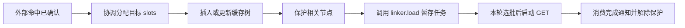

Wrapper 通过 components 和已有 allocator 协调 slots，通过 Cache 操作树和节点锁，再调用 KvClientDirectLinker。`load()` 先暂存任务；`start_layer_wise_loading()` 将当前任务交给后台加载线程，后者通过 KvClientStorage 提交实际读取。IO 完成后，Wrapper 消费 rid 通知并解除加载保护。

### 模块职责

| 层 | 主要对象 | 职责 |
| --- | --- | --- |
| 缓存树与内存管理 | UnifiedRadixCache、components、设备 KV allocator | 前缀匹配、slot 分配、树更新、节点保护与回收 |
| 树侧编排 | UnifiedCacheLinkerWrapper | 构造 PoolTransfer，组织跨 rank 恢复边界、命中标记、在途记录和树侧收尾 |
| 后端传输适配 | KvClientDirectLinker | 实现 UnifiedCacheLinker；生成页 key，解析传输范围，管理加载/卸载线程、队列及完成通知 |
| 公共设备布局工具 | DevicePoolGroup、DevicePoolEntry | 展开逻辑 pool，将设备索引与层号转换为地址、长度和布局偏移 |
| Python 存储适配 | KvClientStorage | 注册设备内存，查找 MR handle，组织 IO 参数，跟踪任务并校验结果 |
| Python/C++ 绑定 | _kvclient.Client，对应 C++ PyClient | 持有 SDK 客户端，将 Python 参数转换成 C++ 类型并调用 SDK |
| SDK 执行层 | kv::KvClient 及 transport/provider | 路由和执行异步查询、读取、写入，返回任务结果 |

### 模块调用图

下图展示模块之间的调用关系：箭头 A → B 表示 A 调用或使用 B。类的继承关系与对象持有关系在后面的类图中单独展示。

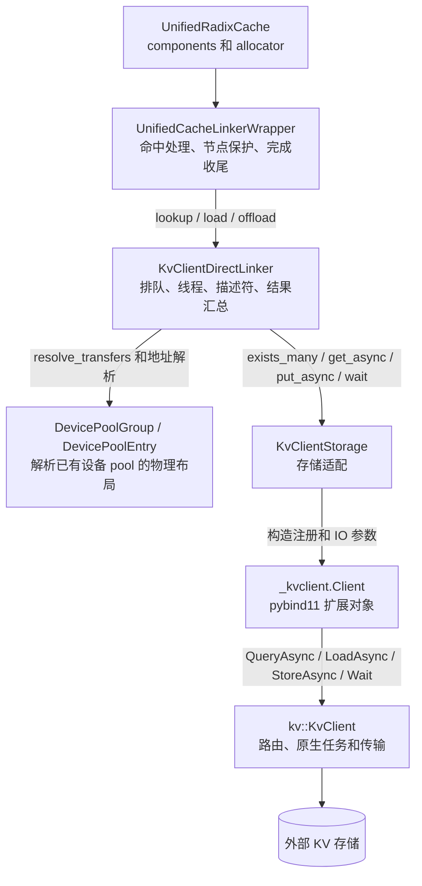

### 对象持有与类继承关系

| 关系 | 图中符号 | 含义 |
| --- | --- | --- |
| 泛化 | 实线与空心三角 | 子类继承父类，三角指向父类 |
| 关联 | 实线箭头 | 通过成员引用另一个对象 |
| 使用依赖 | 虚线箭头，标注 use | 方法使用某个类型或接口 |

**图 A：缓存树、Wrapper 与后端。**

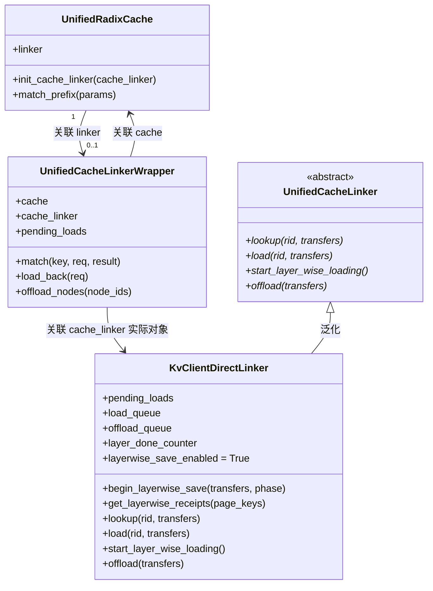

Wrapper 的 cache_linker 类型契约是 UnifiedCacheLinker，本图展示选用 KvClient 时的实际对象。Cache 和 Wrapper 操作同一棵树。

**图 B：后端、设备池视图、存储适配与 C++ 客户端。**

采用自上而下的分支布局：后端连接设备池视图、存储适配及 PoolTransfer 使用依赖；设备池和存储调用链分别向下展开。

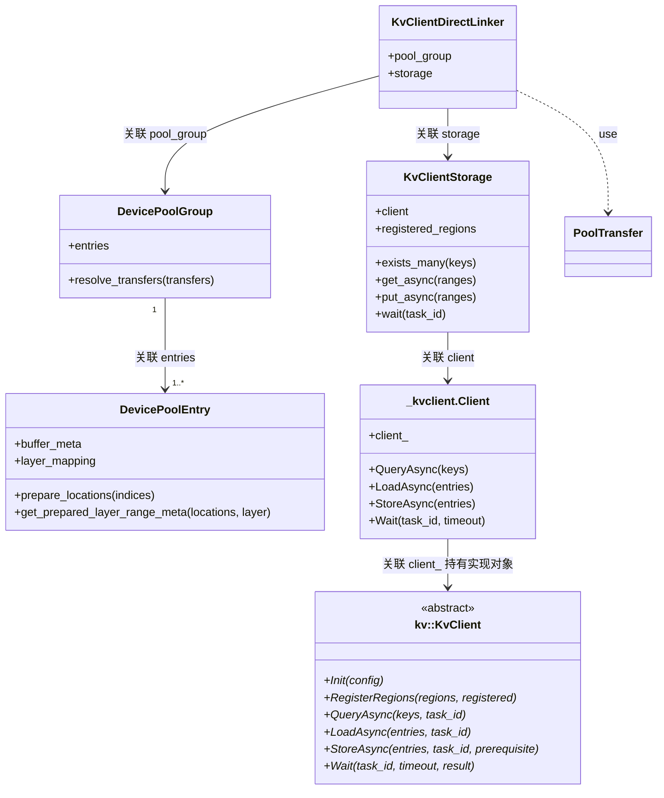

两图中的 KvClientDirectLinker 是同一个类。PyClient 通过 unique_ptr 持有 SDK 创建的 KvClient 实现对象；它通过 pybind11 暴露为 Python 的 _kvclient.Client，不继承 kv::KvClient。KvClientStorage 第一版作为独立存储适配类，不引入 HiCacheStorage 继承。

### 2.1 类名、模块名与文件

**采用 pybind11。** 以下均为拟新增名称，底层 `kv::KvClient` 已存在。

| 层 | 类或模块名 | 文件 | 职责 |
| --- | --- | --- | --- |
| UC Linker 后端 | `KvClientDirectLinker` | `kvclient_direct_linker.py` | 线程、队列、层门控、完成通知 |
| Python 存储适配 | `KvClientStorage` | `kvclient_storage.py` | 注册表、构造 IO 条目、调用及检查结果 |
| Python 扩展模块 | `_kvclient` | 编译自 `kvclient_pybind.cc` | Python 能 import 的原生模块 |
| 扩展里的客户端对象 | `_kvclient.Client` | C++ 包装类 `PyClient`，同一 .cc 文件 | 持有 `unique_ptr<kv::KvClient>`，转换参数和返回值 |
| SDK 客户端 | `kv::KvClient` | SDK 的 `kv_client.h` | 异步 IO 与底层传输 |

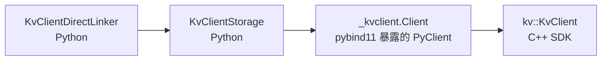

`PyClient` 是绑定文件内部的 C++ 包装类，Python 通过 `_kvclient.Client` 使用该对象。

### 2.2 pybind11 扩展与动态库

拟在 SDK 的 `bindings/python/kvclient_pybind.cc` 实现包装类及绑定。以下为结构示例，方法实现需补齐参数校验、状态转换和资源清理。

```cpp
namespace py = pybind11;

class PyClient {
    std::unique_ptr<kv::KvClient> client_;
public:
    // 构造：LoadFromFile → CreateKvClient → Init。
    // RegisterRegions / QueryAsync / LoadAsync / StoreAsync /
    // Check / Wait / UnregisterRegions / Shutdown 包装方法。
};

PYBIND11_MODULE(_kvclient, m) {
    py::class_<PyClient>(m, "Client")
        .def(py::init<const std::string&, int>())
        .def("register_regions", &PyClient::RegisterRegions)
        .def("query_async", &PyClient::QueryAsync)
        .def("load_async", &PyClient::LoadAsync)
        .def("store_async", &PyClient::StoreAsync)
        .def("check", &PyClient::Check)
        .def("wait", &PyClient::Wait)
        .def("unregister_regions", &PyClient::UnregisterRegions)
        .def("shutdown", &PyClient::Shutdown);
}
```

SDK 工程已有 `kv_client` CMake target；在该 target 可见的构建中添加：

```cmake
find_package(pybind11 CONFIG REQUIRED)
pybind11_add_module(_kvclient kvclient_pybind.cc)
target_link_libraries(_kvclient PRIVATE kv_client)
# 使用 SDK include 路径，并配置安装目录和运行时共享库搜索路径。
```

Linux 产物为带 Python ABI 后缀的 `_kvclient*.so`。安装后 `import _kvclient`；构建时使用目标推理环境的 Python、SDK 和设备依赖。

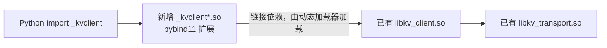

扩展负责 Python/C++ 参数转换，现有 SDK 动态库负责 IO。加载 libkv_client.so 本身不会自动获得 Python 的 Client 类。

### 2.3 存储接口与参数约定

```python
# kvclient_storage.py，拟实现用法
import _kvclient

class KvClientStorage:
    def __init__(self, config_path, device_id):
        self.client = _kvclient.Client(config_path, device_id)
        self.registered_regions = []

    def get_async(self, ranges):
        entries = self._build_entries(ranges)  # 检查注册范围并填入 handle
        return self.client.load_async(entries)

    def put_async(self, ranges):
        entries = self._build_entries(ranges)
        return self.client.store_async(entries)
```

| KvClientStorage 方法 | _kvclient.Client 方法 | SDK 方法 |
| --- | --- | --- |
| register_buffers | register_regions | RegisterRegions |
| exists_many | query_async → wait | QueryAsync → Wait |
| get_async | load_async | LoadAsync |
| put_async | store_async | StoreAsync |
| wait | wait | Wait |
| close | unregister_regions → shutdown（先排空） | UnregisterRegions → Shutdown |

DirectLinker 将布局解析得到的 ranges 交给 KvClientStorage；Storage 查找 handle 后形成绑定输入。Python 传入注册项 `(addr, size, device_id)`；注册返回项保留 region、handle、tokenId。IO 条目传入 `(key8, addr, size, device_id, handle, remote_offset)`，由 PyClient 转成第 4 节的 KVBuffer。KvClientStorage 负责查找覆盖范围的 handle；绑定层再次检查类型、整数范围及 key 恰为 8 字节。

Async 提交失败抛异常，成功返回 TaskId。wait 返回结构化结果：等待状态、任务状态、entryStatus、可选 exists/prefixHitKeys；不丢掉逐条错误。KvClientStorage 保持 active TaskId 和相关资源记录，检查结果并保证每个 task 只消费一次。

先持有 GIL 将 Python 参数转换为 C++ 值，再用 `py::gil_scoped_release` 调用可能阻塞的 SDK 方法；恢复 GIL 后构造 Python 结果。首版仍由卸载线程等待设备 event，store_async 不绑定 Python prerequisite 回调。

EXISTS 图展示存储接口与 SDK 调用两层；GET/PUT 图将绑定和 SDK 调用收进 KvClientStorage 的内部步骤，箭头上的 get_async、put_async、wait 均为 Python 存储接口。

## 3. 初始化：先初始化客户端，再注册设备内存

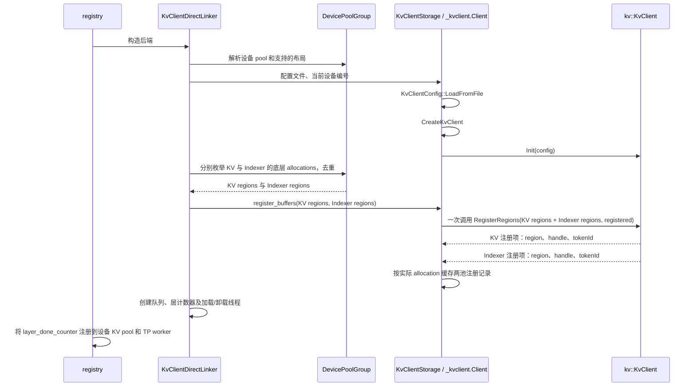

注册的是完整 allocation；每次 IO 可以只访问其中一个子区间。设备/provider 支持范围和地址对齐必须在接入设备上验证，不能假定所有 CUDA/NPU buffer 都能直连。

### 3.1 实例归属：每个推理 worker/rank 一个客户端

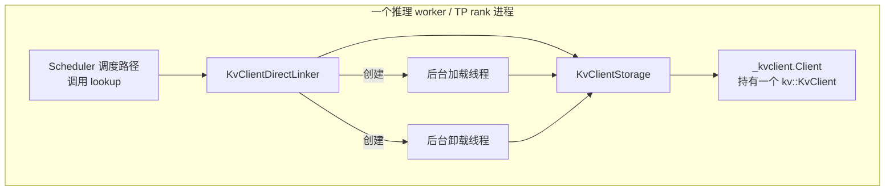

客户端在后端初始化时创建，供本 rank 的查询、加载和卸载共用；不按请求创建。SDK 内部传输 worker 是另一层执行机制。并发调用保证见第 11 节。

### 3.2 两池分别注册，共用页 key

**调用一次 RegisterRegions，批量传入两池的内存区间。** “两池分别注册”指分别获得各区间的注册记录，不是分别调用两次函数。以每池一个 allocation 为例：

```cpp
kv::MemoryRegion kvRegion;
kvRegion.memoryType = kv::MemoryType::DEVICE;
kvRegion.addr = kvBaseAddr;
kvRegion.size = kvAllocationBytes;
kvRegion.deviceId = deviceId;

kv::MemoryRegion indexerRegion;
indexerRegion.memoryType = kv::MemoryType::DEVICE;
indexerRegion.addr = indexerBaseAddr;
indexerRegion.size = indexerAllocationBytes;
indexerRegion.deviceId = deviceId;

std::vector<kv::MemoryRegion> regions{kvRegion, indexerRegion};
std::vector<kv::RegisteredMemory> registered;
auto status = client->RegisterRegions(regions, registered);  // 一次调用
// 检查 status 成功且 registered.size() == regions.size()，再保存记录。
```

```text
输入 regions                           输出 registered
  KV allocation 的地址/大小/设备    →    对应 region、handle、tokenId
  Indexer allocation 的地址/大小/设备 →  对应 region、handle、tokenId
```

KvClient 只接收内存区间，不识别 KV/Indexer 语义。KvClientStorage 保留区间与 pool 的来源关系，后续根据实际 IO 地址查找覆盖它的注册记录。共用远端页 key，不影响两池使用各自的 handle。每池有多个 allocation 时，将全部去重后的区间一起传入，返回相应数量的注册记录。

下图以两个 pool 各一个 allocation 为例；实际每池可能有多个 allocation，每个去重后的 allocation 都保存自己的注册结果，不固定为每池一个 handle。

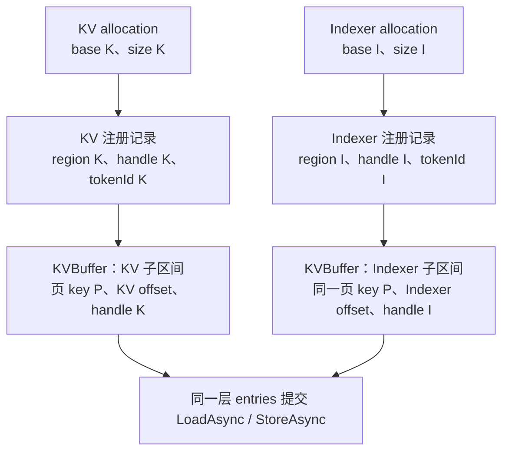

RegisterRegions 可以一次接收两池的 regions，返回逐项 RegisteredMemory；合在一次调用中不等于合并成一个注册区间。查找 handle 依据实际地址覆盖范围，不仅依据 pool 名称。如果多个 tensor 共享底层 allocation，去重后可共用该 allocation 的注册记录。

| 信息 | KV entry | Indexer entry |
| --- | --- | --- |
| 远端 key | 页 key P | 同一页 key P |
| 本地地址和长度 | KV 实际子区间 | Indexer 实际子区间 |
| buffer.handle | 覆盖 KV 子区间的 handle | 覆盖 Indexer 子区间的 handle |
| mrKey | 客户端从对应 handle 解析 tokenId | 客户端从对应 handle 解析 tokenId |
| offset | 统一布局中的 KV 偏移 | 统一布局中的 Indexer 偏移 |

调用者保存注册返回的 tokenId，但不自行填充 KVBuffer.mrKey；KvClient 提交时按 handle 查注册表解析。handle/tokenId 是注册 API 返回的标识，不应自行生成或假设二者相等。

## 4. 数据如何变成 KVBuffer

### 4.1 DSA 一页一个 key，两池和各层用远端 offset 区分

`make_cache_key(page_key)` 是普通函数，拟使用 `sha256(page_key.encode()).digest()[:8]` 生成 8 字节 key。**同一逻辑页的 KV 与 Indexer 使用同一个 key**，不添加 kv/indexer 后缀。模型版本和并行分片隔离通过已有页标识及部署 namespace 规则确定。

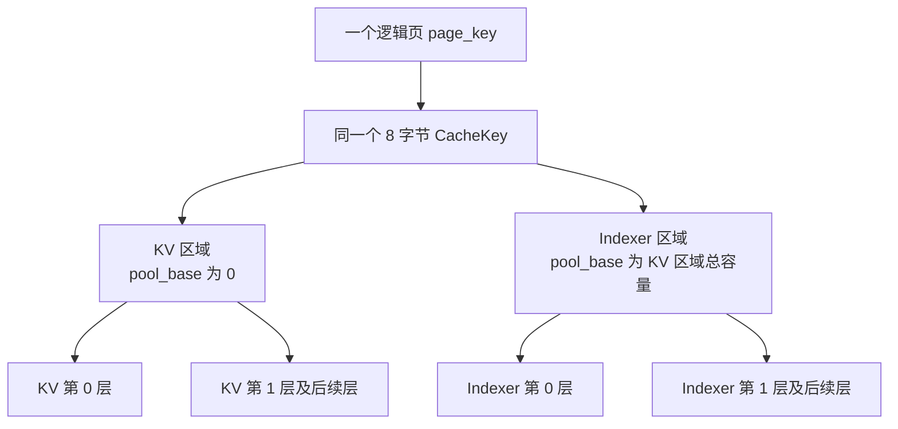

KvClient 的 KVBuffer 没有 pool_name 字段，不能只靠提交顺序区分两池。采用一个远端对象时，初始化需根据 Entry 枚举片段并建立不重叠的偏移表：每片段按要求对齐，先排列全部 KV 片段，再排列全部 Indexer 片段。GET 和 PUT 共用同一张表。

```text
remote_offset = pool_base + aligned_fragment_offset
KV.pool_base = 0
Indexer.pool_base = 全部 KV 片段的对齐后总容量
```

例：两层，每层 KV 页为 1024B，Indexer 页（含其 scale）为 512B：

| 片段 | key | 远端 offset | size |
| --- | --- | --- | --- |
| KV 第 0 层 | 相同页 key | 0 | 1024 |
| KV 第 1 层 | 相同页 key | 1024 | 1024 |
| Indexer 第 0 层 | 相同页 key | 2048 | 512 |
| Indexer 第 1 层 | 相同页 key | 2560 | 512 |

数字仅展示布局规则，实际尺寸从两个 Entry 取得。Indexer 的 index_k_with_scale_buffer 按已有打包布局读取，不拆成普通 K/V tensor。远端 padding 不意味着允许扩大本地读写范围；本地不满足对齐的布局需另行适配。

OD 当前 _object_key(page_key) 同样不含 pool，Storage 检查 KV/Indexer 两半 key 一致；其偏移按 pool 分别计算。KvClient 不能盲目复制两池可能重叠的原始 offset，需使用上述统一对象偏移表。是否需要完全兼容 OD 的远端数据格式，另行确认，本方案只沿用共享页 key 的语义。

### 4.2 IO 描述符生成

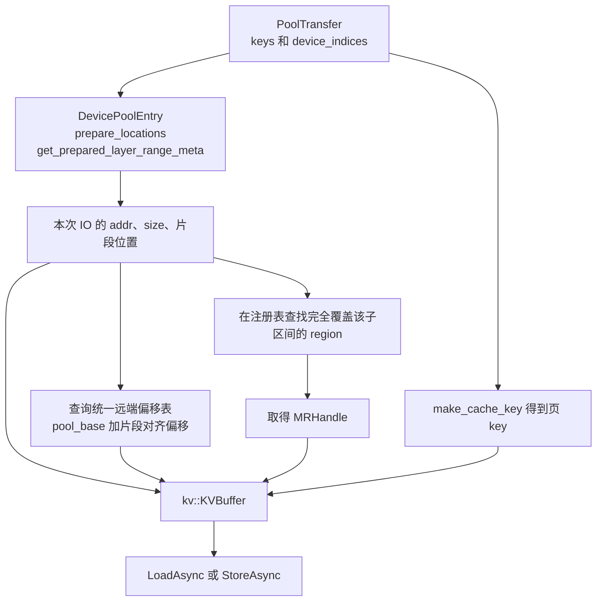

按 ASU `BuildKvBuffers()` 填字段：

```cpp
kv::KVBuffer entry{};
entry.key = key;                          // 同页各分段相同
entry.buffer.region.memoryType = kv::MemoryType::DEVICE;
entry.buffer.region.addr = ptr;            // 本次 IO 的实际地址
entry.buffer.region.size = bytes;          // 本次 IO 长度
entry.buffer.region.deviceId = deviceId;
entry.buffer.handle = registered.handle;   // 覆盖该区间的持久 handle
entry.offset = remoteOffset;               // 远端对象内偏移
// mrKey 由 KvClient 根据 handle 解析。
```

**offset 不是 ptr 相对 MR 起点的偏移。** 提交前检查范围完全包含、对齐及 uint32 offset 边界；不能扩大读写范围来假装满足 512B 对齐。

### 4.3 DSA：一份逻辑页任务对应 KV 和 Indexer 两个 pool

现有 `_build_dsa_device_pool_group()` 已构造两个 DevicePoolEntry。第一版复用该逻辑，对 MTP draft 等超出范围的配置在初始化时明确拒绝。

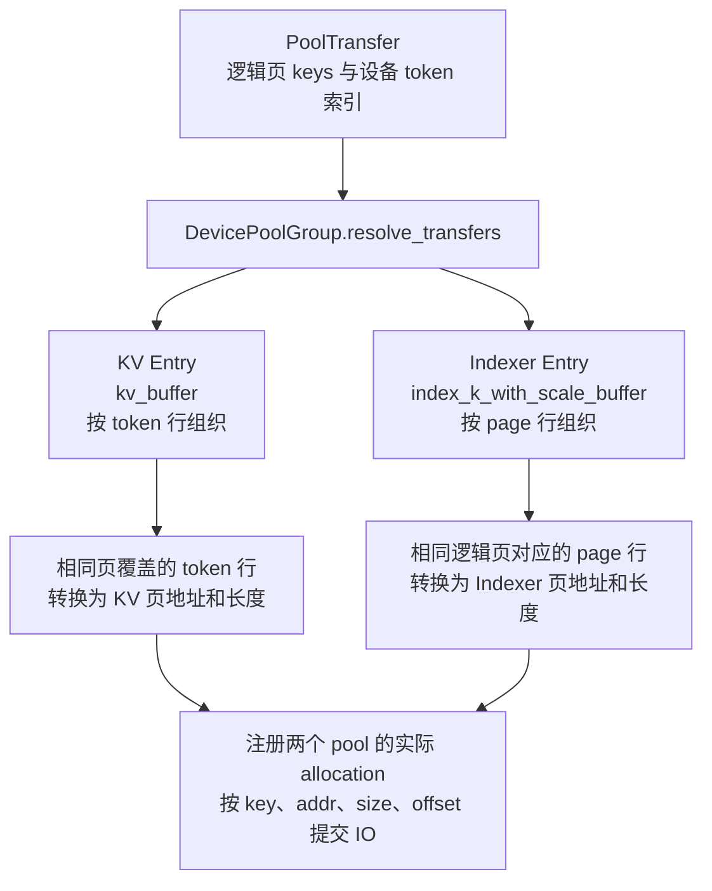

| 项目 | KV Entry | Indexer Entry |
| --- | --- | --- |
| 原始 buffer | kv_buffer | index_k_with_scale_buffer |
| 行组织 | token 行，rows_are_pages=False | page 行，rows_are_pages=True |
| 索引来源 | PoolName.KV | 同样来自 PoolName.KV |
| 远端 key | make_cache_key(page_key) | 与 KV 相同的 make_cache_key(page_key) |
| 位置 | 本地地址和长度来自 Entry，远端 offset 查统一表 | 本地地址和长度来自 Entry，远端 offset 加 Indexer 区域基址 |

Indexer 及其 scale 属于 Indexer Entry 的物理布局；两池共用 key，但拥有各自的本地地址及远端区域。

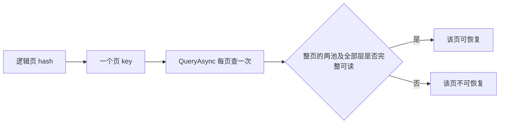

**EXISTS**：每页只查询一个 key，从 exists 或 prefixHitKeys 计算连续可恢复页数。前提是底层保证 key 命中代表两池全部分段完整；如果部分写完即存在，必须先增加发布协议再启用，不能把存在当作完整。

**GET**：两份 transfer 复用同一逻辑索引来源，但各自解析物理地址。每层 KV 与 Indexer 均读取成功、设备可见后，立即推进该层 counter；只有全部层结束，才发布 rid 完成通知。

**PUT**：一次逻辑 offload 包含两池全部必要层；全部成功才报告 True。任一 pool 缺失或分段未完整发布，都不能报告该页完整命中。两池不要求位于同一 allocation，必须分别注册后查找各自 handle。

### 4.4 DSA 多卡实例与写入归属

TP=4 且每卡一个 worker 时，每个 rank 都有一个 linker、一组包含 KV/Indexer 两个 Entry 的 DevicePoolGroup、一个 KvClient，以及本卡的注册 handle。Entry 是本卡 buffer 的视图，不额外复制 KV 数据。

现有 DSA assembler 标记 `rank_replicated=True`。首版应沿用复制型 pool 的约定：在对应 attention TP group 内选择一个 offload owner，其他 rank 仍按 Wrapper 的顺序发布对应逻辑卸载结果；查询和加载使用相同对象 key，MR handle 和设备地址保持 rank 本地。实际 owner/group 须与现有拓扑解析保持一致，不能直接假定全局 rank 0；若实际配置并非复制布局，需单独设计 shard key。

跨 rank 的可恢复边界仍由 Wrapper 求交集。验收需同时检查两池逐字节一致，以及 owner/非 owner 的 offload 完成顺序不破坏 pending_offloads 对应关系。

## 5. EXISTS：从前缀匹配到外部命中

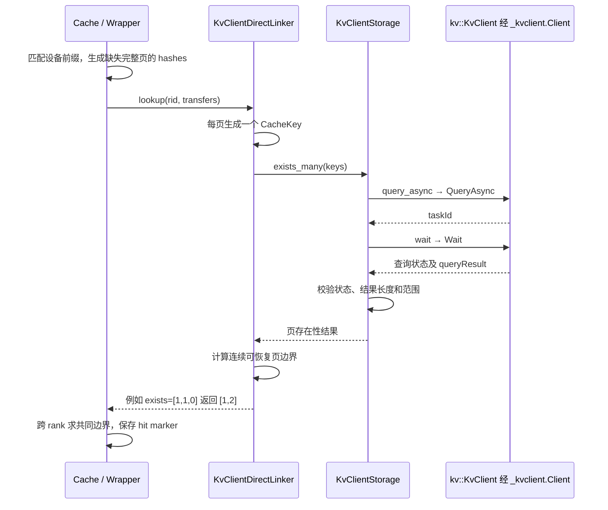

EXISTS 此时只查询可恢复范围，不分配目标 slot，也不读取 KV。GET 阶段才使用 hit marker 组织恢复。

FULL KV 单次有序查询中，一个 key 对应一页，prefixHitKeys 可作为连续命中页数；结果长度和范围必须校验。Query 超时保守按 miss 处理。

**启用前必须验证：同一 key 的部分分段写完时，Query 是否已经返回存在。** 如果会，必须先解决整页提交/完成标记，不能据此报告整页可恢复。

## 6. 线程与排队：两个工作线程、四个队列

分开看加载和卸载两条路径。图中只保留线程交接与结果返回，具体层循环见 GET/PUT 章节。

**加载：load_queue 交付任务，completed_loads 返回完成的 rid。**

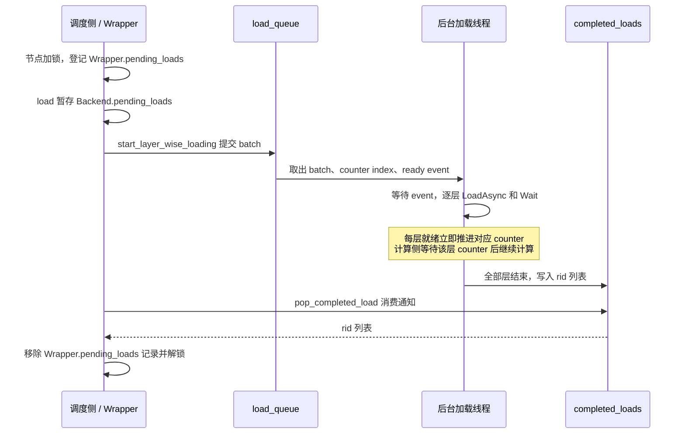

**卸载：offload_queue 交付逐层任务，session receipt 确认保存，offload_results 返回树侧 ACK。**

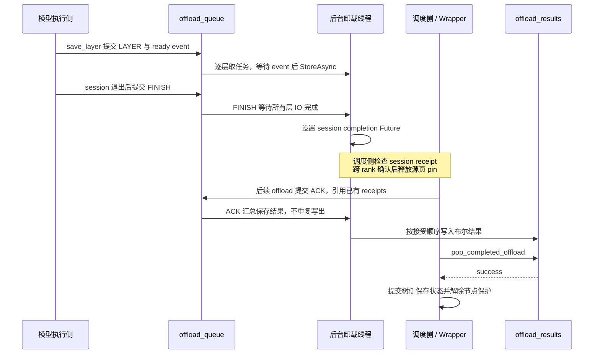

两张图中的队列都属于同一个 KvClientDirectLinker。两个工作线程经同一 KvClientStorage 调用本 rank 的 KvClient，底层调用链不在这里重复展开。

| 容器 | 类型 | 保存什么 | 何时取走 |
| --- | --- | --- | --- |
| Wrapper.pending_loads | 字典 | rid → 节点及锁记录 | 加载完成收尾时 |
| Backend.pending_loads | 字典 | rid → transfers | start_layer_wise_loading 时 |
| load_queue | 有界工作队列 | 一批加载请求及 counter index | 加载线程取任务 |
| offload_queue | 有界工作队列 | 普通 OFFLOAD，或逐层 LAYER/FINISH/ACK 及对应 event | 卸载线程取任务 |
| completed_loads | 完成队列 | 一批已完成的 rid | pop_completed_load |
| offload_results | 完成队列 | 一次逻辑卸载的结果 | pop_completed_offload |

两个 pending_loads 不是队列。后端启动 IO 后移走待启动记录，Wrapper 的锁记录仍保留到 IO 完成。原生 KvClient 另有内部 workers，不与这两个 Python 工作线程混为一谈。

### 6.1 实现选择：逐层加载与逐层卸载分别对接

| 路径 | 参考实现 | KvClient 设计 |
| --- | --- | --- |
| 逐层加载 | Mooncake 的后台逐层 range get | worker 每层合并 KV/Indexer ranges，LoadAsync → Wait → 推进该层 Future |
| 逐层卸载 | OD 的 LayerwiseSaveSession 和模型 save_layer hook | 每层产生数据后记录 event 并入队，StoreAsync 提交；session 等全部层 task 完成 |
| 地址解析 | 公共 DevicePoolEntry | 两池各自 prepare_locations，按层解析 addr/size/offset |
| 最终通知 | 公共 Wrapper 收尾协议 | Load 全部层结束发布 rid；Save 通过 session receipt 和 TP 共识提交 |

加载和保存复用相同的 pool 布局解析规则，但维护不同的任务与计数器。

resolve_transfers 的结果把转换后的设备索引放在 host_indices；它不是 host cache 数据。每个 transfer 先 prepare_locations 一次，再逐层调用 get_prepared_layer_range_meta。

## 7. GET：从命中页到模型安全读取

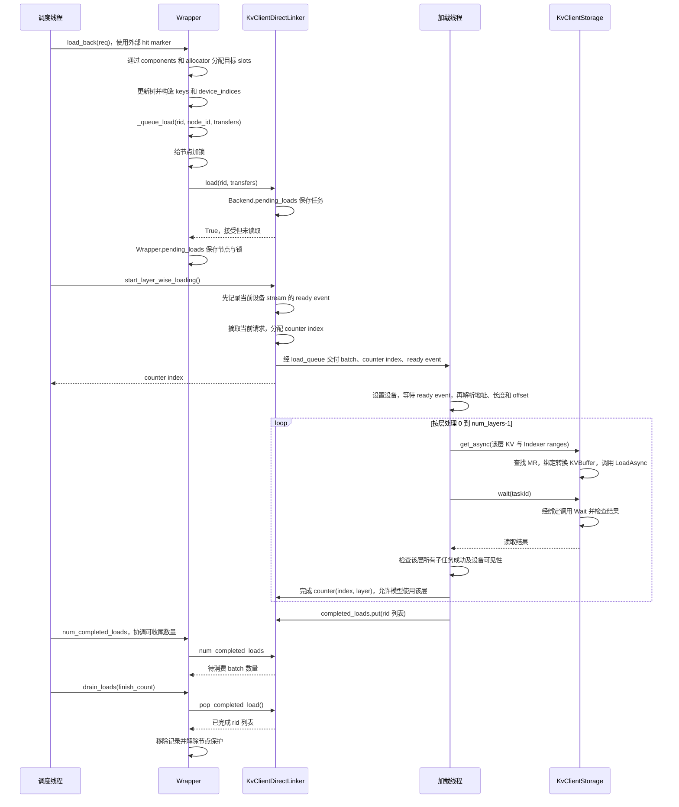

启动由调度侧选好本轮 batch 后触发，不是等队列攒够数量自动启动。每层读取成功后立即放行该层，加载线程继续后续层；失败必须唤醒等待方并传播异常，不能发布成功 rid。

### 7.1 等待位置：加载线程等待 KvClient，计算侧等待层 Future

**与 Mooncake 一样：确认这一层实际读取完成后，才让该层 Future 就绪。** KvClient 的区别是通过 LoadAsync + Wait 获取完成结果，而 Mooncake 当前 linker 使用同步 range-get 返回值确认读取。

```text
加载线程：
  LoadAsync（第 N 层 KV + Indexer）
  → Wait(taskId)，等待该层任务结束
  → 检查该层全部任务和逐条结果成功，确认设备数据可见
  → counter.complete(index, N)
      → Future.set_result(None)

计算侧：
  layer_done_counter.wait_until(N)
  → Future.result() 返回
  → 使用第 N 层 KV
```

**Future 就绪表示该层数据已经可用，不能只表示 IO 已提交。** 一层一次 LoadAsync，Wait 汇总 SDK 内部子任务；失败则给尚未完成的 Future 设置异常。Wait 成功是否已包含设备可见性保证，需核实 provider；若需要额外同步，应在 complete 前完成。

KvClient 暴露 TaskId、Check 和阻塞 Wait，没有公开的可供计算 stream 等待的设备完成 event。Wait 的当前实现等待 CPU 条件变量。因此选择加载线程独占消费 Load task 的 Wait；计算侧通过 layer_done_counter.wait_until(layer) 等待 Future，不直接消费同一个 TaskId。

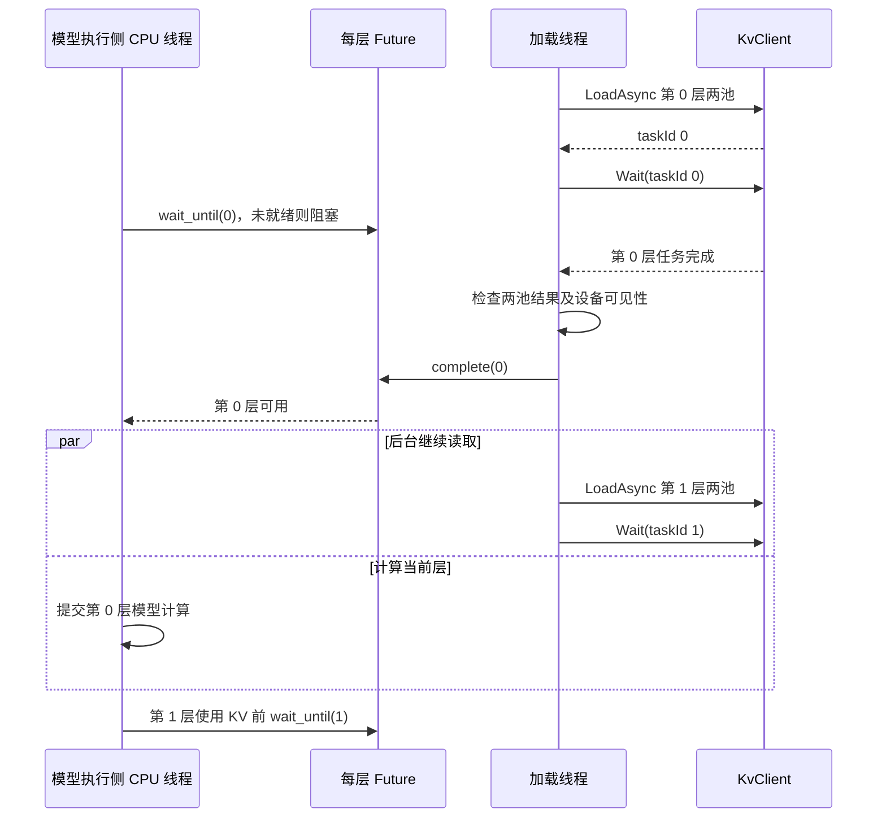

| 实现 | IO 完成等待 | 计算侧使用数据前的等待 |
| --- | --- | --- |
| Mooncake | 加载线程调用同步 range get，返回后推进层 Future | 等待该层 Future |
| OD | 提交后将设备 IO events 交给 Future；后台还等待批次收尾 | 等待 Future 取得 events，再 event.synchronize |
| KvClient 本设计 | 加载线程 Wait 消费 TaskId，成功且可见后推进 Future | 等待层 Future |
| ASU Store | Load 返回 TaskHandle；Wait 方法在调用它的线程阻塞 | 由 ASU 的上层调用者安排，AsuStore 本身不规定线程 |

OD 的 Future 就绪可以只表示“设备 events 已提交”，KvClient 本设计的 Future 就绪则必须表示“该层数据已可读”。不能把 SDK TaskId 当成 CUDA event，也不能在计算侧和加载线程各 Wait 一次同一 task。

让计算线程直接调用 SDK Wait 也可另行实现，但必须增加 TaskId 发布、唯一消费、异常和批次收尾协调；现有接口并不要求这样做。首选后台 Wait + 计算侧 Future，便于保持 Wrapper 的线程职责，也不阻碍逐层加载与模型计算重叠。

需要提高 IO 在途深度时，可先提交有限窗口的后续层 task，再按层 Wait 并推进对应 Future；不能先等全模型所有层完成再集中放行。该优化不改变等待的线程归属。

**完成契约需验证**：SDK Wait 当前等待客户端任务状态，并不单凭这段代码证明设备写入已对计算可见。必须验证 provider 的完成保证；若需额外设备同步，由加载线程在 complete(layer) 前执行。绑定在 Wait 期间释放 GIL。

### 7.2 Mooncake 与 KvClient：逐层调用方式对比

两者都在加载线程逐层读取，完成一层就放行一层，不是一次下发全部层后统一等待。

**Mooncake 当前实现：每层分别读取 KV 和 Indexer。**

以下伪代码对应 MooncakeDirectLinker.load_layer_wise 的核心循环，省略读取 session 的建立/清理和异常处理。

```python
for layer in range(num_layers):
    for name, (keys, locations) in batches.items():  # DSA：KV、Indexer
        meta = pools[name].get_prepared_layer_range_meta(locations, layer)
        if meta is None:
            continue
        ptrs, sizes, offsets = meta
        result = storage.store.batch_get_into_multi_buffer_ranges(
            keys, ptrs, sizes, offsets
        )
        check_transferred_bytes(result, sizes)

    # 该层所有 pool 读取返回并通过检查后，放行该层计算。
    layer_done_counter.complete(counter_index, layer)
```

该路径将 range-get 调用作为同步完成接口使用，不在 linker 中额外调用 Wait。DSA 有 60 层、每层 KV 和 Indexer 各调用一次时，通常是 120 次 range-get；不含 session start/end，也不代表底层网络请求数量。

**KvClient 本设计：每层合并两池，异步提交后显式等待。**

```python
for layer in range(num_layers):
    # 此处只生成当前层的两池范围，包含本批需要恢复的页。
    ranges = build_layer_ranges(layer, kv_transfers, indexer_transfers)
    task_id = storage.get_async(ranges)  # 绑定最终调用 LoadAsync
    result = storage.wait(task_id)       # 绑定最终调用 Wait
    check_result_and_device_visibility(result)

    layer_done_counter.complete(counter_index, layer)
```

build_layer_ranges、check_result_and_device_visibility 为说明步骤的伪代码；实现时使用公共 Entry 布局解析及第 4 节统一偏移表。

| 对比项 | Mooncake 当前实现 | KvClient 设计 |
| --- | --- | --- |
| 每层读取组织 | KV 和 Indexer 分别 range-get | 两池 entries 合并为当前层任务 |
| 提交/等待接口 | 同步 range-get 返回并校验字节数 | LoadAsync 返回 TaskId，Wait 获取完成结果 |
| 60 层且无需拆批 | 通常 120 次 range-get | 60 次 LoadAsync、60 次 Wait |
| 推进层门控 | 本层所有 pool 读取成功后 | 本层全部 task 成功且数据可见后 |
| 与计算重叠 | 加载下一层，同时计算当前层 | 相同 |

上表为 linker 到存储接口的调用次数。KvTransport 按协议限制拆分子批次，KvClient 用一个 TaskId 汇总该层结果；本方案不在 Python 层再拆成多次 LoadAsync。若超出 SDK 可接受的总任务限制，应通过批次规划和背压处理，不静默改变一层一个 TaskId 的约定。

**为什么不把全部层放进一次 LoadAsync？** 现有接口只返回该任务的一个 TaskId，Wait 获取整个任务的完成结果，没有暴露任务内部的逐层完成进度。整模型只提交一个任务，不能依赖该接口逐层放行。

需要更高 IO 并发时，可以提前提交有限数量的后续层，取得多个 TaskId，再逐层消费 Wait 和推进 counter。仍保持每层独立任务及唯一 Wait 消费者，不改变层门控语义。

## 8. PUT：逐层保存与树侧卸载确认

本方案默认逐层保存，同时保留显式关闭 layerwise_save 后的普通卸载路径。逐层模式中，模型 hook 发起 PUT，树侧 offload 只确认 receipts；普通模式中，树侧 offload 发起真实 PUT。两者按配置选择，不能在逐层失败时自动切换并重复写入。

| 路径 | 触发入口 | 主要作用 |
| --- | --- | --- |
| 实际逐层保存 | prepare_layerwise_save → session.save_layer | 生产一层，排队并保存一层；全部层结束后完成 receipt |
| 树侧卸载确认 | BackupKV → Wrapper.offload_nodes → linker.offload | 核对页 receipts，跨 rank 提交外部副本状态，不重复 PUT |

### 8.1 逐层保存：从前向准备到写入完成

将模型侧排队和 worker 执行拆开看。DirectLinker、Session、Storage 是对象；队列连接模型执行路径与独立 offload worker 线程。

**图 A：前向前准备，逐层排队，退出上下文时排入 FINISH。**

图中“模型执行侧”指发起设备运算的 CPU 执行路径。self_attn 返回后，设备可能仍在计算；记录 event 也不等于 event 已完成。卸载线程等待 event 成功后，才可读取该层来源数据。若生产跨多个 stream，记录 event 前必须先建立完整的 stream 依赖。

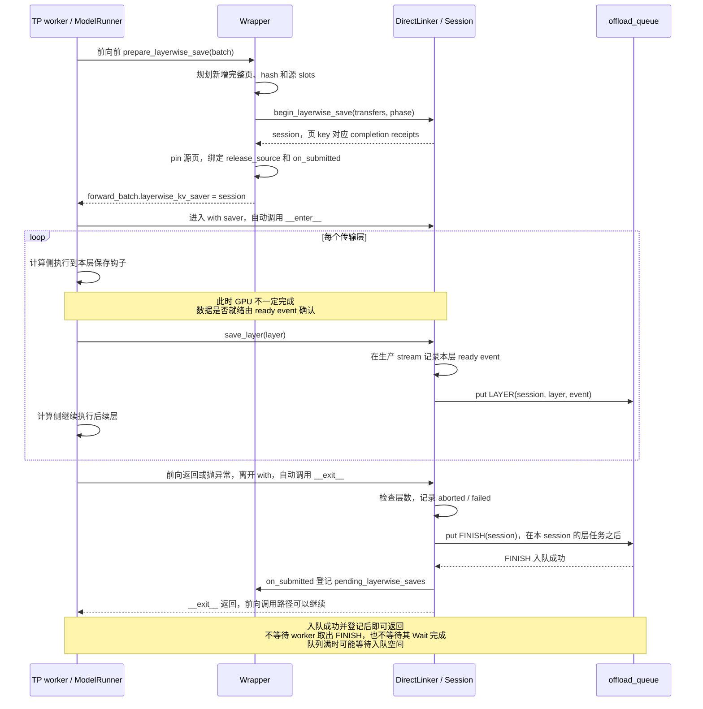

**谁调用 exit？** 现有 `ModelRunner._forward_raw()` 使用上下文管理器包住前向：

```python
saver = getattr(forward_batch, "layerwise_kv_saver", None)
with ctx_mgr, saver if saver is not None else contextlib.nullcontext():
    # 执行模型前向；模型各层调用 saver.save_layer(layer)
    ...
# 离开 with 时，Python 自动执行 saver.__exit__(...)。
# 即使在 with 内 return 或抛异常，也会执行 __exit__。
```

`TP worker` 在调用 ModelRunner 前执行 `Wrapper.prepare_layerwise_save(batch)`，所以这是本次 attention/模型前向之前的准备。退出 session 由执行该前向上下文的 CPU 线程触发，不是由卸载线程主动退出，也不表示设备计算或 PUT 已结束。

**图 B：一层一次 StoreAsync；FINISH 逐个 Wait 尚未收尾的层任务。**

图中 KvClientStorage 是 Python 对象，SDK 调用均经 `_kvclient.Client` 绑定；调用 Storage、绑定和 SDK 的都是同一个后台卸载线程。

```mermaid
sequenceDiagram
    participant Q as offload_queue
    participant B as Offload worker
    participant S as KvClientStorage
    participant K as kv::KvClient 经 pybind
    loop 从队列逐层取任务
        B->>Q: get()
        Q-->>B: LAYER(session, layer, ready_event)
        B->>B: 设置设备，等待 ready_event 完成
        Note over B: 此时才确认该层 KV / Indexer 数据就绪
        B->>S: put_async(本层 KV 和 Indexer ranges)
        S->>S: 查注册 handle，准备 key、addr、size、offset
        S->>K: StoreAsync(entries, taskId)
        K-->>S: Status 和本层唯一 taskId
        S-->>B: taskId；提交失败则抛异常
        B->>B: session.layer_tasks[layer] = taskId
        Note over B,K: SDK 内部路由和拆批，上层仍只有一个 taskId
        opt 在途窗口达到上限
            B->>S: wait(最早尚未消费的 taskId)
            S->>K: Wait(taskId, timeoutMs, result)
            K-->>S: Status、TaskResult
            S-->>B: 校验后的结果
            B->>B: 记录该层结果，从 pending_tasks 移除
        end
    end
    B->>Q: get()
    Q-->>B: FINISH(session)
    Note over B,K: FINISH 不调用 StoreAsync，不产生新 taskId
    loop 遍历 session.pending_tasks 中剩余的 layer 和 taskId
        B->>S: wait(taskId)
        S->>K: Wait(taskId, timeoutMs, result)
        K-->>S: Status、TaskResult.status、entryStatus
        S-->>B: 结构化结果
        B->>B: 记录 layer_results，移除该 taskId
        Note over B: 某层失败仍继续排空其他已提交任务
    end
    B->>B: 检查层数、提交错误、各层结果和 IO 静默
    alt 全部必要层成功
        B->>B: session.completion.set_result(True)
    else 存在失败但全部 IO 已安全结束
        B->>B: session.completion.set_result(False)
    else 无法确认 IO 静默
        B->>B: fatal，保留资源与保护，不发布可释放资源的完成结果
    end
    Note over B: 调度侧轮询 completion.done 后跨 rank 确认<br/>再调用 session.finish 释放源页 pin
```

状态对应关系：

```python
# 每层只调用一次 StoreAsync：一层对应一个 SDK TaskId。
session.layer_tasks[layer] = task_id
session.pending_tasks[layer] = task_id

# 窗口满或 FINISH 收尾时，由同一个 worker 消费一次结果。
result = storage.wait(task_id)
session.layer_results[layer] = checked_result(result)
del session.pending_tasks[layer]

# 全部层均已处理、剩余 IO 静默后，汇总 session 结果。
session.completion.set_result(all_required_layers_succeeded)
```

以上为状态管理伪代码；Wait 超时走 fatal/资源隔离分支，不能直接按普通失败释放保护。提交失败没有有效 taskId：记录该层提交错误，标记 session 失败并排空此前任务；不将无效 taskId 登记到 pending_tasks。

**FINISH 是本地队列收尾项。** 由模型前向退出时的 session.__exit__ 入队，worker 取到后只等待该 session 已有的剩余 TaskId。已在背压阶段消费的任务不再 Wait。KvTransport 内部拆分出的多个子批次由 KvClient 的同一 TaskId 汇总，不在 Python 层再建多个层 task。

图 A 与图 B 并发执行：worker 可以在模型仍计算后续层时提交前面各层。图 B 展示的是正常逐层提交和收尾；模型中断或 session 失败时，后续层可以跳过提交，但仍必须消费 FINISH 并处理已经提交的 IO。

按执行阶段对照：

```text
① 前向前规划
   Wrapper 选择本轮新增完整页 → 构造 transfers
   → begin_layerwise_save → 建立 session 和页 receipts
   → allocator.pin_pages_for_io → 将 session 交给模型

② CPU 提交本层生产计算后排队
   模型 save_layer(layer) → 记录该层 ready event
   → offload_queue.put(LAYER) → 模型继续后续层

③ 后台逐层写出
   worker 取层任务 → 等 ready event
   → Storage.put_async → StoreAsync → 记录 taskId
   → 继续取后续层任务，不强制每层写完才提交下一层

④ 保存收尾
   ModelRunner 离开 with → 自动调用 session.__exit__
   → FINISH 排在所有层任务之后 → worker 从队列取出 FINISH
   → 遍历该 session 尚未消费的 task，逐个 Wait → 检查全部结果
   → 完成 session.completion

⑤ 调度侧完成确认
   Wrapper.take_completed_layerwise_saves → 跨 rank 汇总
   → commit_completed_layerwise_saves → session.finish
   → release_source → unpin_pages_for_io
```

只规划完整的新页，不在每次 forward 重存全部历史页。decode 积累出新完整页时才加入保存。保存的还是已有来源 slots，不分配另一份 KV 数据副本。

#### 层保存钩子的调用时机与任务提交

DSA 模型在本层 `self_attn(...)` 返回后，通过 `forward_batch.layerwise_kv_saver` 调用：

```python
saver.save_layer(self.layer_id)
```

启用 graph hooks 时由对应 hook 转交该层保存，必须保持每层恰好一次。`save_layer()` 的调用发生在模型前向执行侧，但只记录依赖并交付任务，实际 PUT 由后台卸载线程提交：

```text
模型前向执行侧：
  session.save_layer(layer)
    → 在生产该层数据的计算 stream 上记录 ready event
    → 将（session、层号、event）放入 offload_queue
    → 继续后续模型计算（队列满时可能受背压）

后台卸载线程：
  取出层任务
    → 设置设备上下文，等待 ready event
    → 确认该层 KV / Indexer 源数据生产完成
    → 调用 KvClientStorage.put_async
    → 通过 pybind 调用 KvClient.StoreAsync
```

**计算侧发起保存任务，后台线程提交实际保存。** `self_attn(...)` 在 CPU 上返回，不代表它提交的设备工作已经完成；event 将这层数据的生产依赖传给卸载线程，防止 PUT 读取尚未产出的字节。event 只确认源数据就绪，保存是否完成仍由 KvClient 的 task 结果及 session receipt 确认。
### 8.2 保存结果如何登记到缓存树

上一节解决“把数据存出去”；本节解决“让缓存树知道这些页是否已经存好”。**此处不再次 PUT。**

receipt 在创建 session 时就存在，结果最初未就绪。worker 处理 FINISH、等全部写任务收尾后，才将 receipt 设置为 True 或 False。同一 session 的页共享该结果。

```mermaid
flowchart TB
    A[模型逐层保存<br/>见第 8.1 节] --> B[后台等待全部 PUT 收尾<br/>receipt 得到保存结果]
    C[缓存树要求确认外部副本<br/>BackupKV 动作] --> D[Wrapper 调用 linker.offload<br/>按页找到已有 receipt]
    B --> E[后台确认任务检查 receipt]
    D --> E
    E --> F[调度侧汇总各 rank 结果]
    F --> G[Wrapper 更新树状态<br/>成功才标记已有外部副本]
```

BackupKV 是树侧的“保存/确认外部副本”指令。当前逐层模式已提前发起保存，所以 linker.offload 只排队确认已有 receipt；receipt 尚未就绪则等待，缺失或失败则返回确认失败，不重写数据。

图中的两条路径可以时间重叠：树侧发起确认时，PUT 不一定已完成。确认任务在相关 FINISH 之后由同一卸载线程处理，避免阻塞在尚未执行的收尾任务前。结果通过 offload_results 返回，由 Wrapper 按原顺序消费，跨 rank 一致成功后才登记外部副本。

### 8.3 三个时间点：数据就绪、保存完成、解除保护

| 时间点 | 谁确认 | 发生什么 |
| --- | --- | --- |
| 该层数据已产出 | worker 等该层 ready event | 可以开始 PUT 这一层 |
| session 全部写任务已收尾 | worker Wait，设置 receipt 结果 | 保存成功或失败已有结论 |
| 调度侧完成跨 rank 确认 | Wrapper 收尾 | 更新相应状态，解除本次保护 |

两条路径各有自己的保护：**实际逐层保存期间用源页 pin，树侧确认期间用节点锁。** 前者在 session.finish 时解除，后者在 commit_completed_offloads 时解除；解除保护不代表立即释放 KV slots。

需要记住的异常规则：

- 某层失败，整个 session 保存失败；已提交 IO 仍要排空。
- Wait 超时不等于 IO 已停止，未确认安全结束前不能释放源页或注册内存。
- 远端 key 已存在不一定代表逐层数据完整，必须有可靠的完整发布保证，才能在下一次 lookup 中作为命中。

### 8.4 非逐层卸载：后台保存全部必要数据

`layerwise_save=False` 时，不创建模型保存 session，不使用 save_layer hook 或 receipts。以下只展示后端特有的保存路径；入口处构造 transfers、节点保护，以及结果返回后的跨 rank 确认和树状态更新，复用公共 Wrapper 流程。

```mermaid
sequenceDiagram
    participant W as 调用侧 Wrapper
    participant D as KvClientDirectLinker
    participant Q as offload_queue
    participant B as Offload worker
    participant S as KvClientStorage
    W->>D: offload(transfers)
    D->>D: resolve_transfers 展开 KV / Indexer
    D->>D: 在生产 stream 记录 ready event
    D->>Q: put(OFFLOAD, transfers, ready_event)
    D-->>W: True，仅表示接受任务
    B->>Q: get()
    Q-->>B: OFFLOAD、transfers、ready_event
    B->>B: 设置设备，等待 ready event 完成
    B->>B: 根据源 slots 解析全部必要层 ranges
    B->>S: put_async(全部层 KV / Indexer ranges)
    S->>S: 经绑定调用一次 StoreAsync(entries, taskId)
    S-->>B: 一个 TaskId
    B->>S: wait(taskId)
    S->>S: 经绑定调用 Wait，检查整体及逐条结果
    S-->>B: 保存结果
    B->>D: offload_results.put(success)
    Note over W,D: 后续由 Wrapper 消费结果，复用公共确认与解锁流程
```

```text
offload(transfers)
  → 展开两池，记录 ready event，排入 OFFLOAD
  → worker 等待 event，确认源数据就绪
  → 解析全部必要层范围 → StoreAsync → Wait
  → 发布 offload_results，交回公共 Wrapper 收尾
```

这里一次 StoreAsync 包含所有必要层，KvClient 内部按路由和协议限制拆分，向上仍返回一个 TaskId。任务规模必须满足 SDK 限制；超限应在规划阶段处理，不能丢条目。

offload_queue 由 KvClientDirectLinker 持有，但队列本身不是线程：调用侧执行 put，独立 offload worker 执行 get 和后续 IO。

普通卸载使用已有来源 slots，不新分配目标 slots，返回 True 时也不释放来源 slots。ready event 确认来源数据可读，Wait 确认保存完成；已提交后的失败需确认 IO 安全结束，超时未静默时保留保护并进入故障处理。

复制型 DSA 仅 owner 发起实际写入，其他 rank 参与公共结果确认。普通模式不执行逐层 session 的 FINISH 或 ACK，也不检查 receipts。

### 8.5 普通卸载与逐层卸载对照

| 对比 | 非逐层：layerwise_save=False | 逐层：layerwise_save=True，默认 |
| --- | --- | --- |
| 实际 PUT 的入口 | 树侧 BackupKV / offload | 模型层 save_layer hook |
| 排入队列的任务 | OFFLOAD | LAYER、FINISH、ACK |
| 源数据就绪依赖 | 一次 offload 的 ready event | 每层自己的 ready event |
| StoreAsync 调用 | 全部必要层 entries 一次提交，一个 TaskId | 每层两池 entries 一次提交，每层一个 TaskId |
| 保存完成等待 | Wait 此次 offload 的 TaskId | FINISH Wait 各层剩余 TaskId，汇总 receipt |
| 树侧 offload 的作用 | 发起实际保存 | 确认已有 receipts，不重复 PUT |
| 来源保护 | 节点锁引用 | 实际保存的源页 pin，及树侧确认自己的节点锁 |
| 失败行为 | 报告普通保存失败 | receipt 失败，不自动切换普通模式重写 |

### 8.6 逐层模式需要接通的现有 hook

| 位置 | 接入要求 |
| --- | --- |
| registry.py | 按 layerwise_save 配置，仅逐层模式接通 tp_worker.layerwise_cache_linker |
| Wrapper.prepare_layerwise_save | 复用完整页规划、hash、pin、session 回调；验证 allocator 和模式 guards |
| tp_worker.py | 前向前设置 forward_batch.layerwise_kv_saver |
| deepseek_v2.py | 复用 self_attn 调用返回后的 saver.save_layer(layer_id)，不假定设备已完成 |
| layerwise_kv_graph.py | 扩展当前仅 oceandisk 的后端条件，接通 kvclient graph replay 层 hook |
| session / Wrapper 收尾 | 支持 enter/exit、save_layer、completion、finish、on_submitted、release_source |

eager 与启用的 graph replay 均须验证每层 hook 恰好执行一次；不支持的执行路径应明确报错，不能跳过保存后仍发布成功 receipt。

## 9. 完成通知与 slot 生命周期

```mermaid
flowchart LR
    A[分配 slot 并保护节点] --> B[读取 KV]
    B --> C[每层两池就绪后完成该层 counter]
    C --> D[全部层结束后完成队列写入 rid]
    D --> E[Wrapper 消费通知并解除保护]
    E --> F[KV 仍在 slot 中用于推理或复用]
    F --> G[后续满足淘汰条件]
    G --> H[真正释放 slot]
```

| 通知 | 用途 |
| --- | --- |
| layer_done_counter | 计算何时可以使用加载的数据 |
| completed_loads | 调度侧何时可以处理加载收尾、解除节点保护 |
| num_completed_loads | 尚未消费的完成 batch 数量，不是 rid 数或空闲 slot 数 |

## 10. 后端需要实现的方法与底层调用

| 方法 | 后端行为 | KvClient 调用 |
| --- | --- | --- |
| 构造函数 | 解析 pool、初始化、注册、创建线程 | Init、RegisterRegions |
| lookup | 查询连续可恢复页 | QueryAsync、Wait |
| load | 保存到后端 pending_loads | 无 |
| start_layer_wise_loading | 摘取 pending，给加载线程排队 | 由线程执行 LoadAsync、Wait |
| cancel_queued_load | 仅未启动且可安全回滚时允许取消，否则 False | 无原生取消接口 |
| num_completed_loads / pop_completed_load | 查看/消费完成 rid batch | 无 |
| begin_layerwise_save / get_layerwise_receipts | 创建保存 session、提供页 receipt | 层任务由卸载线程执行 StoreAsync、Wait |
| session.save_layer | 生产 stream 记录该层 event，排入 LAYER 任务 | 异步写该层两池 |
| session.__exit__ / finish | 排入 FINISH，TP 确认后释放源页 pin | FINISH 等待所有原生写任务 |
| offload | 逐层模式排队 ACK；普通模式排队 OFFLOAD | 普通模式 StoreAsync、Wait；逐层确认不新增 Store |
| num_completed_offloads / pop_completed_offload | 查看/消费写出结果 | 无 |
| reset | 停止接收、排空并清理本地状态，再恢复接收 | 按需等待活动任务 |
| close | 停止接收、排空、停止线程、注销、关闭 | UnregisterRegions、Shutdown |

拟新增绑定仅暴露：register_regions、query_async、load_async、store_async、check、wait、unregister_regions、shutdown。保留提交状态、Wait 返回状态、TaskResult.status 和逐条结果；阻塞调用释放 GIL。

## 11. SDK 调用与异常处理

| ASU 函数 | 本设计如何对应 |
| --- | --- |
| Setup / BuildKvClientConfig | LoadFromFile → CreateKvClient → Init |
| RegisterKVCaches / FindPersistentHandle | 注册 allocation，按 IO 子区间查覆盖 handle |
| MakeAsuKey | make_cache_key(page_key)，不默认复用 ASU 哈希算法 |
| BuildTensorOffsets / BuildKvBuffers | 同页 key、多条 addr/size/offset 描述符 |
| Submit | LoadAsync 或 StoreAsync，取得 TaskId |
| Query / WaitForTask | Wait 消费结果并检查状态 |

| 情况 | 处理 |
| --- | --- |
| Queue 满、任务尚未接受 | offload 返回 False；加载启动失败不得丢 pending 或遗留无人处理的 counter |
| 子任务部分提交失败 | 排空已经提交的任务，整次逻辑传输失败 |
| Load 失败 | counter 携带异常，调度侧能观察 fatal error，不发布成功 rid |
| Wait 超时 | TaskId 已被消费，不重复 Wait；未证明 IO 静默前不释放 buffer、MR 或 slot |
| Check 返回 True | 只对本地登记的有效 task 使用；未知 task 也可能返回 True |
| close/reset | 先确认 IO 静默，再回收资源；异常时不能机械注销 MR |

同一客户端允许并发查询、加载和卸载，以及完成结果保证设备可见，均需在 SDK 上确认。若不支持并发调用，增加统一原生提交入口调度，不能用持锁阻塞 Wait 的方式阻断其他任务。

## 12. 接入文件和第一版验收

| 文件 / 位置 | 改动 |
| --- | --- |
| mem_cache/storage/kvclient/kvclient_direct_linker.py | 后端、make_cache_key、队列和线程 |
| mem_cache/storage/kvclient/kvclient_storage.py | KvClientStorage，支持注入 fake client |
| model_executor/runner_utils/layerwise_kv_graph.py | 扩展 kvclient 的 graph 层 hook，并校验配置入口 |
| mem_cache/unified_cache/unified_cache_linker.py | 验证并接通保存 session、pin 和 TP 收尾 |
| SDK 侧 bindings/python/kvclient_pybind.cc | _kvclient 模块、Client 对象和 SDK 类型转换 |
| mem_cache/registry.py | 增加 kvclient 后端构造分支 |
| arg_groups/fields/memory.py 及字段顺序 | 增加后端 choice 和客户端配置入口 |

表中 SGLang 路径均相对 `python/sglang/srt/`；SDK 绑定路径相对 `kv_semantics/`。启动参数拟为 `--unified-cache-external-linker-backend kvclient`，配合现有 external linker 开关及拟新增 `--kvclient-config-path`，目前尚未实现。

```mermaid
flowchart LR
    A[确定性填充设备 KV] --> B[卸载并等待成功]
    B --> C[清空或换一组本地 slot]
    C --> D[lookup 验证页命中]
    D --> E[load 读回并等待门控]
    E --> F[逐字节比较所有层 K/V]
    F --> G[注入部分失败和超时<br/>验证不误命中、不提前解锁]
```

第一版交付前重点确认：整页分段写入的查询可见性、设备/provider 支持与对齐、超时后排空语义。验收必须观察到加载第 l+1 层与计算第 l 层重叠，以及计算第 l+1 层与保存第 l 层重叠；记录层 event、提交、完成及 session 收尾时间。不能只用整批读写正确性替代逐层验证。