# KvClientDirectLinker 第一版设计

本文描述 SGLang 的 KvClient 后端。当前后端已接入 EXISTS、逐层 GET 和普通 PUT。逐层 PUT 是第 8 节描述的待实现方案。SDK 调用可参考 `ucm/store/asu/cc/asu_store.cc`。

第一版以 DSA 模型的前缀缓存适配为目标：同时保存和恢复 KV、Indexer 两个 pool；每个逻辑页一个 key，KV/Indexer 与各层使用互不重叠的远端 offset；每层 KV 与 Indexer 就绪后放行该层计算；模型执行侧提交每层 KV/Indexer 生产计算后记录 event 并排队，后台等待该层数据就绪后写出。先验证单卡，再验证 TP 多卡。必须支持逐层 IO/计算重叠；暂不包含 MTP draft、SWA 和 PD 通知。

## 1. 整体流程：把设备 KV 保存到外部，再按需读回

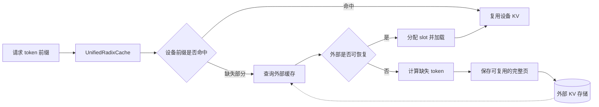

KV 数据在设备 pool 和外部存储之间传输；Python 线程只组织描述符、提交任务及处理结果，不增加 CPU host cache 层。

## 2. 模块职责与调用关系

先区分两个已有对象：

- **UnifiedRadixCache 管缓存。** 记录哪些前缀已有 KV、数据所在的设备 slots，并管理节点和内存回收。
- **UnifiedCacheLinkerWrapper 组织外部存取。** 将外部命中、目标 slots、加载/保存任务和节点保护串起来，完成后处理树侧状态。

Cache 是缓存管理者，Wrapper 是它对接外部存储的助手。未启用外部 linker 时，Cache 也能管理设备前缀缓存；启用后挂接 Wrapper，复用同一棵树和已有内存管理能力。

一次从 KvClient 后端恢复缓存，树侧组织的流程是：

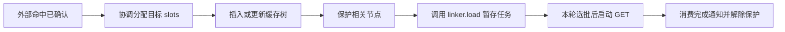

Wrapper 通过 components 和已有 allocator 协调 slots，通过 Cache 操作树和节点锁，再调用 KvClientDirectLinker。`load()` 先暂存任务；`start_layer_wise_loading()` 将当前任务交给后台加载线程，后者通过 KvClientStorage 提交实际读取。IO 完成后，Wrapper 消费 rid 通知并解除加载保护。

### 模块职责

| 层 | 主要对象 | 职责 |
| --- | --- | --- |
| 缓存树与内存管理 | UnifiedRadixCache、components、设备 KV allocator | 前缀匹配、slot 分配、树更新、节点保护与回收 |
| 树侧编排 | UnifiedCacheLinkerWrapper | 构造 PoolTransfer，组织跨 rank 恢复边界、命中标记、在途记录和树侧收尾 |
| 后端传输适配 | KvClientDirectLinker | 实现 UnifiedCacheLinker；生成页 key，解析传输范围，管理加载/卸载线程、队列及完成通知 |
| 公共设备布局工具 | DevicePoolGroup、DevicePoolEntry | 展开逻辑 pool，将设备索引与层号转换为地址、长度和布局偏移 |
| Python 存储适配 | KvClientStorage | 注册设备内存，查找 MR handle，组织 IO 参数，跟踪任务并校验结果 |
| Python/C++ 绑定 | _kvclient.Client，对应 C++ PyClient | 持有 SDK 客户端，将 Python 参数转换成 C++ 类型并调用 SDK |
| SDK 执行层 | kv::KvClient 及 transport/provider | 路由和执行异步查询、读取、写入，返回任务结果 |

### 模块调用图

下图展示模块之间的调用关系：箭头 A → B 表示 A 调用或使用 B。类的继承关系与对象持有关系在后面的类图中单独展示。

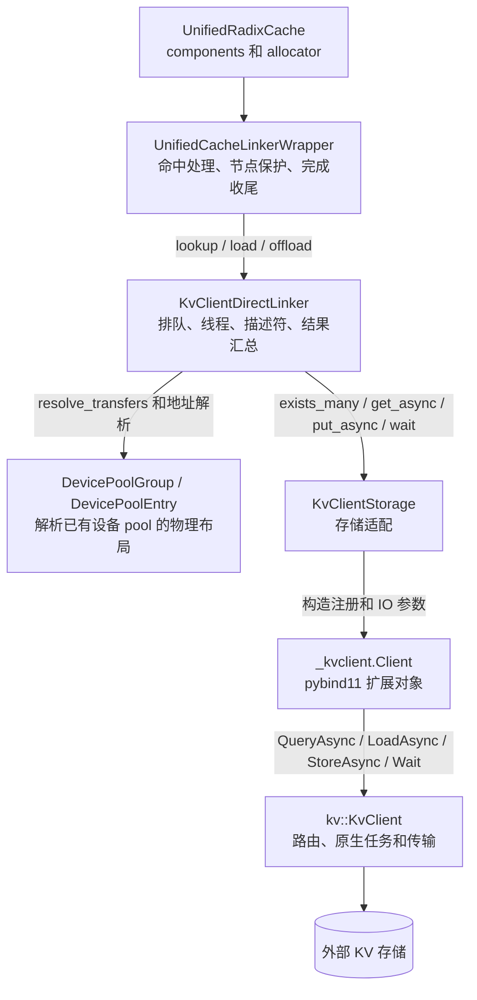

### 对象持有与类继承关系

先用文本区分持有关系和继承关系，不能把所有类理解成一条继承链。以下展示选用 KvClient 后端时的拟接入关系：

```text
UnifiedRadixCache
  └─ 持有 UnifiedCacheLinkerWrapper（cache.linker）
       ├─ 引用 cache：操作同一棵缓存树、节点和锁
       └─ 持有 cache_linker：接口类型为 UnifiedCacheLinker
            └─ 实际对象为 KvClientDirectLinker

继承关系：
UnifiedCacheLinker（ABC，传输接口）
  └─ KvClientDirectLinker（KvClient 后端）

KvClientDirectLinker
  ├─ 持有 LayerwiseSaver（逐层 PUT 设计）：分配保存编号，选中本次 forward，按层记录 ready_event 并入队
  ├─ 持有 DevicePoolGroup
  │    └─ 包含 DevicePoolEntry：引用已有 GPU buffers，描述地址和布局映射
  └─ 持有 KvClientStorage：内存注册、IO 参数组装、任务跟踪和结果校验
       └─ 持有 _kvclient.Client（C++ 包装类 PyClient 暴露的 Python 对象）
            └─ 通过 unique_ptr 持有 kv::KvClient 的实现对象
```

接入缓存树时，复用已有 Wrapper 挂接方式：

```python
# UnifiedRadixCache.init_cache_linker()
self.linker = UnifiedCacheLinkerWrapper(self, cache_linker)
```

启用 KvClient 后端后的对象关系如下。

```python
cache.linker               # 树侧 UnifiedCacheLinkerWrapper
cache.linker.cache_linker  # KvClientDirectLinker 实例
```

`KvClientDirectLinker` 实现公共 `UnifiedCacheLinker` 接口。`KvClientDirectLinker` 持有 `KvClientStorage`，后者通过 `PyClient` 调用 SDK 的 `kv::KvClient`。第一版的范围见文档开头。

| 关系 | 图中符号 | 含义 |
| --- | --- | --- |
| 泛化 | 实线与空心三角 | 子类继承父类，三角指向父类 |
| 关联 | 实线箭头 | 通过成员引用另一个对象 |
| 使用依赖 | 虚线箭头，标注 use | 方法使用某个类型或接口 |

**图 A：缓存树、Wrapper 与后端。**

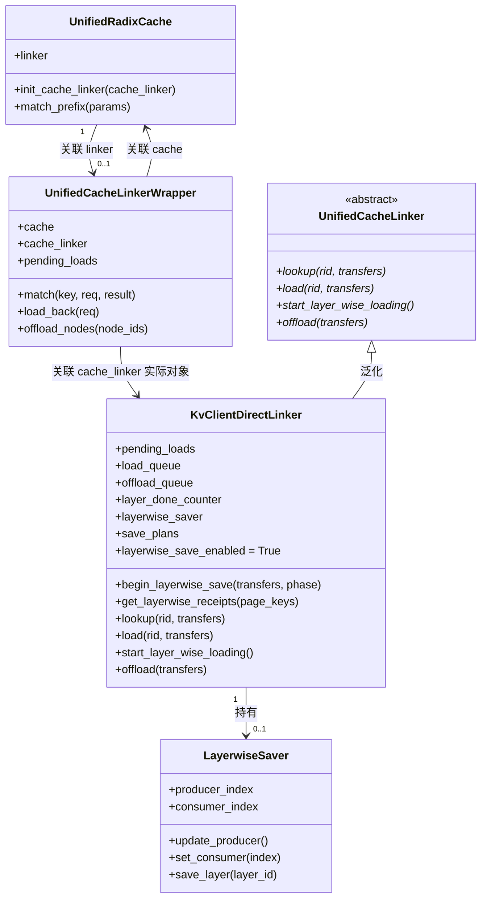

Wrapper 的 cache_linker 类型契约是 UnifiedCacheLinker，本图展示选用 KvClient 时的实际对象。Cache 和 Wrapper 操作同一棵树。

**图 B：后端、设备池视图、存储适配与 C++ 客户端。**

采用自上而下的分支布局：后端连接设备池视图、存储适配及 PoolTransfer 使用依赖；设备池和存储调用链分别向下展开。

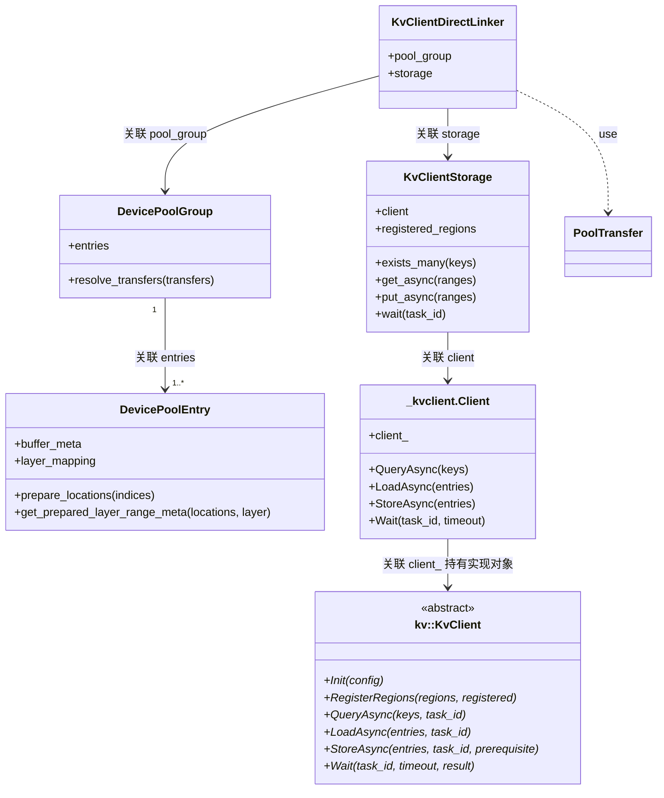

两图中的 KvClientDirectLinker 是同一个类。PyClient 通过 unique_ptr 持有 SDK 创建的 KvClient 实现对象；它通过 pybind11 暴露为 Python 的 _kvclient.Client，不继承 kv::KvClient。KvClientStorage 第一版作为独立存储适配类，不引入 HiCacheStorage 继承。

### 2.1 类名、模块名与文件

Python 扩展使用 pybind11 调用底层 `kv::KvClient`。

| 层 | 类或模块名 | 文件 | 职责 |
| --- | --- | --- | --- |
| UC Linker 后端 | `KvClientDirectLinker` | `kvclient_direct_linker.py` | 线程、队列、层门控、完成通知 |
| Python 存储适配 | `KvClientStorage` | `kvclient_storage.py` | 注册表、构造 IO 条目、调用及检查结果 |
| Python 扩展模块 | `_kvclient` | 编译自 `kvclient_pybind.cc` | Python 能 import 的原生模块 |
| 扩展里的客户端对象 | `_kvclient.Client` | C++ 包装类 `PyClient`，同一 .cc 文件 | 持有 `unique_ptr<kv::KvClient>`，转换参数和返回值 |
| SDK 客户端 | `kv::KvClient` | SDK 的 `kv_client.h` | 异步 IO 与底层传输 |

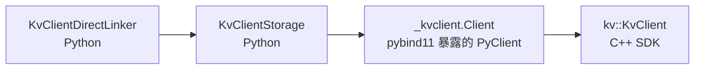

`PyClient` 是绑定文件内部的 C++ 包装类，Python 通过 `_kvclient.Client` 使用该对象。

### 2.2 pybind11 扩展与动态库

拟在 SDK 的 `bindings/python/kvclient_pybind.cc` 实现包装类及绑定。以下为结构示例，方法实现需补齐参数校验、状态转换和资源清理。

```cpp
namespace py = pybind11;

class PyClient {
    std::unique_ptr<kv::KvClient> client_;
public:
    // 构造：LoadFromFile → CreateKvClient → Init。
    // RegisterRegions / QueryAsync / LoadAsync / StoreAsync /
    // Check / Wait / UnregisterRegions / Shutdown 包装方法。
};

PYBIND11_MODULE(_kvclient, m) {
    py::class_<PyClient>(m, "Client")
        .def(py::init<const std::string&, int>())
        .def("register_regions", &PyClient::RegisterRegions)
        .def("query_async", &PyClient::QueryAsync)
        .def("load_async", &PyClient::LoadAsync)
        .def("store_async", &PyClient::StoreAsync)
        .def("check", &PyClient::Check)
        .def("wait", &PyClient::Wait)
        .def("unregister_regions", &PyClient::UnregisterRegions)
        .def("shutdown", &PyClient::Shutdown);
}
```

SDK 工程已有 `kv_client` CMake target；在该 target 可见的构建中添加：

```cmake
find_package(pybind11 CONFIG REQUIRED)
pybind11_add_module(_kvclient kvclient_pybind.cc)
target_link_libraries(_kvclient PRIVATE kv_client)
# 使用 SDK include 路径，并配置安装目录和运行时共享库搜索路径。
```

Linux 产物为带 Python ABI 后缀的 `_kvclient*.so`。安装后 `import _kvclient`；构建时使用目标推理环境的 Python、SDK 和设备依赖。

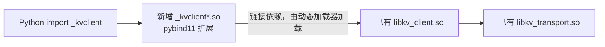

扩展负责 Python/C++ 参数转换，现有 SDK 动态库负责 IO。加载 libkv_client.so 本身不会自动获得 Python 的 Client 类。

### 2.3 存储接口与参数约定

**KvClientStorage 不只是转发 SDK 调用，它负责内存注册记录、IO 参数组装、原生任务跟踪和结果校验。** 它将 DirectLinker 给出的传输范围转换成可提交给 SDK 的请求，并管理这些请求涉及的资源。

| 职责 | 第一版拟实现行为 |
| --- | --- |
| 客户端初始化 | 根据配置路径和设备编号创建 `_kvclient.Client`，由绑定层创建并初始化 SDK 客户端 |
| 内存注册与登记 | 接收去重后的底层 allocation 区间，调用注册接口，校验返回结果，保存 region、handle、tokenId 及来源关系 |
| IO 参数组装 | 接收 key、addr、size、device_id、remote_offset，检查地址范围完全落在已注册区间内，查找对应 handle 并构造绑定输入 |
| 查询适配 | 通过 `query_async → wait` 获取并校验对象查询结果，提供给 Linker 判断连续可恢复前缀 |
| 异步任务跟踪 | 提交 GET/PUT 后登记有效 TaskId 及相关资源，避免任务丢失或结果重复消费 |
| 完成结果校验 | 检查等待状态、任务状态和逐条结果，保留失败信息，不将“提交成功”当成“传输成功” |
| 资源关闭 | 停止接受新任务，排空活动 IO；确认安全结束后再注销内存和关闭客户端 |

各层分工如下：

| 对象 | 负责 | 交给下一层的内容 |
| --- | --- | --- |
| KvClientDirectLinker，借助 DevicePoolEntry | 组织页和层的传输，解析 slot 对应的地址、长度，确定页 key 与远端 offset，管理线程和层门控 | 本次 IO 的 ranges |
| KvClientStorage | 查注册记录、填 handle、组装请求、跟踪 TaskId、校验结果 | SDK 绑定接受的 entries |
| `_kvclient.Client` / PyClient | 检查绑定参数类型和范围，转换 Python/C++ 类型，调用 SDK，转换返回结果 | SDK 原生结构和方法调用 |
| `kv::KvClient` | 执行路由、传输和原生任务管理 | 原生任务结果 |

Storage 不操作缓存树、不挑选空闲 slots，也不根据模型布局计算 slot 的物理地址。页 key 和统一远端 offset 由 Linker 侧确定；Storage 根据实际本地地址查找注册 handle，而不是仅凭 KV/Indexer 池名选择 handle。

以一次读取为例：

```text
DirectLinker 解析本层两池的 ranges
  → 每段包含 key8、addr、size、device_id、remote_offset
KvClientStorage.get_async(ranges)
  → 查找完全覆盖每个本地子区间的注册记录
  → 填入对应 handle，构造 entries
  → 调用 _kvclient.Client.load_async(entries)
  → 成功后登记 TaskId 和相关资源，并返回 TaskId
后台加载线程调用 KvClientStorage.wait(task_id)
  → 经绑定调用 SDK Wait
  → 校验等待、任务和逐条状态，消费此次结果
  → 将结果交给 Linker，由 Linker 决定层门控和完成通知
```

提交失败时没有有效 TaskId，应抛出异常而不是登记一个占位任务。Wait 超时不代表 IO 已停止，不能据此释放 GPU slots 或注销内存；未能确认 IO 静默时须保留相关资源并进入故障处理，具体规则见第 11 节。

下面的代码仅展示接口形状，实际实现还需补齐上述注册检查、活动任务记录和异常处理。

```python
# kvclient_storage.py，拟实现用法
import _kvclient

class KvClientStorage:
    def __init__(self, config_path, device_id):
        self.client = _kvclient.Client(config_path, device_id)
        self.registered_regions = []

    def get_async(self, ranges):
        entries = self._build_entries(ranges)  # 检查注册范围并填入 handle
        return self.client.load_async(entries)

    def put_async(self, ranges):
        entries = self._build_entries(ranges)
        return self.client.store_async(entries)
```

| KvClientStorage 方法 | _kvclient.Client 方法 | SDK 方法 |
| --- | --- | --- |
| register_buffers | register_regions | RegisterRegions |
| exists_many | query_async → wait | QueryAsync → Wait |
| get_async | load_async | LoadAsync |
| put_async | store_async | StoreAsync |
| wait | wait | Wait |
| close | unregister_regions → shutdown（先排空） | UnregisterRegions → Shutdown |

DirectLinker 将布局解析得到的 ranges 交给 KvClientStorage；Storage 查找 handle 后形成绑定输入。Python 传入注册项 `(addr, size, device_id)`；注册返回项保留 region、handle、tokenId。IO 条目传入 `(key8, addr, size, device_id, handle, remote_offset)`，由 PyClient 转成第 4 节的 KVBuffer。KvClientStorage 负责查找覆盖范围的 handle；绑定层再次检查类型、整数范围及 key 恰为 8 字节。

Async 提交失败抛异常，成功返回 TaskId。wait 返回结构化结果：等待状态、任务状态、entryStatus、可选 exists/prefixHitKeys；不丢掉逐条错误。KvClientStorage 保持 active TaskId 和相关资源记录，检查结果并保证每个 task 只消费一次。

先持有 GIL 将 Python 参数转换为 C++ 值，再用 `py::gil_scoped_release` 调用可能阻塞的 SDK 方法；恢复 GIL 后构造 Python 结果。首版仍由卸载线程等待设备 event，store_async 不绑定 Python prerequisite 回调。

EXISTS 图展示存储接口与 SDK 调用两层；GET/PUT 图将绑定和 SDK 调用收进 KvClientStorage 的内部步骤，箭头上的 get_async、put_async、wait 均为 Python 存储接口。

## 3. 初始化：先初始化客户端，再注册设备内存

初始化包含后端自身初始化和缓存树挂接两部分。下图完整展示拟接入顺序：先构造 KvClientDirectLinker，完成客户端初始化、内存注册和后台执行准备，再通过 `cache.init_cache_linker(linker)` 创建公共 Wrapper。Wrapper 不是由 Storage 或 SDK 创建的。

图例（KvClient 后端对象及线程为拟实现关系）：

| 图中名称 | 实际对象或执行位置 |
| --- | --- |
| registry | `registry.py` 中的初始化调用侧 |
| Cache / cache | `UnifiedRadixCache` 实例 |
| Wrapper / wrapper | `cache.linker`，即 `UnifiedCacheLinkerWrapper` 实例 |
| linker / DirectLinker | `cache.linker.cache_linker`，即 `KvClientDirectLinker` 实例 |
| assembler | 公共设备布局工具模块 `hybrid_cache/linker_pool_assembler.py` |
| PoolGroup | `linker.pool_group`，即 `DevicePoolGroup`；包含 KV / Indexer Entries |
| Storage / PyClient | `linker.storage`（`KvClientStorage`）及其 `client`（`_kvclient.Client`）；图中合并展示两层 |
| KvClient SDK | PyClient 内部持有的 `kv::KvClient` 实现对象 |
| component | Cache 中的 FULL 等树组件；分配工作使用已有 allocator |
| counter | `linker.layer_done_counter`；设备 KV pool 和 TP worker 接入同一个对象 |
| load thread | 拟由 `linker.load_thread` 执行同一后端对象的 `load_thread_func()`，不是另一份 linker |
| pool / kvcache | 模型实际使用的 GPU KV pool，持有数据 buffers；不是 `DevicePoolGroup` |

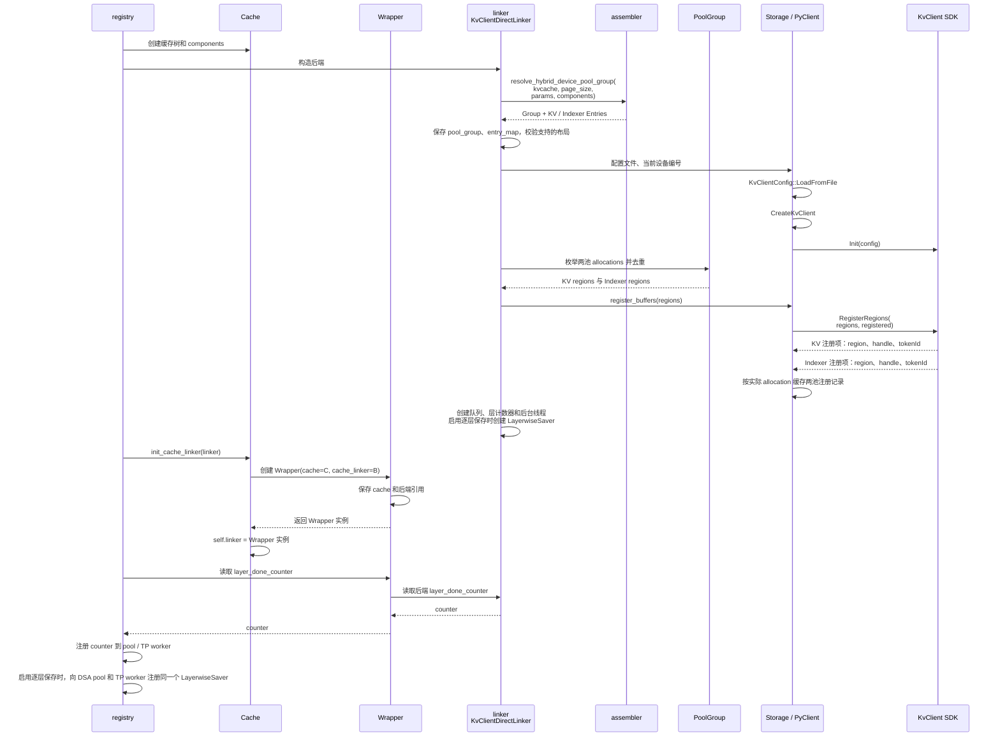

对应的拟接入代码如下，仅展示关键关系，具体构造参数和 guards 仍需在 registry 中实现：

```python
linker = KvClientDirectLinker(...)
cache.init_cache_linker(linker)

# init_cache_linker 内部复用已有实现：
# self.linker = UnifiedCacheLinkerWrapper(self, cache_linker)

counter = cache.linker.layer_done_counter
kvcache.register_layer_transfer_counter(counter)
tp_worker.register_hicache_layer_transfer_counter(counter)
if linker.layerwise_save_enabled:
    saver = linker.layerwise_saver
    kvcache.register_layerwise_saver(saver)
    tp_worker.register_layerwise_saver(saver)
```

初始化结束后的调用入口是 `cache.linker`（Wrapper），实际后端是 `cache.linker.cache_linker`（KvClientDirectLinker）。Wrapper 引用原有 cache，不复制缓存树；它负责树侧保护与收尾，后端负责传输。只完成后端构造还不算接入完成，必须挂接 Wrapper 并接通层计数器及启用的保存 hook。

后端构造函数内部拟复用的设备布局入口是 `hybrid_cache/linker_pool_assembler.py` 中已有的 `resolve_hybrid_device_pool_group()`，调用形状如下：

```python
self.pool_group = resolve_hybrid_device_pool_group(
    kvcache=params.token_to_kv_pool_allocator.get_kvcache(),
    page_size=params.page_size,
    params=params,
    components=components,
)
self.pools = self.pool_group.entry_map
self.num_layers = self.pool_group.num_layers
```

对于本方案支持的 DSA 路径，该入口内部使用 `_build_dsa_device_pool_group()`，返回包含 KV / Indexer Entries 的 DevicePoolGroup；两个 Entry 分别引用已有的 `kv_buffer` 和 `index_k_with_scale_buffer`。该函数建立已有设备内存的布局视图，不执行 SDK 内存注册，也不提交 IO。KvClient 后端还需明确拒绝第一版不支持的 MTP draft 等配置。

注册的是完整 allocation；每次 IO 可以只访问其中一个子区间。设备/provider 支持范围和地址对齐必须在接入设备上验证，不能假定所有 CUDA/NPU buffer 都能直连。

### KvClientDirectLinker 在什么时候接到 Cache 上？

创建缓存树时，`registry.py` 按配置选择并构造 `KvClientDirectLinker`，再调用 `cache.init_cache_linker(linker)`。下面是该分支的示意代码。

```python
cache = UnifiedRadixCache(params)
linker_cls = KvClientDirectLinker
linker = linker_cls(server_args, params, components=set(cache.components))
cache.init_cache_linker(linker)
```

已有 `init_cache_linker()` 内部的关键操作是：

```python
self.linker = UnifiedCacheLinkerWrapper(self, cache_linker)
```

执行后的对象关系是：

```text
cache
  └─ linker → Wrapper
                 ├─ cache → 原来的 cache
                 └─ cache_linker → 刚创建的 KvClientDirectLinker 实例
```

因此，这里“注册 KvClient 后端”指选择类、创建对象，再通过 Wrapper 保存引用；本方案不引入单独的 `register_kvclient_linker()` 挂接接口。Wrapper 与后端引用的是原有缓存树和设备数据，不创建另一棵树或另一份 GPU 缓存。

**最后的 counter 注册是另一件事。** registry 通过 Wrapper 取出这个后端对象的 `layer_done_counter`，注册给设备 KV pool 和 TP worker，把模型执行侧的逐层等待机制接通。它不是再次创建或挂接后端对象，也不会在初始化时直接执行 GET。设备内存注册则是把 GPU allocation 地址范围交给 SDK，和对象挂接、counter 注册也应分别理解。

### 3.1 实例归属：每个推理 worker/rank 一个客户端

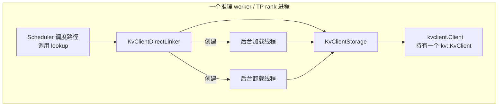

客户端在后端初始化时创建，供本 rank 的查询、加载和卸载共用；不按请求创建。SDK 内部传输 worker 是另一层执行机制。并发调用保证见第 11 节。

### 3.2 两池分别注册，共用页 key

**调用一次 RegisterRegions，批量传入两池的内存区间。** “两池分别注册”指分别获得各区间的注册记录，不是分别调用两次函数。以每池一个 allocation 为例：

```cpp
kv::MemoryRegion kvRegion;
kvRegion.memoryType = kv::MemoryType::DEVICE;
kvRegion.addr = kvBaseAddr;
kvRegion.size = kvAllocationBytes;
kvRegion.deviceId = deviceId;

kv::MemoryRegion indexerRegion;
indexerRegion.memoryType = kv::MemoryType::DEVICE;
indexerRegion.addr = indexerBaseAddr;
indexerRegion.size = indexerAllocationBytes;
indexerRegion.deviceId = deviceId;

std::vector<kv::MemoryRegion> regions{kvRegion, indexerRegion};
std::vector<kv::RegisteredMemory> registered;
auto status = client->RegisterRegions(regions, registered);  // 一次调用
// 检查 status 成功且 registered.size() == regions.size()，再保存记录。
```

```text
输入 regions                           输出 registered
  KV allocation 的地址/大小/设备    →    对应 region、handle、tokenId
  Indexer allocation 的地址/大小/设备 →  对应 region、handle、tokenId
```

KvClient 只接收内存区间，不识别 KV/Indexer 语义。KvClientStorage 保留区间与 pool 的来源关系，后续根据实际 IO 地址查找覆盖它的注册记录。共用远端页 key，不影响两池使用各自的 handle。每池有多个 allocation 时，将全部去重后的区间一起传入，返回相应数量的注册记录。

下图以两个 pool 各一个 allocation 为例；实际每池可能有多个 allocation，每个去重后的 allocation 都保存自己的注册结果，不固定为每池一个 handle。

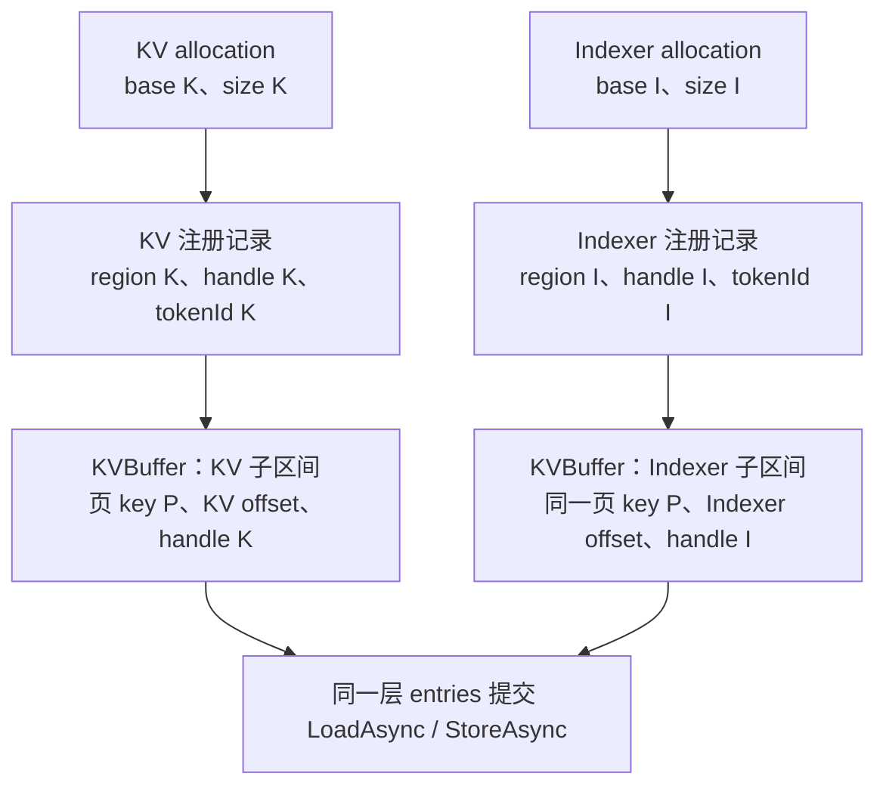

RegisterRegions 可以一次接收两池的 regions，返回逐项 RegisteredMemory；合在一次调用中不等于合并成一个注册区间。查找 handle 依据实际地址覆盖范围，不仅依据 pool 名称。如果多个 tensor 共享底层 allocation，去重后可共用该 allocation 的注册记录。

| 信息 | KV entry | Indexer entry |
| --- | --- | --- |
| 远端 key | 页 key P | 同一页 key P |
| 本地地址和长度 | KV 实际子区间 | Indexer 实际子区间 |
| buffer.handle | 覆盖 KV 子区间的 handle | 覆盖 Indexer 子区间的 handle |
| mrKey | 客户端从对应 handle 解析 tokenId | 客户端从对应 handle 解析 tokenId |
| offset | 统一布局中的 KV 偏移 | 统一布局中的 Indexer 偏移 |

调用者保存注册返回的 tokenId，但不自行填充 KVBuffer.mrKey；KvClient 提交时按 handle 查注册表解析。handle/tokenId 是注册 API 返回的标识，不应自行生成或假设二者相等。

## 4. 数据如何变成 KVBuffer

### 逻辑任务、slot 与物理地址

**PoolTransfer 是逻辑任务单，不包含算好的 GPU 地址。** 下面是示意值，实际 `device_indices` 使用 tensor：

```python
PoolTransfer(
    name=PoolName.KV,
    keys=["A", "B"],
    device_indices=slots_tensor,
)
# slots_tensor = [128,129,130,131, 256,257,258,259]
# page_size = 4：A 对应前四个 slots，B 对应后四个 slots。
```

`keys` 定位外部存储中的逻辑页，`device_indices` 定位本地设备缓存中的 token slots。GET 将对应页读入这些 slots，PUT 将这些 slots 的数据写出。查询阶段没有目标 slots 也正常，因为查询只关心对象是否存在。

slot 是设备内存池中的位置编号，分配器管理其使用权；它不是指针，也不是新分配的一份 CUDA tensor。GPU KV 分配器属于 SGLang 内存管理，正常计算也使用它。Wrapper 通过 cache、components 和已有 allocator 协调目标位置，KvClient 后端不自行挑选空闲 slots。

**原有 kvcache 已经持有 GPU buffers；DevicePoolEntry 引用这些已有 tensor，不复制或另建一份数据显存。** 初始化 linker 时，assembler 创建 Entry，Entry 从 buffer 读取起始地址、行步长和片段长度等元数据；DevicePoolGroup 再建立 `name → Entry` 的查找表。客户端初始化后注册这些 buffers 的底层 allocations，后续 IO 使用其中的子区间。

```text
原有 kvcache
  ├─ kv_buffer                 ← KV Entry 引用
  └─ index_k_with_scale_buffer  ← Indexer Entry 引用
                                  ↑
DevicePoolGroup 按 name 组织这两个 Entry
```

`resolve_transfers()` 根据各 Entry 的 `indices_from_pool` 查找输入任务，将逻辑任务展开成物理池任务。DSA 的 KV 与 Indexer Entry 均从逻辑 KV 任务取索引；输出任务的 `name` 分别为 KV、INDEXER。函数将 `entry.translate_indices(source.device_indices)` 填入输出任务的 `host_indices`，同时保留 `device_indices`。没有配置 index mapper 时，索引数值原样保留。

这里复用了通用传输接口的 `host_indices` 字段：**在 device 直连路径中，它表示目标物理 device pool 使用的索引，不是 CPU host cache 位置，也不是外部存储的 slot。** `resolve_transfers()` 只组织任务和按需映射索引，不搬数据，也尚未计算最终 GPU 地址。

### DSA 的 token 行与 page 行如何对应

两池都按逻辑页传输，但 GPU buffer 的一行不一定是一页。假设页起始 token slot 为 128，`page_size=4`：

| 物理池 | Entry 设置 | 该页对应的 buffer 行 |
| --- | --- | --- |
| KV | `rows_are_pages=False` | 从第 128 行开始，覆盖连续 4 个 token 行 |
| Indexer | `rows_are_pages=True` | 第 32 行，即 `128 / 4`；一行存一页 Indexer 数据 |

Entry 后续通过 `prepare_locations(indices)` 校验按页对齐、页内连续的索引，并换算行号；再通过 `get_prepared_layer_range_meta(locations, layer)` 结合具体层的 buffer 元数据计算地址、长度和片段偏移。

```text
KV 地址      = 该层 KV base      + 128 × KV token 行步长
Indexer 地址 = 该层 Indexer base +  32 × Indexer page 行步长
```

因此，同一组 token slot 索引在不同层、不同池对应不同地址，必须结合 Entry 的布局寻址。上述转换只计算位置，不搬数据；实际 IO 在后续提交 KvClient 任务时执行。

KvClient 通过公共设备 pool assembler 解析 DSA 的两种行布局，具体行布局由各自的 GPU buffer 决定。

### 4.1 DSA 一页一个 key，两池和各层用远端 offset 区分

`make_cache_key(page_key)` 使用 `sha256(page_key.encode()).digest()[:8]` 生成 8 字节 key。**同一逻辑页的 KV 与 Indexer 使用同一个 namespace 和同一个 key。** 目标 namespace 支持不同长度的 IO，两池和各层的片段通过远端 offset 区分。模型版本和并行分片隔离通过已有页标识及部署 namespace 规则确定。

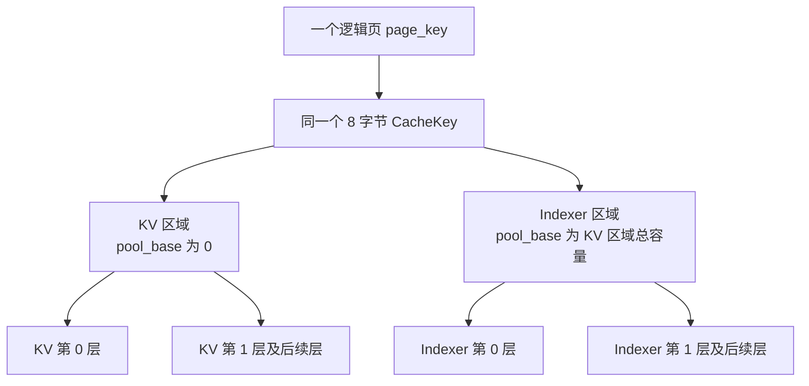

Linker 初始化时根据 Entry 枚举片段，先排列全部 KV 片段，再排列全部 Indexer 片段。`_storage_offsets[pool_name][raw_offset]` 把池内原始 offset 映射到这个 ASU 对象内的 offset，GET 和 PUT 共用这张表。**目标协议要求每条 IO 的远端 offset 按 512 字节对齐，IO 长度保留片段的实际字节数。** 每个片段在远端为下一片段的起点预留对齐空间。

```text
remote_offset = pool_base + aligned_fragment_offset
next_fragment_offset = remote_offset + align_up(size, 512)
KV.pool_base = 0
Indexer.pool_base = 全部 KV 片段的对齐后总容量
```

以 78 层的 GLM5.2-FP8 为例，每个 block 每层 KV 的实际长度为 73728 字节，Indexer 的实际长度为 8448 字节。下表列出两池的前两层，四条 IO 都使用同一个 `page_key` 编码后的对象 key。

| 片段 | 远端 offset（字节） | 实际 IO 长度（字节） |
| --- | ---: | ---: |
| KV 第 1 层 | `0` | `73728` |
| KV 第 2 层 | `73728` | `73728` |
| Indexer 第 1 层 | `73728 * 78 = 5750784` | `8448` |
| Indexer 第 2 层 | `73728 * 78 + 8704 = 5759488` | `8448` |

`align_up(8448, 512) = 8704`。这 256 字节的间隔位于远端对象中，两条 Indexer IO 各自只传输 8448 字节。以第 2 层 Indexer 为例，其池内原始 offset 是 `8448`，`_storage_offsets[PoolName.INDEXER][8448]` 得到 `5759488`。实际片段尺寸从 Entry 取得，Indexer 使用 `index_k_with_scale_buffer` 的已有打包布局。

**不同页复用同一套对象内偏移。** `key` 选中远端对象，`offset` 从该对象的起点算。同一布局下，A、B 两页的第 2 层 KV 分别写到 `(key_A, 73728)` 和 `(key_B, 73728)`，两笔写入分别落在各自对象的 `73728` 字节处。A 页的第 2 层 Indexer 写到 `(key_A, 5759488)`，与 A 页的 KV 共用对象，使用不同片段位置。

### 4.2 IO 描述符生成

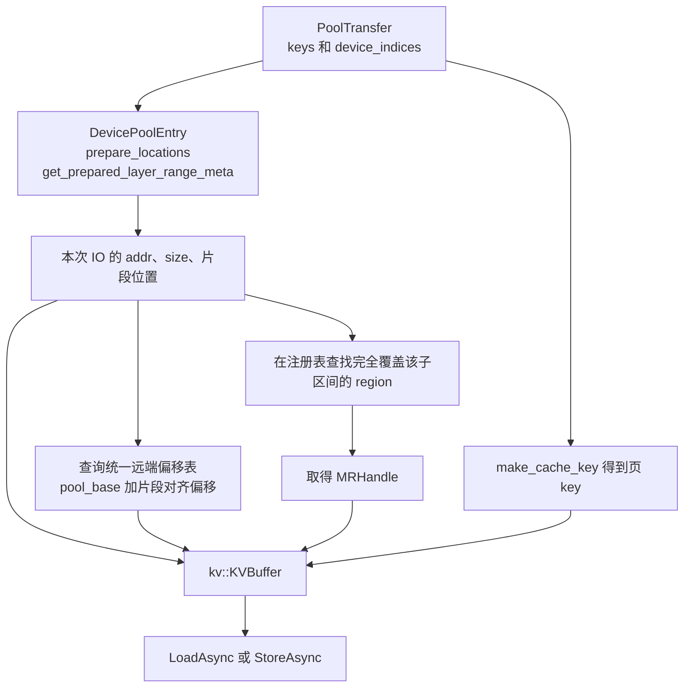

按 ASU `BuildKvBuffers()` 填字段：

```cpp
kv::KVBuffer entry{};
entry.key = key;                          // 同页各分段相同
entry.buffer.region.memoryType = kv::MemoryType::DEVICE;
entry.buffer.region.addr = ptr;            // 本次 IO 的实际地址
entry.buffer.region.size = bytes;          // 本次 IO 长度
entry.buffer.region.deviceId = deviceId;
entry.buffer.handle = registered.handle;   // 覆盖该区间的持久 handle
entry.offset = remoteOffset;               // 远端对象内偏移
// mrKey 由 KvClient 根据 handle 解析。
```

以第 2 层 Indexer 的 PUT 为例，Linker 把下面的描述符加入 `ranges`，普通 offload 再将同一页两池全部必要层一起交给 `storage.put_async(ranges)`。

```python
ranges.append(
    KvClientRange(
        key=make_cache_key(page_key),
        addr=indexer_layer_2_gpu_addr,
        size=8448,
        device_id=device_id,
        remote_offset=73728 * 78 + 8704,
    )
)
```

Storage 用 `addr` 和实际 `size` 查找完整覆盖该范围的 MR handle，并把 `remote_offset` 原样交给绑定层。绑定层将 `8448` 写入 `KVBuffer.buffer.region.size`，将 `5759488` 写入 `KVBuffer.offset`。提交前检查本地地址范围是否被注册区间完整覆盖，以及远端 offset 的 512 字节对齐和 uint32 边界。设备地址要求遵循目标 provider 的约束。

GET 读回同一页的第 2 层 Indexer 时，使用和 PUT 相同的 `key`、`size=8448` 和 `remote_offset=5759488`。`addr` 取本次分配的目标 GPU slot 地址，Storage 也用这个目标地址查 MR handle。

```python
layer_ranges.append(
    KvClientRange(
        key=make_cache_key(page_key),
        addr=target_indexer_layer_2_gpu_addr,
        size=8448,
        device_id=device_id,
        remote_offset=73728 * 78 + 8704,
    )
)
# layer_ranges 汇集本批该层的 KV 与 Indexer 描述符。
task_id = storage.get_async(layer_ranges)
```

`storage.get_async()` 通过绑定调用 `KvClient::LoadAsync(entries, taskId)`。后台线程先提交本批全部层，再按层 Wait。第 2 层成功时，SDK 已从同一 ASU 对象的 `5759488` 处读取 `8448` 字节到指定的目标地址，Linker 随后放行该层。

**SDK 兼容性**。SGLang 的 Linker、Storage 和 pybind 保留实际 IO 长度。参考 UCM SDK 的 `kv_semantics/src/trans/proto/kv_protocol.cc` 在 `BatchStore` 和 `BatchRetrieve` 打包时仍要求长度按 512 字节对齐。运行上述例子需要在目标环境链接支持 `size=8448` 的 SDK。远端对齐间隔只影响 offset 计算。

### 4.3 DSA：一份逻辑页任务对应 KV 和 Indexer 两个 pool

现有 `_build_dsa_device_pool_group()` 已构造两个 DevicePoolEntry。第一版复用该逻辑，对 MTP draft 等超出范围的配置在初始化时明确拒绝。

**buffer 是存数据的 GPU tensor，slot 是 allocator 分配的 token 位置编号。** 同一页的 slot 编号用来在 KV 和 Indexer 各自的 buffer 中定位数据。两个 pool 的行组织不同，所以同一个 slot 编号在两个 buffer 中要分别换算。

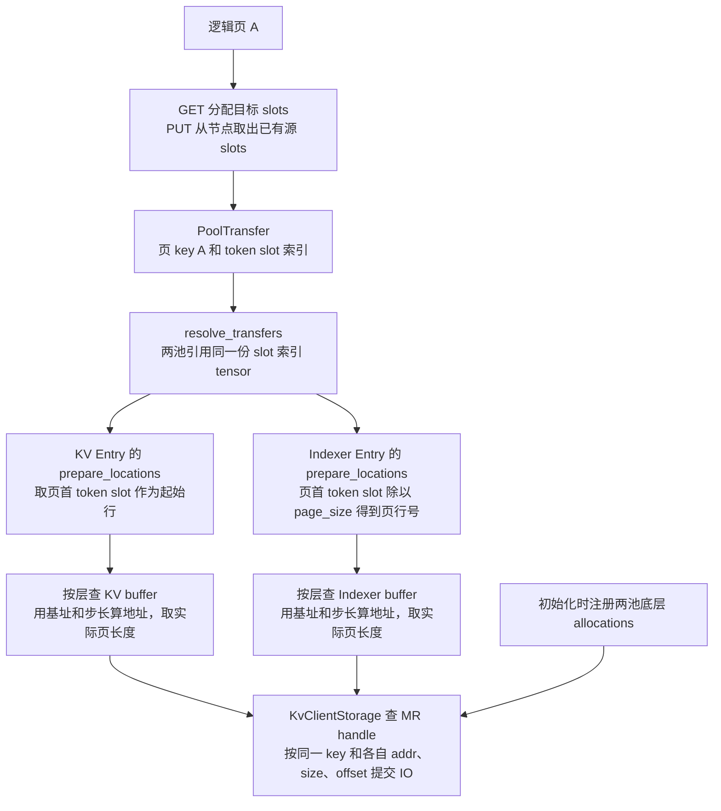

例如 `page_size=64`，页 A 的 token slots 是 `[128, 129, ..., 191]`。Wrapper 把页 A 和这份 slot tensor 放入一个逻辑 `PoolTransfer`。`resolve_transfers()` 展开成 KV 和 Indexer 两条 pool transfer。在当前 DSA 布局下，两条 transfer 的 `host_indices` 引用的是同一份整数索引。到了 `get_prepared_layer_range_meta(locations, layer)`，才结合指定层的 GPU buffer 布局计算地址。

| 物理池 | `prepare_locations()` 得到的行号 | 指定层的本地地址和长度 |
| --- | --- | --- |
| KV | 页首 token 行 `128` | `该层 kv_buffer 的基址 + 128 × token 行步长`，长度覆盖第 128～191 行 |
| Indexer | 页行 `128 / 64 = 2` | `该层 index_k_with_scale_buffer 的基址 + 2 × page 行步长`，长度是一整行，包含 Indexer 和 scale |

Linker 按第 4.1 节查出两个片段各自的远端 offset。Storage 根据各自的本地地址和实际长度查找初始化时登记的 MR handle。同一页的两条 IO 用同一个 `make_cache_key(page_key)`。如果下一次 GET 把页 A 分到 slots `[256, ..., 319]`，KV 从第 `256` 行开始接收，Indexer 写入第 `4` 行，ASU 上的 key 和远端 offset 沿用原来的值。

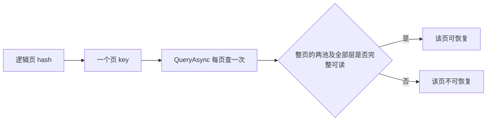

**EXISTS**：每页只查询一个 key，从 exists 或 prefixHitKeys 计算连续可恢复页数。前提是底层保证 key 命中代表两池全部分段完整；如果部分写完即存在，必须先增加发布协议再启用，不能把存在当作完整。

**GET**：两份 transfer 复用同一逻辑索引来源，但各自解析物理地址。每层 KV 与 Indexer 均读取成功、设备可见后，立即推进该层 counter；只有全部层结束，才发布 rid 完成通知。

**PUT**：一次逻辑 offload 包含两池全部必要层；全部成功才报告 True。任一 pool 缺失或分段未完整发布，都不能报告该页完整命中。两池不要求位于同一 allocation，必须分别注册后查找各自 handle。

### 4.4 DSA 多卡实例与写入归属

TP=4 且每卡一个 worker 时，每个 rank 都有一个 linker、一组包含 KV/Indexer 两个 Entry 的 DevicePoolGroup、一个 KvClient，以及本卡的注册 handle。Entry 是本卡 buffer 的视图，不额外复制 KV 数据。

现有 DSA assembler 标记 `rank_replicated=True`，复制型 pool 由 attention TP group 内的 rank 0 执行普通 PUT。查询和加载使用相同对象 key，MR handle 和设备地址保持 rank 本地。启用 interleave prefill CP 时的 owner 选择和配置限制见[第 13 节](#13-特殊场景与配置限制)。

跨 rank 的可恢复边界仍由 Wrapper 求交集。验收需同时检查两池逐字节一致，以及 owner/非 owner 的 offload 完成顺序不破坏 pending_offloads 对应关系。

## 调度总览：先匹配，再接纳，最后统一启动

EXISTS 与 GET 不是同一次调用。前缀匹配阶段先查出外部可恢复范围，Wrapper 保存外部 hit marker；调度器接纳请求、实际需要恢复时，再使用这个标记准备加载。下面以候选请求 A、B 为例串起公共调度路径；KvClient 调用部分为拟接入行为：

```text
调度器遍历候选请求 A
  │
  ├─ ① req.init_next_round_input(cache)
  │      → cache.match_prefix(...)
  │          → 匹配本地 GPU 缓存树
  │          → wrapper.match(...)
  │              → linker.lookup(...)：查询 KvClient 外部缓存
  │              → 若可恢复，记录请求的外部 hit marker
  │      → 将前缀匹配结果写回 req
  │
  └─ ② adder.add_one_req(A, ...)
         → 检查接纳条件、资源和本轮预算
         → 在需要且允许恢复外部缓存的路径上：
             cache.init_load_back(...)
               → wrapper.load_back(req)：使用此前的 hit marker
                   → 协调 slots、更新树、保护节点
                   → linker.load(rid, transfers)
                       → 暂存到 linker.pending_loads，尚未 GET

继续处理候选请求 B……

③ 选择循环结束，有可运行请求时创建 new_batch
   → 在 prepare_for_extend() 之前：
       cache.ready_to_load_host_cache()
         → wrapper.start_layer_wise_loading()
             → linker.start_layer_wise_loading()
                 → 将当前已收集的加载任务交给后台，启动 GET
   → 返回的 counter index 保存到 batch，供本轮模型前向等待
```

**hit marker 表示“外部哪些页可恢复”，不是“数据已经在 GPU 上”。** 查到命中也不等于本轮一定接纳；请求准备和实际 GET 分开，才能先判断预算与接纳条件，再统一启动本轮已暂存任务。`load()` 返回只表示接受任务，设备数据是否可用由后续逐层 counter 保证。

讲解时可对照 `managers/scheduler.py` 的 `req.init_next_round_input(...)`、`adder.add_one_req(...)` 与 `ready_to_load_host_cache()` 调用，以及 `managers/schedule_policy.py` 的请求接纳逻辑。这里沿用的 host 命名是已有调度接口，不表示 KvClient 直连路径增加了 CPU host cache。

## 5. EXISTS：从前缀匹配到外部命中

本章对应前面调度总览的第 ① 步中“查询外部缓存”的部分。`req.init_next_round_input(cache)` 调用 `cache.match_prefix(...)`，先匹配本地 GPU 缓存树，再由 `wrapper.match(...)` 组织外部查询。不是整个前缀匹配都叫 EXISTS：本地树匹配由 Cache 完成，外部对象查询才经 Linker 和 Storage 进入 KvClient 的 Query 接口。

```text
req.init_next_round_input(cache)
  → cache.match_prefix(...)：匹配本地设备前缀
    → wrapper.match(...)：组织外部查询
      → linker.lookup(rid, transfers)
        → storage.exists_many(keys)
          → _kvclient.Client.query_async(...) → SDK QueryAsync
          → _kvclient.Client.wait(...)        → SDK Wait
```

查询只需要页 keys，不需要加载目标 slots。外部结果经 Linker 转成连续可恢复页边界，Wrapper 协调各 rank 的共同边界并保存 hit marker，前缀匹配结果再写回请求。后面的 `adder.add_one_req()` 判断接纳条件，需要恢复时才使用该标记调用 `load_back()`；统一启动加载后才真正 GET。

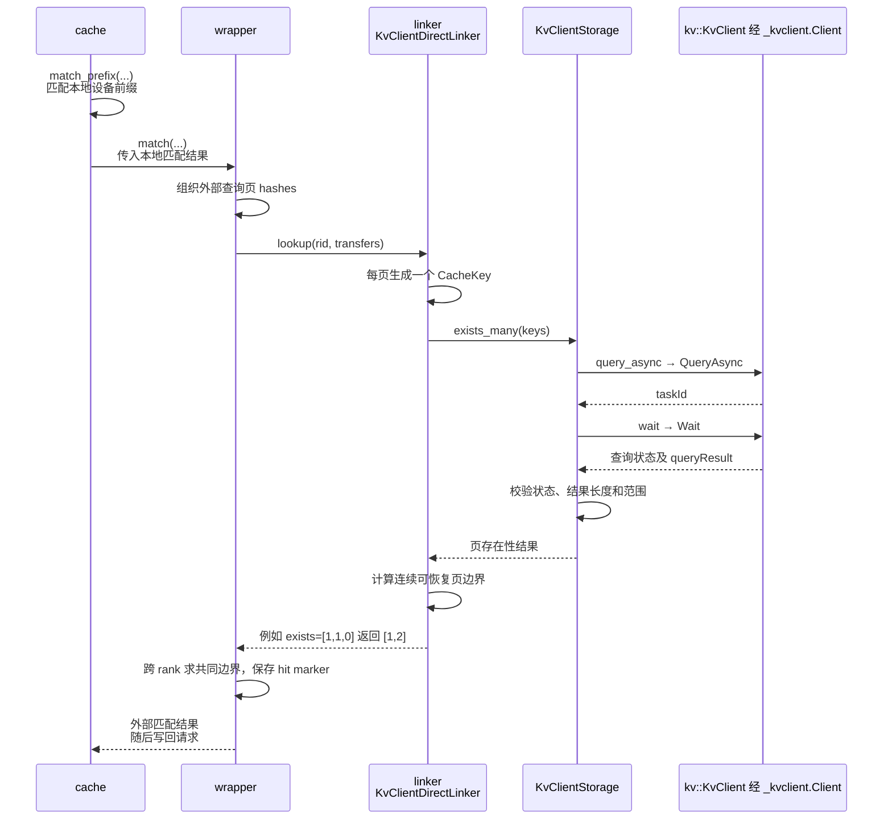

EXISTS 此时只查询可恢复范围，不分配目标 slot，也不读取 KV。GET 阶段才使用 hit marker 组织恢复。

FULL KV 单次有序查询中，一个 key 对应一页，prefixHitKeys 可作为连续命中页数；结果长度和范围必须校验。Query 超时保守按 miss 处理。

**启用前必须验证：同一 key 的部分分段写完时，Query 是否已经返回存在。** 如果会，必须先解决整页提交/完成标记，不能据此报告整页可恢复。

## 6. 线程与排队：两个工作线程、四个队列

本节约定线程、队列和任务命名。加载和保存的时序以第 7 节 GET 和第 8 节 PUT 的流程图为准。

### 统一命名约定

下表列出 KvClient 的线程对象、入口函数和队列。后文图中的线程角色对应这些对象和函数。

| 含义 | 加载 | 卸载 |
| --- | --- | --- |
| Linker 持有的线程对象 | `load_thread` | `offload_thread` |
| 线程入口函数 | `load_thread_func()` | `offload_thread_func()` |
| 有界工作队列 | `load_queue` | `offload_queue` |
| 完成队列 | `completed_loads` | `offload_results` |
| 设备准备事件 | `ready_event` | `ready_event` |

四个队列都由同一个 `KvClientDirectLinker` 持有。两个工作线程经同一个 `KvClientStorage` 调用本 rank 的 KvClient。

| 容器 | 类型 | 保存什么 | 何时取走 |
| --- | --- | --- | --- |
| Wrapper.pending_loads | 字典 | rid → (node_id, lock_params)，供完成后解锁 | 加载完成收尾时 |
| linker.pending_loads | 字典 | rid → transfers | start_layer_wise_loading 时 |
| Wrapper.pending_offloads | 列表 | 已接受卸载的节点保护和待发布记录 | 跨 rank 确认后 commit_completed_offloads 时 |
| load_queue | 有界工作队列 | 一批加载请求及 counter index | 加载线程取任务 |
| offload_queue | 有界工作队列 | 普通 OFFLOAD、逐层 LAYER（save_index、layer_id、ready_event）或 ACK | 卸载线程取任务 |
| completed_loads | 完成队列 | 一批已完成的 rid | pop_completed_load |
| offload_results | 完成队列 | 一次逻辑卸载的结果 | pop_completed_offload |

两个 pending_loads 不是队列。后端启动 IO 后移走待启动记录，Wrapper 的锁记录仍保留到 IO 完成。原生 KvClient 另有内部 workers，不与这两个 Python 工作线程混为一谈。

### 6.1 逐层加载与逐层卸载的实现约定

| 路径 | KvClient |
| --- | --- |
| 逐层加载 | 加载线程每层合并 KV/Indexer ranges，先提交本批全部层的 LoadAsync，再按层 Wait 并推进 Future |
| 逐层卸载（设计） | Scheduler 准备保存计划，TP worker 在 forward 前选中保存批次。DSA pool 在 KV setter 内按层触发，后台按任务携带的编号提交 StoreAsync 并汇总结果 |
| 地址解析 | 两池通过各自的 DevicePoolEntry 调用 prepare_locations，按层解析 addr/size/offset |
| 最终通知 | 加载全部层成功后发布 rid。逐层保存通过 receipt 和 TP 共识提交 |

加载和保存共用 pool 布局解析。加载用 layer_done_counter 等每层可读，保存按 save_index 跟踪本轮计划和写入结果。

resolve_transfers 的结果把转换后的设备索引放在 host_indices；它不是 host cache 数据。每个 transfer 先 prepare_locations 一次，再逐层调用 get_prepared_layer_range_meta。

## 7. GET：从命中页到模型安全读取

GET 分为准备恢复任务、启动批次和逐层读取三个阶段。图中参与者表示对象或执行位置。

| 图中名称 | 实际对象或执行位置 |
| --- | --- |
| cache | `UnifiedRadixCache` 实例；本节树侧方法由调度路径调用 |
| wrapper | `cache.linker`，即 `UnifiedCacheLinkerWrapper` |
| component / allocator | Cache 的树组件及已有设备内存分配器 |
| linker | `wrapper.cache_linker`，即 `KvClientDirectLinker` |
| storage | `linker.storage`，即 `KvClientStorage`，通过 pybind 调用 SDK |
| counter | `linker.layer_done_counter`；设备 KV pool 和 TP worker 接入同一个对象 |
| load thread | 同一 linker 对象持有的 `load_thread`，执行 `load_thread_func()` |
| pool | 模型实际使用的 GPU KV pool，不是 `DevicePoolGroup` |

从 Scheduler 启动 GET，到 attention 取本地 buffer，调用顺序如下。

```text
Scheduler 逐个选择请求，将待恢复的任务登记到 Linker.pending_loads
  → 选完本轮请求，创建 new_batch
  → ready_to_load_host_cache()
      → Wrapper → Linker.start_layer_wise_loading()，交给后台启动本批 GET
      → 返回 counter index，存入 new_batch.hicache_consumer_index
  → prepare_for_extend()
  → TP worker 在 forward 前调用 set_hicache_consumer(batch.hicache_consumer_index)
      → counter.set_consumer(index)，选中本批的逐层状态
  → 模型 forward，attention 调用 pool.get_kv_buffer(layer_id)
      → getter 内部调用 counter.wait_until(layer_id - start_layer)
      → 该层就绪后，将本地 GPU buffer 返回给 attention
```

#### GET 批次与逐层 Future 的结构

现有实现中，`linker.layer_done_counter` 是一个 `LayerWiseLoadCounter` 对象。`producer_index` 和 `consumer_index` 是对象上的整数，`futures` 字典也在这个对象内。每调用一次 `update_producer()`，就给新批次分配一个编号，并为本地每层创建一个 Future。

```text
linker.layer_done_counter（LayerWiseLoadCounter）
  producer_index = 4     # 最近分配的是第 4 批
  consumer_index = 3     # 当前 forward 使用第 3 批
  futures = {
    3: [第 3 批第 0 层的 Future, 第 3 批第 1 层的 Future, ...],
    4: [第 4 批第 0 层的 Future, 第 4 批第 1 层的 Future, ...],
  }
```

当前 forward 调用 `wait_until(1)` 时会等待 `futures[3][1]`。加载线程等第 3 批第 1 层的 GET 成功后，调用 `complete(3, 1)` 设置同一个 Future。这里的 `1` 是由 `layer_id - start_layer` 得到的本地层下标。

**阶段 A：单个请求准备恢复，后端暂存任务。**

前缀匹配已发现外部可恢复页，Wrapper 保存了请求的外部 hit marker。请求接纳逻辑需要恢复这些页时，调用 `cache.init_load_back()`，Cache 再转交 `wrapper.load_back(req)`。这部分在调度调用路径执行。

Wrapper 通过 components 和 allocator 协调目标 slots，更新缓存树并处理重复前缀，再按实际采用范围构造加载任务。分配 slots 和插入树只准备位置及映射，不会读取外部数据。随后 Wrapper 保护节点，调用后端 `load()`；后端展开物理池任务并写入自己的 `pending_loads`。

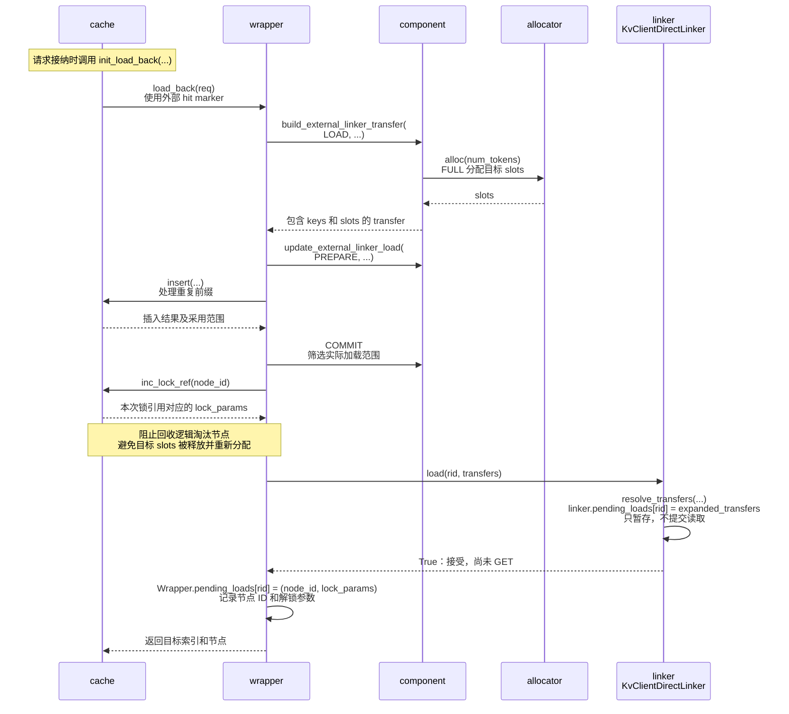

两个 `pending_loads` 用途不同：Wrapper 记录 `rid → (node_id, lock_params)`，供完成后查找并解除本次保护；linker 保存待启动的物理池传输描述，供后续组成 batch 放入 load_queue。字典本身不建立锁保护，保护由 `inc_lock_ref()` 建立。阶段 A 结束时，最终 GPU 指针尚未解析，也尚未提交 GET。`load_back()` 返回后，调度器继续选择请求，不是在这个调用内部直接进入逐层读取。

**阶段 B：调度器创建 new_batch 后，统一启动后台加载。**

**小例子：两个请求共用一个加载批次。** `linker.pending_loads` 是一个字典，不是每个请求各建一个字典；请求 A、B 分别是其中两个条目。DSA 展开后，每个请求的列表中包含 KV / Indexer 两个物理池任务：

```python
# 示意结构，实际列表元素为 PoolTransfer，索引为 tensor。
linker.pending_loads = {
    "req_A": [A_kv_transfer, A_indexer_transfer],
    "req_B": [B_kv_transfer, B_indexer_transfer],
}

pending = linker.pending_loads
linker.pending_loads = {}  # 后续新任务写入新的待启动字典
index = linker.layer_done_counter.update_producer()
# 记录当前设备 stream 的 ready_event 后：
linker.load_queue.put((index, pending, ready_event))
```

这里的 `index` 是 **counter 为本批加载分配的编号**，用于关联这一批的逐层 Futures；不是请求 rid、GPU slot 或 SDK TaskId。上例只有一个加载批次、一个 index，包含两个请求。计算侧通过 `set_consumer(index)` 选择该批次，再通过 `wait_until(layer)` 等待对应层。

后台负责逐层 GET，不需要上层按层反复调用 `load()`。每层汇集这批请求的 KV / Indexer ranges，调用一次 `storage.get_async(ranges)`。后台先提交本批全部层，记录各层 TaskId，再按层号 Wait 并校验结果。确认本层两池成功且设备可见后，调用 `counter.complete(index, layer)`：

```text
同一批 pending = {req_A: [...], req_B: [...]}
  → 第 0 层：读取 A + B 所需的 KV / Indexer → 放行本批第 0 层计算
  → 第 1 层：读取 A + B 所需的 KV / Indexer → 放行本批第 1 层计算
  → ……直到本 worker / pool group 的全部必要层
  → 发布本批完成请求 IDs：[req_A, req_B]
```

PoolTransfer 指定页和 slots，不单独指定层范围，因此默认恢复这些页在当前 worker / pool group 全部必要层的数据；有 PP 时不代表每个 worker 都读取整个模型。某层加载完成即可计算该层，不必等全批所有层结束。

实际公共入口为 `Scheduler → cache.ready_to_load_host_cache() → wrapper.start_layer_wise_loading() → linker.start_layer_wise_loading()`。为控制图宽，下面从后端入口画起。

启动方法摘取当前暂存任务，为本批分配 counter index 和逐层 Futures，在调用侧当前设备 stream 记录 `ready_event`，再将任务交给加载线程。加载线程等待该事件，确认前序设备准备完成后启动 GET。index 沿调用链返回并保存到模型 batch，具体到某层的数据可读状态由该层 Future 通知。


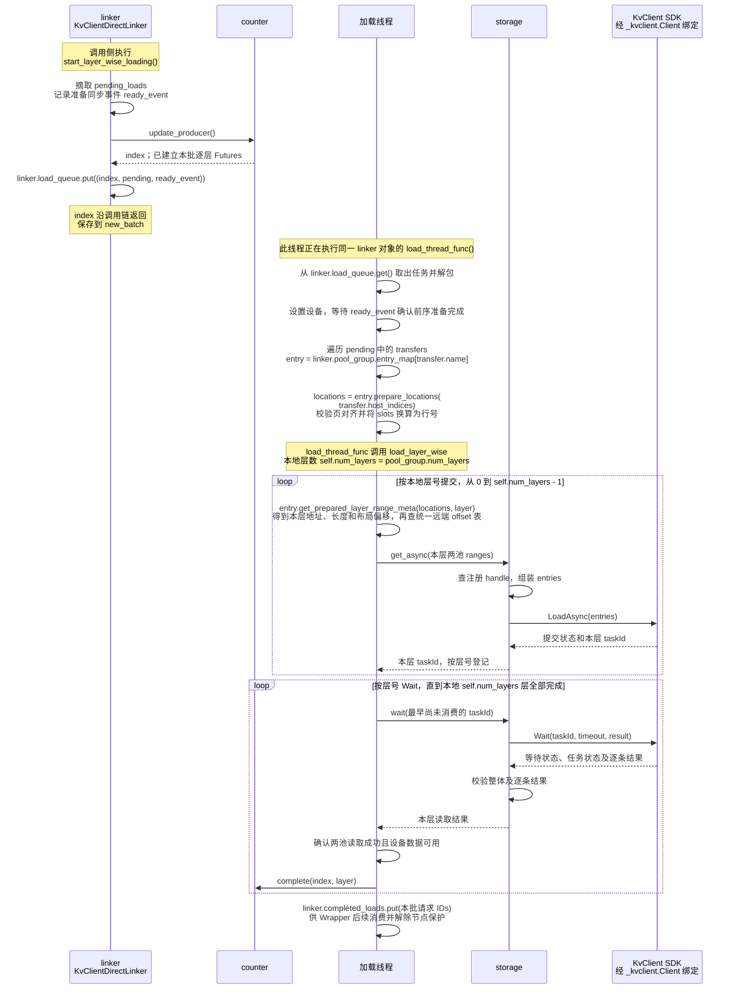

加载线程执行同一个 Linker 对象的加载方法，依次调用 `get_async()`、`wait()` 和 `complete()`。加载线程先提交本批全部层的 LoadAsync，再按层号 Wait，确认本层两池成功且设备可见后推进 Future。

**阶段 C：计算侧通过共享 counter 等待本层数据，调度侧另行处理树侧收尾。**

该阶段与阶段 B 的后台读取交错。TP worker 在 forward 前设置一次 counter index，选中本批的逐层状态。attention 调用 get_kv_buffer(layer_id) 时，getter 用层号等待这批中对应层的 Future，就绪后返回 GPU buffer。DSA 的 Indexer getter 也使用同一个 counter。

计算侧用 `wait_until()` 等待对应层的 Future。加载线程确认该层读取成功且设备可见后，通过 `complete(index, layer)` 将 Future 标记为就绪。

```text
计算侧                              加载线程
wait_until(0)                       读取第 0 层
  → Future.result() 等待                ↓
                                    complete(index, 0)
  ← Future 就绪，等待结束 ←──────────────┘
继续第 0 层计算
```

如果调用 `wait_until()` 时该层已经完成，就直接返回；否则等加载线程通知。`complete()` 不执行 GET，也不解除节点锁。

加载线程负责消费 SDK TaskId 的 Wait，计算侧只等待层 Future，不对同一个 TaskId 再次 Wait。Future 成功就绪必须表示本层数据已可读；读取失败则给尚未完成的 Future 设置异常，唤醒等待方。

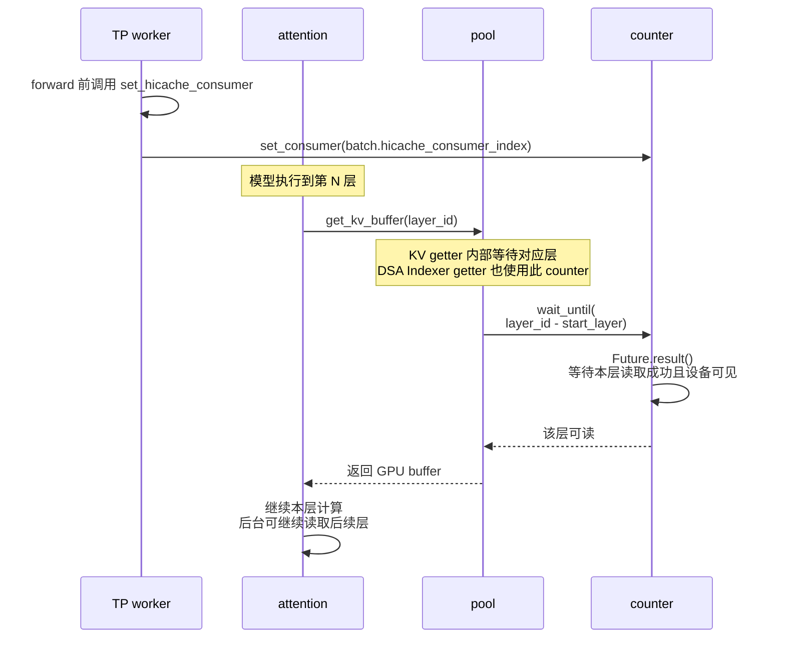

全部层加载结束后，加载线程发布请求 IDs 完成通知。调度侧通过 `cache.check_hicache_events()` 协调各 rank 可收尾数量，再由 Wrapper 消费通知并解除保护：

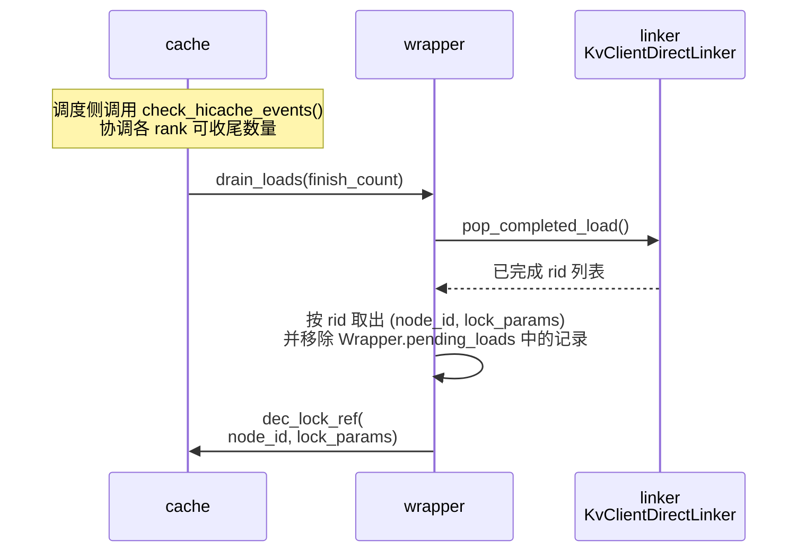

**节点不是 slot。** 树节点记录前缀与设备 slot 索引的关联，实际 KV 数据存放在设备 pool。inc_lock_ref 增加节点锁引用，使缓存回收逻辑不能淘汰相关受保护节点，从而避免把目标 slots 归还 allocator 后重新分配；KV pool 本身不决定淘汰哪个树节点。

**Wrapper.pending_loads 不负责加锁，只保存对应关系。** 后端返回完成 rid，Wrapper 根据该 rid 找到 node_id 和 lock_params，再调用 Cache.dec_lock_ref 解除这次加载保护。这是 UnifiedRadixCache 与 Linker 在加载生命周期上的衔接；后端只执行传输，不直接操作树节点锁。若 load 拒绝或抛异常，Wrapper 撤销刚增加的锁引用，不保留本次 pending 记录。

节点锁防止 slots 被回收复用，层 Future 防止计算提前读取，两者用途不同。解除加载保护不等于立刻释放 slots，数据仍用于推理和后续前缀复用。

| 时点 | 含义 |
| --- | --- |
| `load()` 返回 True | 后端接受任务，尚未读取 |
| `start_layer_wise_loading()` 返回 index | 本批读取已交付后台，尚未证明数据可用 |
| 某层 Future 成功就绪 | 本设计要求该层两池读取成功且设备可见 |
| Wrapper 消费完成通知并解锁 | 本次树侧加载保护已解除，不代表释放 slots |

启动由调度侧选好本轮 batch 后触发，不是等队列攒够数量自动启动。失败必须唤醒等待方并传播异常，不能发布成功 rid；未确认 IO 安全结束时，不能提前解除资源保护。

### 7.1 逐层 GET 的提交与等待

加载线程先提交本批全部层，再按层调用 Wait。每层的 KV 和 Indexer ranges 合并到同一次 LoadAsync，取得一个 TaskId。

```python
# load_layer_wise()，伪代码，省略失败收尾。
task_ids = []
for layer in range(self.num_layers):
    ranges = build_layer_ranges(layer, kv_transfers, indexer_transfers)
    task_ids.append(storage.get_async(ranges))  # 每层一次 LoadAsync

for layer, task_id in enumerate(task_ids):
    result = storage.wait(task_id)
    check_result_and_device_visibility(result)
    layer_done_counter.complete(counter_index, layer)
```

两个循环都处理本批的本地层。先按 self.num_layers 提交，每层取得一个 TaskId。全部提交成功后从第 0 层开始等待，哪一层确认可读就放行哪一层。

build_layer_ranges、check_result_and_device_visibility 为说明步骤的伪代码；实现时使用公共 Entry 布局解析及第 4 节统一偏移表。

例如，本批读取 60 层时，会提交 60 次 LoadAsync，并按对应的 TaskId 调用 60 次 Wait。第 0 层确认可读后，模型可以开始计算，同时后续层的 GET 可以继续执行。

**为什么不把全部层放进一次 LoadAsync？** 现有接口只返回该任务的一个 TaskId，Wait 获取整个任务的完成结果，没有暴露任务内部的逐层完成进度。整模型只提交一个任务，不能依赖该接口逐层放行。

提交或读取失败时，通知未放行的层，已提交的任务安全收尾后再解除节点保护。

## 8. PUT：逐层保存与树侧卸载确认

逐层模式由 `LayerwiseSaver` 把各层保存任务交给 Linker，树侧 offload 确认已有 receipts。关闭 `layerwise_save` 后，树侧 offload 直接发起普通 PUT。

| 路径 | 触发入口 | 主要作用 |
| --- | --- | --- |
| 实际逐层保存 | Scheduler 准备保存计划 → `LayerwiseSaver.save_layer(layer_id)` | 本层写入提交后入队，后台与前向并行写出，整批收尾后发布 receipt |
| 树侧卸载确认 | BackupKV → Wrapper.offload_nodes → linker.offload | 核对页 receipts，跨 rank 登记外部副本 |

### 8.1 逐层保存：按层入队，PUT 与前向重叠

**前向前登记保存计划。** 在 KvClient 的逐层 PUT 设计中，`Scheduler.run_batch(batch)` 先调用 `resolve_forward_inputs(batch, self.future_map)`，再直接调用 `Wrapper.prepare_layerwise_save(batch)`。Wrapper 选完整页、构造 `PoolTransfer` 并保护源 slots。跨 chunk 填满的页从 `req_to_token` 取完整 slots。Linker 调用 `resolve_transfers()` 展开 KV 和 Indexer 两池。

Linker 调用 `saver.update_producer()` 取得本批的 `save_index`，将展开后的 transfers 和预期本地层登记到 `save_plans[save_index]`，并持有本批稳定的页 key 和 slot 索引，供后台准备时使用。Linker 同时登记本批页共享的 receipt Future，用来报告整批保存结果。Scheduler 将返回的编号写入 `batch.save_index`，然后把同一个 `ScheduleBatch` 传给 `forward_batch_generation(batch)`。本轮无页待存时，`batch.save_index` 为 `-1`。TP worker 在 `model_runner.forward()` 前用这个编号设置 saver 的 `consumer_index`，将当前模型前向与保存计划关联起来。

#### LayerwiseSaver 的用法

**每批只分配一个 `save_index`。** `save_index` 是 `save_plans` 的查找键。Saver 的两个字段都从 `-1` 开始，分别记录分配进度和当前 forward 的选择。

- `producer_index` 记录最近分配到哪个编号。Linker 调用 `saver.update_producer()` 时，saver 递增此字段并返回新编号。
- `consumer_index` 记录当前 forward 使用哪个编号。TP worker 在 forward 前把 `batch.save_index` 写入此字段。普通 DSA forward 的 KV setter 只传层号 `N`，`save_layer(N)` 从 `consumer_index` 取出本批编号，将 `(save_index, N, ready_event)` 入队。

逐层 PUT 设计中，`layerwise_saver` 和 `save_plans` 都是 Linker 的字段。假设 A 批分到 `7`，B 批已分到 `8`，当前执行的是 A 批。

```text
KvClientDirectLinker
  layerwise_saver（LayerwiseSaver）
    producer_index = 8   # 最近分配的是 B 批
    consumer_index = 7   # 当前 forward 使用 A 批
  save_plans = {
    7: A 批的保存计划,
    8: B 批的保存计划,
  }
```

setter 调用 `save_layer(N)` 时，saver 从 `consumer_index` 取出 `7`，将 `(7, N, ready_event)` 入队。卸载线程拿到任务后，用任务里的 `7` 查 `save_plans[7]`。随后提交该层的 `StoreAsync()`，用 SDK 返回的 `task_id` 调用 `Wait(task_id)` 确认这次写入。

```text
Scheduler.run_batch(batch_A)
  1. resolve_forward_inputs(batch_A)
     准备 A 批的模型输入。
  2. prepare_layerwise_save(batch_A)
     选完整页、保护源 slots，展开 KV 和 Indexer 两池。
     登记 save_plans[7]，把 7 写入 batch_A.save_index。
  3. forward_batch_generation(batch_A)
     把同一个 batch 交给 TP worker。

TP worker
  4. set_consumer(batch_A.save_index)
     选中 A 批的保存计划，consumer_index = 7。
  5. model_runner.forward(...)
     从这里开始执行模型前向。

模型前向执行到第 N 层
  6. 提交本层 Indexer 和 KV 的 GPU 写入。
  7. save_layer(N) 取出编号 7，记录 ready_event。
     将 (7, N, ready_event) 入队，前向继续往下执行。

卸载线程
  8. 取出任务，用 7 找保存计划，等待 ready_event。
  9. 首次处理 A 批时调用 _prepare()，缓存页 key 和行号。
 10. 用 N 算本层两池的地址，提交 StoreAsync()。
```

普通和 overlap Scheduler 在同一个 TP worker 上串行调用 Python forward。A 退出后，TP worker 清空 `consumer_index`，再在 B 的 forward 前将它设为 `8`。即使 A 的后台保存仍在进行，卸载线程也会用 A 的任务入队时携带的 `7` 查 `save_plans[7]`。

**图 A　Scheduler 在 forward 前准备保存计划**

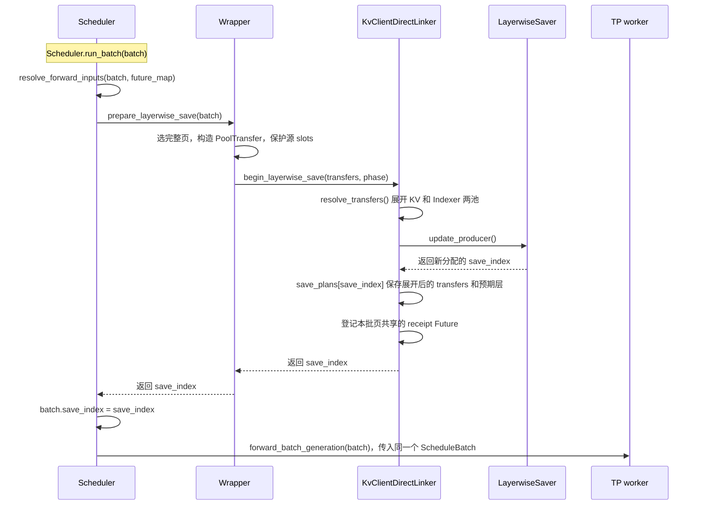

**图 B　算到一层就入队，后台可以与下一层计算重叠**

```mermaid
sequenceDiagram
    participant D as TP worker / DSA backend
    participant P as DSA KV pool
    participant S as LayerwiseSaver
    participant W as Linker 卸载线程
    participant K as KvClient

    D->>S: forward 前 set_consumer(batch.save_index)
    Note over D,P: 前向阶段，写本地 GPU 缓存
    D->>P: 提交 Indexer key 和 scale 写入本地第 N 层 index_k_with_scale_buffer
    D->>P: set_mla_kv_buffer() 提交 MLA KV 写入本地第 N 层 kv_buffer
    P->>S: 两池写入均已提交，setter 调用一次 save_layer(N)
    S->>S: 从 consumer_index 取出本批 save_index
    S->>S: 创建 ready_event，调用 ready_event.record(stream)
    S-)W: offload_queue 入队 (save_index, N, ready_event)
    S-->>P: 入队后返回
    P-->>D: setter 返回
    D->>D: 前向继续执行，进入第 N+1 层
    Note over W,K: 后台阶段，从本地两块 GPU buffer 卸载到 ASU
    W->>W: 取出任务，查 save_plans[save_index]
    W->>W: ready_event.synchronize()，确认两池源数据均可读
    opt 首次处理该 save_index 的层任务
        W->>W: _prepare(plan.transfers)，缓存两池的页 key 和行号
    end
    W->>W: _layer_ranges(prepared, N)，计算本层两池 ranges
    W->>K: 一次 StoreAsync 提交两池 ranges，同页共用 key，各片段使用自己的 offset
    K-->>W: 返回本层 task_id
```

图 B 适用于经过该 setter 的普通 DSA forward。KV setter 在 Indexer 和 KV 的本地写入均已提交后调用一次 `save_layer(N)`。两次写入在同一条 stream 时，`save_layer(N)` 在该 stream 上调用 `ready_event.record(stream)`。若写入分属不同 stream，记录事件的 stream 要先依赖两次写入。然后 saver 将事件对象与批次号、层号一起入队。若计划中的 slot 索引在 GPU 上，事件依赖还需覆盖这些索引的准备，使后台等待事件后能安全地将索引转到 CPU。Breakable CUDA Graph 的触发点见第 8.6 节。

卸载线程按队列里的 `save_index` 查计划，并调用 `ready_event.synchronize()`。首次处理该批的层任务时，调用一次 `_prepare()`，将两池的页 key 和行号缓存到计划中，后续层直接复用。每层用 `_layer_ranges(prepared, layer_id)` 生成本层两池的 GPU 地址、长度和远端 offset，再提交 `StoreAsync()`。地址计算见第 4.2 节。各批的已提交层和 `task_id` 分别记录在各自的保存计划中。

**图 C　前向退出和后台收尾独立进行**

```mermaid
sequenceDiagram
    participant T as TP worker
    participant V as LayerwiseSaver
    participant S as Scheduler / Wrapper
    participant L as Linker / 卸载线程
    participant K as KvClient

    par 前向退出
        T->>V: set_consumer(-1)，清空本次 forward 的选择
        T-->>S: 返回 forward 结果
        S->>L: 按 save_index 登记 forward 结果
    and 后台写入收尾
        Note over L,K: 本轮最后一个预期层的 PUT 已提交
        loop 本轮尚未确认的每个 task_id
            L->>K: Wait(task_id)
            K-->>L: 本层 PUT 结果
        end
        L->>L: 汇总各层 PUT 结果
    end

    L->>L: 前向结果和写入结果齐全，发布 receipt
    S->>L: Wrapper 读取本批 receipt
    L-->>S: 返回本批保存结果
    S->>S: 跨 rank 确认，解除源页保护并清理记录
```

forward 退出后，计划仍保留到本批的写入确认结束。forward 正常返回且各层 PUT 成功时，receipt 才报告成功。复制布局中，由 owner 提交 Store，其余 rank 参加跨 rank 确认。

forward 失败、未进入 forward 或缺少预期层时，Scheduler 通知后台收尾。后台排空已提交的 PUT，确认 IO 安全结束后发布失败 receipt，由 Wrapper 解除源页保护。

### 8.2 保存结果如何登记到缓存树

上一节解决“把数据存出去”；本节解决“让缓存树知道这些页是否已经存好”。**此处不再次 PUT。**

逐层 PUT 为每次保存准备一个 `completion` Future，作为这批页共享的 receipt，供 Wrapper 轮询。每层用 `ready_event` 确认源数据可读，用 `Wait(task_id)` 确认写入结果。前向结果已知且已提交的 PUT 全部安全收尾后，才给整批 Future 设置成功或失败。

```mermaid
flowchart TB
    A[模型逐层保存<br/>见第 8.1 节] --> B[后台等待全部 PUT 收尾<br/>receipt 得到保存结果]
    C[缓存树要求确认外部副本<br/>BackupKV 动作] --> D[Wrapper 调用 linker.offload<br/>按页找到已有 receipt]
    B --> E[后台确认任务检查 receipt]
    D --> E
    E --> F[调度侧汇总各 rank 结果]
    F --> G[Wrapper 更新树状态<br/>成功才标记已有外部副本]
```

BackupKV 是树侧的“保存/确认外部副本”指令。当前逐层模式已提前发起保存，所以 linker.offload 只排队确认已有 receipt；receipt 尚未就绪则等待，缺失或失败则返回确认失败，不重写数据。

图中的两条路径可以时间重叠：树侧发起确认时，PUT 不一定已完成。ACK 在相关保存的最后一条层任务之后入队。若前向中途失败，则排在失败收尾通知之后。卸载线程先收尾 PUT，再处理对应 ACK。结果通过 offload_results 返回，由 Wrapper 按原顺序消费，跨 rank 一致成功后才登记外部副本。

### 8.3 三个时间点：数据就绪、保存完成、解除保护

| 时间点 | 谁确认 | 发生什么 |
| --- | --- | --- |
| 该层数据已产出 | worker 等该层 ready_event | 可以开始 PUT 这一层 |
| 全部写任务已收尾 | worker Wait，结合前向状态发布 receipt | 保存成功或失败已有结论 |
| 调度侧完成跨 rank 确认 | Wrapper 收尾 | 更新相应状态，解除本次保护 |

两条路径各有自己的保护：**实际逐层保存期间用源页 pin，树侧确认期间用节点锁。** 前者在 Wrapper 跨 rank 确认保存结果后解除，后者在 commit_completed_offloads 时解除；解除保护不代表立即释放 KV slots。

需要记住的异常规则：

- 某层失败，本次逐层保存失败；已提交 IO 仍要排空。
- Wait 超时不等于 IO 已停止，未确认安全结束前不能释放源页或注册内存。
- 远端 key 已存在不一定代表逐层数据完整，必须有可靠的完整发布保证，才能在下一次 lookup 中作为命中。

### 8.4 非逐层卸载：后台保存全部必要数据

`layerwise_save=False` 时，由树侧 offload 直接触发保存。以下只展示后端特有的保存路径；入口处构造 transfers、节点保护，以及结果返回后的跨 rank 确认和树状态更新，复用公共 Wrapper 流程。

普通 PUT 通过 `offload_queue` 传递任务。`offload_thread` 执行 `offload_thread_func()`，调用 `put_async() → wait()`，并将结果写入 `offload_results`。

```mermaid
sequenceDiagram
    participant W as 调用侧 Wrapper
    participant D as KvClientDirectLinker
    participant Q as offload_queue
    participant B as offload_thread<br/>offload_thread_func()
    participant S as KvClientStorage
    participant E as DevicePoolEntry<br/>初始化时已创建
    Note over W: 调用前已保护源节点，持有 node_id 与 lock_params
    W->>D: offload(transfers)
    D->>D: pool_group.resolve_transfers(transfers)<br/>展开 KV / Indexer 物理池任务
    D->>D: 在生产 stream 记录 ready_event
    D->>Q: put((OFFLOAD, transfers, ready_event))
    D-->>W: True，仅表示接受任务
    W->>W: 标记节点 offload pending<br/>pending_offloads.append(节点 ID、解锁参数、待更新节点列表)
    B->>Q: get()
    Q-->>B: OFFLOAD、transfers、ready_event
    B->>B: offload_thread_func 指定当前 GPU<br/>等待 ready_event，确认源数据已产出
    loop 遍历两池 transfers
        B->>B: entry = linker.pool_group.entry_map[transfer.name]
        B->>E: prepare_locations(transfer.host_indices)
        E-->>B: locations：源 slots 对应的行号
        loop 遍历本池全部必要层
            B->>E: get_prepared_layer_range_meta(locations, layer)
            E-->>B: 本层源地址、长度和布局偏移
            B->>B: 查统一远端 offset 表<br/>汇集到全部层 ranges
        end
    end
    B->>S: put_async(全部层 KV / Indexer ranges)
    S->>S: 经绑定调用一次 StoreAsync(entries, taskId)
    S-->>B: 一个 TaskId
    B->>S: wait(taskId)
    S->>S: 经绑定调用 Wait，检查整体及逐条结果
    S-->>B: 保存结果
    B->>D: offload_results.put(success)
    Note over W,D: 后续调度侧协调可消费数量与跨 rank 保存结果
    W->>D: pop_completed_offload()
    D-->>W: success，与 pending_offloads 中最早记录对应
    Note over W: 先获取本地结果，跨 rank 确认后再提交
    W->>W: commit_completed_offloads：按 FIFO 取 pending 记录<br/>更新节点状态并 dec_lock_ref
```

```text
offload(transfers)
  → 展开两池，记录 ready_event，排入 (OFFLOAD, transfers, ready_event)
  → offload_thread 执行 offload_thread_func，取任务并等待 ready_event
  → 解析全部必要层范围 → StoreAsync → Wait
  → 发布 offload_results，交回公共 Wrapper 收尾
```

**pending_offloads 在 Wrapper 中，不在 Linker 的工作队列中。** 它保存已接受卸载的树侧记录，offload_results 保存对应后台结果，两者按接受顺序匹配；结果为 False 也需在 IO 安全结束后收尾。取走 offload_results 的本地结果时尚不删除 pending 记录，跨 rank 确认后 commit_completed_offloads 才移除记录并解锁。

```text
Wrapper.pending_offloads： [节点 A 的保护记录, 节点 B 的保护记录]
Linker.offload_results：  [A 的结果 True,    B 的结果 False]
```
这里一次 StoreAsync 包含所有必要层，KvClient 内部按路由和协议限制拆分，向上仍返回一个 TaskId。任务规模必须满足 SDK 限制；超限应在规划阶段处理，不能丢条目。

offload_queue 由 KvClientDirectLinker 持有，但队列本身不是线程：调用侧执行 put，独立 offload_thread 在线程入口 offload_thread_func() 中执行 get 和后续 IO。

普通卸载使用已有来源 slots，不新分配目标 slots，返回 True 时也不释放来源 slots。ready_event 确认来源数据可读，Wait 确认保存完成；已提交后的失败需确认 IO 安全结束，超时未静默时保留保护并进入故障处理。

复制型 DSA 仅 owner 发起实际写入，其他 rank 参与公共结果确认。interleave prefill CP 的单写和结果确认见[第 13 节](#13-特殊场景与配置限制)。普通模式通过 OFFLOAD 任务直接返回保存结果。

### 8.5 普通卸载与逐层卸载对照

| 对比 | 非逐层：layerwise_save=False | 逐层：layerwise_save=True，默认 |
| --- | --- | --- |
| 实际 PUT 的入口 | 树侧 BackupKV / offload | 普通 forward 的 DSA pool setter 或 Graph 回放 hook 调用 saver.save_layer(layer_id) |
| 排入队列的任务 | OFFLOAD | 正常路径为 LAYER、ACK |
| 源数据就绪依赖 | 一次 offload 的 ready_event | 每层自己的 ready_event |
| StoreAsync 调用 | 全部必要层 entries 一次提交，一个 TaskId | 每层两池 entries 一次提交，每层一个 TaskId |
| 保存完成等待 | Wait 此次 offload 的 TaskId | 处理完预期层后 Wait 剩余 TaskId，结合前向状态发布 receipt |
| 树侧 offload 的作用 | 发起实际保存 | 确认已有 receipts，不重复 PUT |
| 来源保护 | 节点锁引用 | 实际保存的源页 pin，及树侧确认自己的节点锁 |
| 失败行为 | 报告普通保存失败 | receipt 失败，不自动切换普通模式重写 |

### 8.6 逐层模式的接入点

| 位置 | 接入要求 |
| --- | --- |
| registry.py | 启用逐层保存时，将同一个 LayerwiseSaver 注册给 DSA KV pool 和 TP worker |
| scheduler.py | `run_batch()` 在输入解析后、调用 TP worker 前准备保存，记录 forward 成功或失败 |
| Wrapper.prepare_layerwise_save | 复用完整页规划和 hash，构造 PoolTransfer 并 pin 源页，向 Linker 取得 save_index，登记收尾记录 |
| ScheduleBatch / tp_worker.py | forward 前用本轮 save_index 调用 saver.set_consumer，退出时清空 |
| dsa_backend.py / memory_pool.py | DSA pool 持有 saver，普通 forward 在 KV setter 内提交本层写入后调用 saver.save_layer(layer_id) |
| layerwise_kv_graph.py / prefill_cuda_graph_runner.py | Breakable CUDA Graph 回放时，由逐层 hook 调用同一个 LayerwiseSaver |
| offload_thread_func / Wrapper | worker 确认所有 PUT 结果，Wrapper 消费 receipt 并做跨 rank 收尾 |

**Breakable CUDA Graph 回放使用同一个 saver。** 回放循环在当前 Python forward 中直接执行逐层 host hook。在本层两池写入提交后，hook 调用 `saver.save_layer(layer_id)`，由 saver 读取 TP worker 已设置的 `consumer_index`。capture、warmup 以及 Graph 路径上的 setter 调用跳过保存，实际 replay 只由逐层 hook 触发。验收时检查每个预期层恰好入队一次，以及 `ready_event` 覆盖两池写入。

## 9. 完成通知与 slot 生命周期

```mermaid
flowchart LR
    A[分配 slot 并保护节点] --> B[读取 KV]
    B --> C[每层两池就绪后完成该层 counter]
    C --> D[全部层结束后完成队列写入 rid]
    D --> E[Wrapper 消费通知并解除保护]
    E --> F[KV 仍在 slot 中用于推理或复用]
    F --> G[后续满足淘汰条件]
    G --> H[真正释放 slot]
```

| 通知 | 用途 |
| --- | --- |
| layer_done_counter | 计算何时可以使用加载的数据 |
| completed_loads | 调度侧何时可以处理加载收尾、解除节点保护 |
| num_completed_loads | 尚未消费的完成 batch 数量，不是 rid 数或空闲 slot 数 |

## 10. 后端需要实现的方法与底层调用

| 方法 | 后端行为 | KvClient 调用 |
| --- | --- | --- |
| 构造函数 | 解析 pool、初始化、注册、创建线程 | Init、RegisterRegions |
| lookup | 查询连续可恢复页 | QueryAsync、Wait |
| load | 保存到后端 pending_loads | 无 |
| start_layer_wise_loading | 摘取 pending，给加载线程排队 | 由线程执行 LoadAsync、Wait |
| load_thread_func | 加载线程入口，取批次、等 ready_event、调用 load_layer_wise，成功后发布 rid | IO 由 load_layer_wise 调用 |
| load_layer_wise | 先提交本批全部层 GET，再按层等待并推进 counter；失败时排空已提交任务 | LoadAsync、Wait |
| cancel_queued_load | 仅未启动且可安全回滚时允许取消，否则 False | 无原生取消接口 |
| num_completed_loads / pop_completed_load | 查看/消费完成 rid batch | 无 |
| begin_layerwise_save / get_layerwise_receipts | 每批展开 PoolTransfer 并准备地址计算所需的位置，按 save_index 登记保存计划及页 receipt | 层任务由卸载线程执行 StoreAsync、Wait |
| LayerwiseSaver.update_producer / set_consumer / save_layer | 分配并选中保存批次，按层记录 ready_event 并将编号、层号和 event 入队 | 后台按批次与层号准备两池 ranges，再异步写入 |
| 逐层保存收尾 | worker 处理完预期层后汇总结果，Wrapper 消费 receipt 并释放源页 pin | Wait 剩余写任务 |
| offload | 逐层模式排队 ACK；普通模式排队 OFFLOAD | 普通模式 StoreAsync、Wait；逐层确认不新增 Store |
| offload_thread_func | 卸载线程入口，执行队列中的普通保存、逐层保存或确认任务，发布对应结果 | 按任务类型调用 StoreAsync、Wait |
| num_completed_offloads / pop_completed_offload | 查看/消费写出结果 | 无 |
| reset | 停止接收、排空并清理本地状态，再恢复接收 | 按需等待活动任务 |
| close | 停止接收并排空任务，向两个工作队列送入 `None` 通知线程退出，再注销内存并关闭客户端 | UnregisterRegions、Shutdown |

绑定接口包括 register_regions、query_async、load_async、store_async、check、wait、unregister_regions 和 shutdown。保留提交状态、Wait 返回状态、TaskResult.status 和逐条结果，阻塞调用释放 GIL。

## 11. SDK 调用与异常处理

| ASU 函数 | 本设计如何对应 |
| --- | --- |
| Setup / BuildKvClientConfig | LoadFromFile → CreateKvClient → Init |
| RegisterKVCaches / FindPersistentHandle | 注册 allocation，按 IO 子区间查覆盖 handle |
| MakeAsuKey | make_cache_key(page_key)，不默认复用 ASU 哈希算法 |
| BuildTensorOffsets / BuildKvBuffers | 同页 key、多条 addr/size/offset 描述符 |
| Submit | LoadAsync 或 StoreAsync，取得 TaskId |
| Query / WaitForTask | Wait 消费结果并检查状态 |

| 情况 | 处理 |
| --- | --- |
| Queue 满、任务尚未接受 | offload 返回 False；加载启动失败不得丢 pending 或遗留无人处理的 counter |
| 子任务部分提交失败 | 排空已经提交的任务，整次逻辑传输失败 |
| Load 失败 | counter 携带异常，调度侧能观察 fatal error，不发布成功 rid |
| Wait 超时 | TaskId 已被消费，不重复 Wait；未证明 IO 静默前不释放 buffer、MR 或 slot |
| Check 返回 True | 只对本地登记的有效 task 使用；未知 task 也可能返回 True |
| close/reset | 先确认 IO 静默，再回收资源；异常时不能机械注销 MR |

同一客户端允许并发查询、加载和卸载，以及完成结果保证设备可见，均需在 SDK 上确认。若不支持并发调用，增加统一原生提交入口调度，不能用持锁阻塞 Wait 的方式阻断其他任务。

## 12. 接入文件和第一版验收

| 文件 / 位置 | 改动 |
| --- | --- |
| mem_cache/storage/kvclient/kvclient_direct_linker.py | 后端、LayerwiseSaver、make_cache_key、队列和线程 |
| mem_cache/storage/kvclient/kvclient_storage.py | KvClientStorage，支持注入 fake client |
| mem_cache/memory_pool.py | DSA pool 注册 LayerwiseSaver，在 set_mla_kv_buffer 内提交 KV 写入后调用 save_layer(layer_id) |
| model_executor/runner_utils/layerwise_kv_graph.py / model_executor/runner/prefill_cuda_graph_runner.py | 接通 KvClient 逐层保存的回放 hook |
| managers/scheduler.py | 在 forward 输入确定后准备逐层保存，记录 forward 结果 |
| managers/tp_worker.py / ScheduleBatch | 从调度批次取保存编号，在 forward 前设置 saver 的 consumer_index |
| mem_cache/unified_cache/unified_cache_linker.py | 接通保存记录、pin、receipt 和 TP 收尾 |
| SDK 侧 bindings/python/kvclient_pybind.cc | _kvclient 模块、Client 对象和 SDK 类型转换 |
| mem_cache/registry.py | 增加 kvclient 后端构造分支 |
| arg_groups/fields/memory.py 及字段顺序 | 增加后端 choice 和客户端配置入口 |

表中 SGLang 路径相对 `python/sglang/srt/`，SDK 绑定路径相对 `kv_semantics/`。启用 external linker 后，用 `--unified-cache-external-linker-backend kvclient` 选择 KvClient，用 `--kvclient-config-path` 提供客户端配置。

```mermaid
flowchart LR
    A[确定性填充设备 KV] --> B[卸载并等待成功]
    B --> C[清空或换一组本地 slot]
    C --> D[lookup 验证页命中]
    D --> E[load 读回并等待门控]
    E --> F[逐字节比较所有层 K/V]
    F --> G[注入部分失败和超时<br/>验证不误命中、不提前解锁]
```

第一版交付前重点确认：整页分段写入的查询可见性、设备/provider 支持与对齐、超时后排空语义。验收必须观察到加载第 l+1 层与计算第 l 层重叠，以及计算第 l+1 层与保存第 l 层重叠；记录层 event、提交、完成及 receipt 就绪时间。不能只用整批读写正确性替代逐层验证。

## 13. 特殊场景与配置限制

### 13.1 Interleave prefill CP 的 CP0 写入规则

普通 interleave prefill CP 将 token 计算分配给多个 CP rank。KV 和 Indexer 经 CP all-gather 后，每个 rank 都有同一逻辑页的完整数据。各 rank 以同一个 namespace 和页 key 访问同一个 ASU 对象，设备 buffer 地址和 MR handle 仍属于各自的 rank。

启用了 interleave prefill CP、`attn_cp_size > 1` 且设备池为复制布局时，只有同时满足 `attn_tp_rank == 0` 和 `attn_cp_rank == 0` 的 rank 调用 `StoreAsync`。这两个编号都是组内编号。例如，总 TP=4、attention DP=1、CP=2 时，两个 attention TP 组分别是 `[0, 1]` 和 `[2, 3]`。rank 0 和 rank 2 都是各自 attention TP 组的 rank 0，其中 rank 0 同时是 CP rank 0，因此由它写出。

所有 rank 按相同顺序处理普通 offload。owner 等待 SDK 返回真实写入结果，其余 rank 由 `offload_thread_func()` 在相同的队列位置返回 `True`，表示本 rank 无需写入。调度侧先对可消费结果数取 `MIN`，只取出各 rank 均已完成的 FIFO 前缀，再对这些布尔结果取 `MIN`。owner 在确认 IO 安全结束后报告 `False` 时，各 rank 都以失败收尾，Wrapper 据此更新树状态并解除节点保护。无法确认 IO 安全结束时，按第 11 节的故障规则保留保护。

### 13.2 按 CP rank 拆分 DSA 缓存层

`--enable-dsa-cache-layer-split` 按模型层切分本地缓存。例如 78 层、CP=2 时，CP rank 0 持有前 39 层，CP rank 1 持有后 39 层。第 13.1 节的普通 interleave prefill CP 则分配 token 的计算，各 rank 最终持有全部层的缓存。

由于按层拆分后 CP0 无法单独写出一页的全部层，当前 KvClient 在初始化时拒绝 `--enable-dsa-cache-layer-split`。支持该场景需要明确各 rank 写哪些层，并在所有分片写完后才发布整页完成结果。

### 13.3 同一批 IO 的页 key 复用

KvClient 的 `_prepare()` 为当前 GET 或 PUT 批次建立临时的 `page_key → CacheKey` 映射。每个不同的 `page_key` 只调用一次 `make_cache_key()`。KV、Indexer 和同批引用该页的其他请求共享编码结果，各层继续沿用已经准备好的 key 列表。

复用的范围是 key 编码结果。每个 transfer 仍保留原有页顺序和目标或源 slots，同一页出现在多个 slots 时会分别生成 IO 描述符。两池的地址、长度和远端 offset 各自从布局取得，提交给 ASU 的 8 字节 key 沿用第 4.1 节的编码规则。

### 13.4 两池共享 CPU slot 索引，各层共享行号

**两池共享的是行号换算的输入。** 在一个 GET 或 PUT 批次中，`_prepare()` 按原始 slot tensor 的对象身份保存 CPU 上的 `int64` 副本。同一份 GPU slot tensor 只搬到 CPU 一次。KV 和 Indexer 各调用一次自己的 `prepare_locations()`，消费同一份 CPU 索引并分别换算行号。Entry 内部接到已经在 CPU 上的 `int64` 索引时，`.to()` 不再搬运数据。

**同一池的各层共享的是换算出来的行号。** 以 `page_size=64`、slots `[128, ..., 191]` 为例，KV 得到行号 `[128]`，Indexer 得到 `[2]`。KV 的各层都从 `128` 开始，Indexer 的各层都用第 `2` 行。`_layer_ranges()` 仍用每层自己的 buffer 基址和步长计算 GPU 地址。

```text
GPU slots [128, ..., 191]
  → _prepare() 搬到 CPU 一次
  ├─ KV Entry.prepare_locations()      → [128]，供 KV 各层复用
  └─ Indexer Entry.prepare_locations() → [2]，供 Indexer 各层复用
```

GET 使用刚分配的目标 slots，普通 PUT 使用缓存节点已有的源 slots，逐层 PUT 使用准备阶段选定的完整页源 slots。各路径都在逐层计算 GPU 地址之前完成这两步。

### 13.5 GET 的 LayerWiseLoadCounter 与 PUT 的 LayerwiseSaver

对象结构和批次查找示例见 [GET 批次与逐层 Future 的结构](#get-批次与逐层-future-的结构)和 [LayerwiseSaver 的用法](#layerwisesaver-的用法)。

| 对比项 | GET · `LayerWiseLoadCounter`（现有实现） | PUT · `LayerwiseSaver`（设计） |
| --- | --- | --- |
| 对象职责 | 持有批次编号和逐层 Future，供模型等待数据可读 | 持有保存侧的 producer_index 和 consumer_index，按层入队。保存计划、TaskId 和整批 receipt 由 Linker 管理 |
| 初始化 | Linker 创建 counter，将同一实例注册给 pool 和 TP worker。`producer_index` 和 `consumer_index` 都是 `-1`，`futures = {}` | Linker 创建 saver，registry 将同一实例注册给 DSA pool 和 TP worker。`producer_index` 和 `consumer_index` 都从 `-1` 开始 |
| 分配批次号（producer） | Linker 通过 `update_producer()` 先递增 `producer_index` 再分号，为该批创建每层一个 Future | Linker 登记保存计划时调用 saver 的 `update_producer()`，递增并取出本批 `save_index` |
| 模型侧如何选择批次 | TP worker 用 `ScheduleBatch.hicache_consumer_index` 设置 counter 的 `consumer_index` | TP worker 用 `ScheduleBatch.save_index` 设置 saver 的 `consumer_index` |
| 到第 N 层时做什么 | 读 KV buffer 前调用 `wait_until(N)`，等待 `futures[consumer_index][N]` | DSA pool 在 setter 内提交 KV 写入后调用 `save_layer(N)`。saver 读取 `consumer_index`，记录覆盖两池的 `ready_event`，把编号、层号和 event 一起入队 |
| 后台如何确认 | 用队列里的批次号执行 GET，本层数据可读后调用 `complete(index, N)`，放行模型 | 用队列里的 `save_index` 查保存计划，等本层 event 就绪后提交 `StoreAsync()`。通过 `Wait(task_id)` 确认每层写入 |
| 结束时如何处理 | 模型等完最后一层后，counter 移除本批的逐层 Future。加载线程在全批成功后通知 Wrapper | forward 退出时清空 saver 的 `consumer_index`。后台继续用任务里的编号写出，前向和写入结果齐全后完成整批 receipt Future |

GET 和 PUT 各自分配批次号。GET 每层有一个 Future，供模型等该层可读。PUT 每层记录 `ready_event`，供卸载线程等 GPU 源数据可读。KvClient 的 `Wait(task_id)` 确认该层写入结果。整批只建一个 receipt Future，前向正常结束且全部预期层写入成功时才发布成功。
