# OceanDisk PC 适配：代码架构与流程讲解

本文用于向代码读者讲解当前 OceanDisk 前缀缓存（Prefix Cache，PC）适配：它如何接入 UnifiedRadixCache、如何把 GPU slot 转成 I/O 地址，以及 DirectLinker 与 Storage 怎样协作。范围为普通 PC 路径，包含 PC 使用的逐层保存；不展开 P/D 交接、通知或后台 handoff 流程。

阅读顺序按讲解安排：问题与分层 → 类关系 → 初始化 → 数据描述与地址 → EXISTS / GET / PUT → 生命周期 → 新后端扩展。

## 1. 开场：这份适配代码解决什么问题

模型计算得到的 KV 位于 GPU 内存池。GPU 容量有限，希望把可复用的完整缓存页保存到 OceanDisk；后续请求命中相同 token 前缀时，直接读回 GPU，减少重复计算。

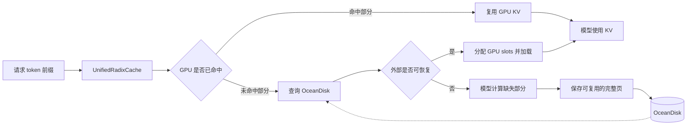

这条适配路径连接 GPU KV pool 与外部存储，没有中间 CPU host cache tier。CPU 仍处理 hash、索引、队列与 metadata；处理这些信息不等于 KV payload 经过 CPU 缓存。

讲解时先区分两件事：**缓存树决定要恢复或保存什么，并保护内存生命周期；后端负责把任务变成实际 I/O，并报告完成。**

## 2. 五层架构：从树到原生存储接口

先用最简单的话区分：

- **`UnifiedRadixCache`：管缓存。** 哪些前缀已缓存、放在哪里、什么时候可以回收。
- **`UnifiedCacheLinkerWrapper`：帮它组织外部存取。** 哪些数据要从 OceanDisk 等后端加载或保存，传输期间保护节点，完成后更新状态。

**Cache 是缓存管理者，Wrapper 是它对接外部存储的助手。** 不启用外部 linker 时，Cache 也能管理 GPU 前缀缓存；启用后才挂接 Wrapper，复用 Cache 的树和内存管理能力。Wrapper 没有自己的另一棵缓存树。

例如一次从 OD 恢复缓存，Wrapper 组织的流程是：

```text
分配 slots → 插入树 → 保护节点 → 调用 OD → 完成后解除保护
```

Wrapper 通过 component 和已有分配器协调 slots 分配，通过 Cache 操作树和节点锁，再调用 OD 后端，最后消费完成通知并解除保护。它负责把这些步骤串起来；其中调用 OD 的 `load()` 先暂存任务，实际 GET 由后续启动方法发起。

| 层 | 当前主要对象 | 职责 |
| --- | --- | --- |
| 缓存树与内存管理 | `UnifiedRadixCache`、components、GPU KV allocator | 前缀匹配、slot 分配、树插入、节点回收保护、跨 rank 状态协调 |
| 树侧编排 | `UnifiedCacheLinkerWrapper` | 构造 PoolTransfer，管理命中标记、在途任务、节点锁与树侧结果提交 |
| 后端传输适配 | `OceanDiskDirectLinker` | 实现 UC Linker 契约；组织 key、物理池、地址、逐层传输、队列和 receipts |
| 公共 GPU 布局工具 | `DevicePoolGroup`、`DevicePoolEntry` | 展开逻辑池，描述已有 buffer，转换 slot、层与内存布局 |
| 存储执行适配 | `OceanDiskStorage`、`ConnectionRouter` | 注册内存、路由 connection、打包原生 metadata、调用 GIDS 并同步事件 |

下面是**调用关系图，不是 UML 类图**。实线箭头 `A → B` 只表示“A 调用/使用 B”，不表示继承、持有或数据一定沿箭头搬运。对象持有与继承关系看第 3 节。

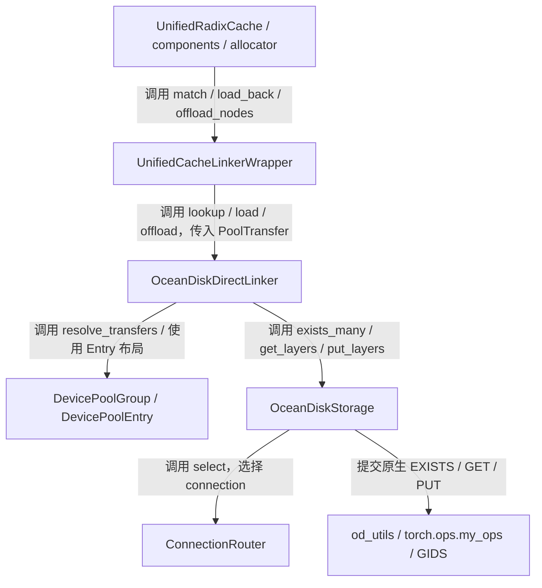

例如 `Wrapper → DirectLinker` 表示 Wrapper 调用后端的传输方法；`DirectLinker → Group / Entry` 表示后端使用公共池映射；`DirectLinker → Storage` 表示后端提交具体 I/O。Wrapper 反向调用 Cache 操作树的细节未在这张概览图逐条展开。

## 3. 类关系：继承、引用和依赖要分开讲

先用文本关系图讲清“谁持有谁”和“谁继承谁”。本图仅覆盖 PC 路径：

```text
持有与引用关系：
UnifiedRadixCache
  └─ 持有 UnifiedCacheLinkerWrapper（cache.linker）
       ├─ 引用 cache：操作同一棵树的节点、请求相关资源和锁引用
       └─ 持有 cache_linker：类型契约为 UnifiedCacheLinker
            └─ 实际对象为 OceanDiskDirectLinker

继承关系：
UnifiedCacheLinker（ABC，定义传输接口）
  └─ OceanDiskDirectLinker（实现 OceanDisk 传输）

OceanDiskDirectLinker
  ├─ 持有 DevicePoolGroup
  │    └─ 包含 DevicePoolEntry：已有 GPU buffer 的视图、地址和布局映射
  └─ 持有 OceanDiskStorage：GIDS I/O、内存注册及 connection 路由
```

讲解时先沿第一段找到对象：**Cache 持有 Wrapper，Wrapper 持有实际 OD 后端；OD 后端再使用池视图和 Storage。** 第二段单独表达继承：OD 后端遵守 UnifiedCacheLinker 契约；Wrapper 不继承这个接口。下面的 UML 类图用于进一步对照具体成员、方法和依赖，不要把持有关系读成一条继承链。

类图关系按用户指定的[华为云 CodeArts Modeling 类图说明](https://support.huaweicloud.com/usermanual-codeartsmodeling/modeling_ug_0003_2.html)分类，并用 Mermaid 表达。以下是本图实际采用的关系：

| UML 分类 | 本图符号 | 代码含义 |
| --- | --- | --- |
| Generalization（泛化） | 实线＋空心三角，三角指向父类 | `class OceanDiskDirectLinker(UnifiedCacheLinker)` |
| Association（关联） | 实线＋普通箭头，标注成员名 | `self.pool_group` 等成员引用；箭头表示单向可导航，不表示继承 |
| Usage（使用依赖） | 虚线＋普通箭头，标注 `«use»` | 方法接收或处理 PoolTransfer |
| Instantiate（实例化依赖） | 虚线＋普通箭头，标注 `«instantiate»` | 创建 PoolTransfer 实例 |

图中关联采用单向可导航画法；链接中的双向关联示例是不带方向箭头的实线。两者属于同一关联分类。成员引用不足以证明严格整体/部分生命周期，因此不额外画聚合或组合。后端实际继承 Python ABC，使用泛化，不画类实现 Interface 的 Realization（实现）关系。

`UnifiedCacheLinker` 在 Python 中是 ABC，因此画成抽象类的继承关系。图只列讲解所需的主要成员和方法。

读图时直接对照这四条：

- **泛化**：实线＋空心三角。
- **关联**：实线＋普通箭头，标注成员名。
- **使用依赖**：虚线箭头＋`«use»`。
- **实例化依赖**：虚线箭头＋`«instantiate»`。

为便于展示，拆成两张类图：图 A 纵向展示树侧与后端关系，图 B 横向展示 OD 内部适配。每张只保留当前讲解所需的主要成员。两图中的 `OceanDiskDirectLinker` 是同一个类。

**图 A：Cache 如何通过 Wrapper 使用后端。**

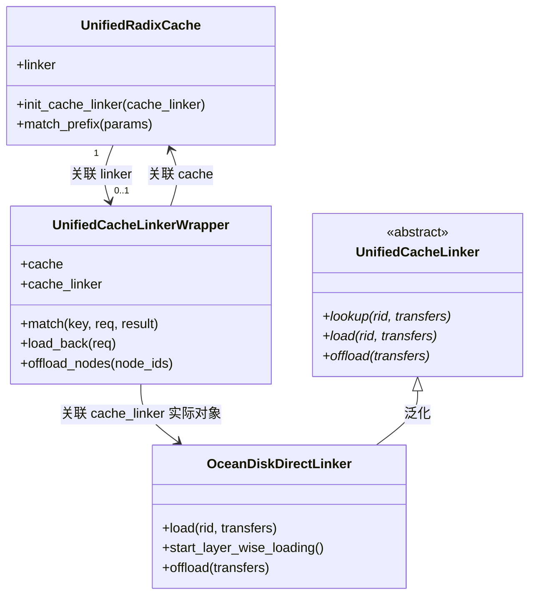

图 A 以 OD 场景展示关联的实际对象：Wrapper 的 `cache_linker` 类型契约仍是 `UnifiedCacheLinker`，此处指向其实际持有的 `OceanDiskDirectLinker`。抽象接口作为另一条分支通过泛化连接 OD，避免把“持有接口类型”和“继承接口”排成一条长链。为保持图面紧凑，PoolTransfer 不再单列节点：Wrapper 创建它属于 `«instantiate»` 实例化依赖，OD 接收并处理它属于 `«use»` 使用依赖。

**图 B：OD 后端如何使用池视图和存储执行层。**

OD 类框中同时列出队列、线程和 worker 方法，以明确它们属于同一个后端对象。`_load_thread` 的 target 是 `self._load_worker`，`_offload_thread` 的 target 是 `self._offload_worker`；线程不是另外一个 linker 对象。下划线成员在图中用 `-` 表达内部使用约定，Python 不强制 UML private 访问权限。

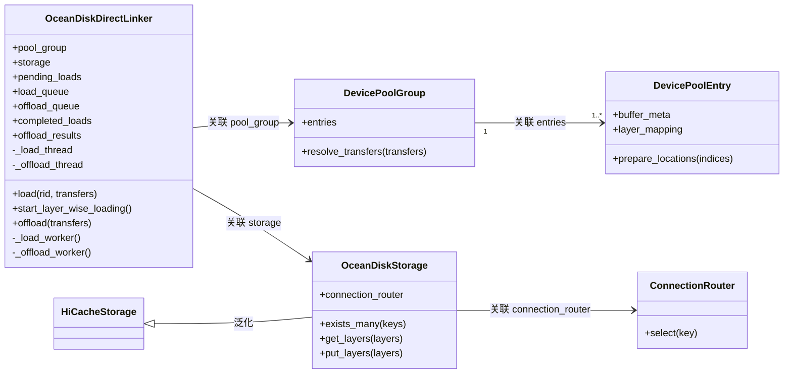

注意：Storage 虽继承 `HiCacheStorage`，当前这份适配实际支持的是 UC range I/O。`get()`、`batch_get()`、`set()` 等传统 host-cache 接口会明确报不支持，不能据继承关系推断已接通 HiCache host 路径。

### 3.1 具体对象是谁

下面是对象关系伪代码，省略构造参数：

```python
cache = UnifiedRadixCache(...)
od = OceanDiskDirectLinker(...)
cache.init_cache_linker(od)

wrapper = cache.linker
assert wrapper.cache is cache
assert wrapper.cache_linker is od
```

**Wrapper 与 `UnifiedCacheLinker` 没有继承关系：Wrapper 持有后端，后端继承抽象接口。** Wrapper 构造参数的类型标注是 `UnifiedCacheLinker`，运行时实际传入的是 `OceanDiskDirectLinker` 等具体对象，没有另外创建一个抽象接口对象。

Wrapper 调用 `self.cache_linker.load(...)` 时，执行的是实际后端的方法。传入 OD 就走 OD，传入 Mooncake 就走 Mooncake，因此树侧编排可以复用。

所以 `cache.linker.load_back(req)` 是 Wrapper 的树侧组织流程；内部调用的 `cache.linker.cache_linker.load(rid, transfers)` 才是 OD 后端的排队接口。

Wrapper 引用的 cache 就是原来的对象，没有复制缓存树。它通过这个引用协调树插入、GPU slots 和锁引用；OD 和 Storage 不需要各自保存另一棵树。

## 4. 初始化：先建立布局视图，再接入执行链

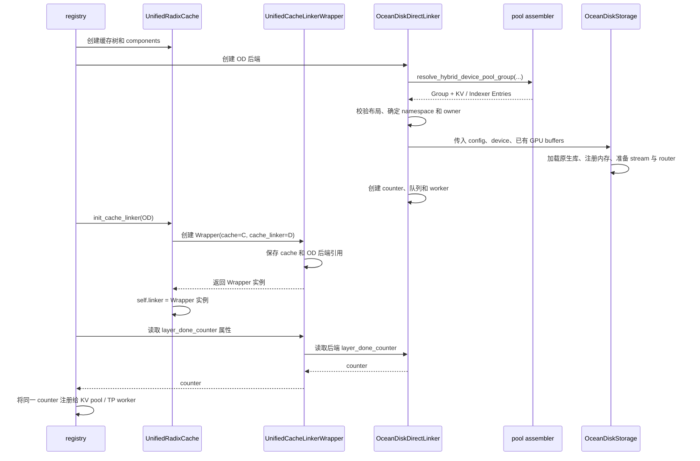

### 4.1 OD 构造时，assembler 到底做什么？

**assembler 把 SGLang 已有 GPU 内存池的布局，整理成 linker 能使用的 Group / Entry。** 它是布局适配与组装代码，不是另一套 KV 分配器，也不负责连接 OceanDisk。

OD 构造函数中的实际入口：

```python
self.pool_group = resolve_hybrid_device_pool_group(
    kvcache=params.token_to_kv_pool_allocator.get_kvcache(),
    page_size=params.page_size,
    params=params,
    components=components,
)
self.pools = self.pool_group.entry_map
self.num_layers = self.pool_group.num_layers
```

`resolve_hybrid_device_pool_group()` 定义在 `hybrid_cache/linker_pool_assembler.py`。它调用 `hybrid_pool_assembler.py` 的 `_select_strategy()`，按 GPU pool 类型和 components 选择策略，再调用该策略的 `build_direct_linker_pool_group()`。当前 DSA 策略进入 `_build_dsa_device_pool_group()`。

| 初始化步骤 | 具体做什么 | 结果由谁使用 |
| --- | --- | --- |
| 获取已有 GPU pool | 从 allocator 取得 kvcache，其中已有各层 GPU tensors | assembler 读取其布局 |
| 选择策略 | 匹配 pool 类型与 tree components，判断是否有 direct-linker 适配 | 决定用哪个构建函数 |
| 创建 Entries | DSA 中创建 KV、Indexer Entry，引用已有 buffers；记录层映射、行步长、大小和索引来源 | 后端用于解释 slots 和构造地址 |
| 组成 Group | 记录物理池列表、名称映射、来源关系、页大小、层数及复制属性 | OD 保存到 `self.pool_group` |
| OD 校验并缓存布局 | `_validate_dsa_layout()` 检查 OD 的支持范围，并预计算 GET 布局与存储对齐 offset | 后续 `_get_transfer_layers()` 使用 |
| 创建 Storage | OD 将 Entry 引用的 buffers 交给 Storage，注册对应底层 GPU allocations | 原生 I/O 使用注册内存描述 |

在 DSA 例子中，assembler 记录 KV 是 token 行、Indexer 是 page 行，且两池都以逻辑 KV 任务为索引来源。它不复制一份 KV payload，不为本次请求分配目标 slots，也不执行 GET / PUT。

初始化结束后，OD 持有 Group / Entry，后续传输直接使用这些对象：`resolve_transfers()` 展开任务；`prepare_locations()` 解释索引；GET 启动时再结合缓存布局计算本次 GPU 地址。具体过程见第 5.3 节。

这也是新增模型布局的适配入口：已有 GPU pool 能存数据，不等于 external linker 已能传它；还需要对应 strategy 实现 `build_direct_linker_pool_group()`，具体后端也必须接受该布局。

### 4.2 ODLinker 在什么时候接到 Cache 上？

在创建缓存树的初始化阶段，`registry.py` 按配置选择 `OceanDiskDirectLinker`，创建实例，然后调用 `cache.init_cache_linker(od)`。省略其他分支后的等价示意代码如下：

```python
cache = UnifiedRadixCache(params)
linker_cls = OceanDiskDirectLinker  # backend 配置为 oceandisk
od = linker_cls(server_args, params, components=set(cache.components))
cache.init_cache_linker(od)
```

`init_cache_linker()` 内部就是：

```python
self.linker = UnifiedCacheLinkerWrapper(self, cache_linker)
```

执行后：

```text
cache
  └─ linker → Wrapper
                 ├─ cache → 原来的 cache
                 └─ cache_linker → 刚创建的 od
```

因此，“注册 ODLinker”实际是选择类、创建对象，再通过 Wrapper 保存引用，没有单独的 `register_odlinker()`。

最后的 counter 注册是另一件事：取出这个 OD 对象的 `layer_done_counter`，注册给 GPU KV pool 和 TP worker，把模型执行侧的逐层等待机制接通。它不是再次创建或挂接 OD 对象，也不会在初始化时直接执行 GET。

### 4.3 开关与初始化关注点

入口为 `mem_cache/registry.py` 的 `_create_unified_radix_cache()`，选择参数是：

```text
--enable-unified-cache-external-linker
--unified-cache-external-linker-backend oceandisk
```

当前参数校验与 hierarchical cache 互斥，也不接受同时指定 `--hicache-storage-backend`。

初始化时重点讲四件事：

1. **复用已有 GPU buffers**：assembler 构建的是布局视图，不另建一份 KV 副本。
2. **限制支持范围**：当前 OD 要求物理池恰好是 KV、Indexer，packed 布局，且各层与两池 fragment 数满足原生配对要求。公共工具支持的布局范围大于 OD 当前支持范围。
3. **配置存储身份与写入者**：namespace 默认来自 model path，也可配置；结合分页和并行拓扑构造 key 身份。复制布局可由指定 owner 写入，不能笼统认为每个 rank 都写一份。
4. **准备原生资源**：Storage 从底层 allocation 去重得到注册区域，加载扩展、读取 GIDS 配置，建立 GET/PUT streams 和 connection router。注册 KV buffers 不等于注册模型所有显存。

`layerwise_save` 在当前 OD 中默认是 True。开启时还校验 PP、CP 布局和 speculative decoding 等条件；模型层保存钩子的接线也有范围限制，不能只看到配置开启就认为任意模型都支持。

## 5. 数据如何逐步变成 I/O

### 5.1 PoolTransfer 是逻辑任务单，不包含算好的 GPU 地址

下面是示意值；真实索引使用 tensor：

```python
PoolTransfer(
    name=PoolName.KV,
    keys=["A", "B"],
    device_indices=slots_tensor,
)
# 假设 slots_tensor = [128,129,130,131, 256,257,258,259]
# page_size = 4：A 对应前四个 slots，B 对应后四个 slots
```

查询阶段没有目标 slots 也正常，因为查询只关心对象是否存在。slot 是内存池中的位置编号，分配器管理其使用权；它不是指针，也不是新分配的一份 CUDA tensor。

GPU KV 分配器属于 SGLang 内存管理，正常计算也使用它。Wrapper 通过 cache 与 component 协调目标位置；OD 不自行挑选空闲 slots。

### 5.2 DSA 布局：KV 按 token 行，Indexer 按 page 行

| 物理池 | Entry 设置 | 同一页起始 slot=128、page_size=4 时 |
| --- | --- | --- |
| KV | `rows_are_pages=False` | 行号 128，连续 4 个 token 行 |
| Indexer | `rows_are_pages=True` | 行号 32，一行是一页 Indexer 数据 |

两者都按页传输，但 GPU buffer 的一行不一定是一页。每个池、每一层有自己的 buffer base 和行步长：

```text
KV 地址      = 该层 KV base      + 128 × KV token 行步长
Indexer 地址 = 该层 Indexer base +  32 × Indexer page 行步长
```

同一个 slot 在不同层、不同池对应不同地址，所以传给存储接口前必须结合具体布局寻址。这个转换只计算位置，不搬数据。

Mooncake 在相同 DSA 路径也调用同一个 assembler，得到相同的两种布局。这由 GPU buffer 决定，不是 OD 协议独有的规则；其他模型需要按实际 strategy 判断。

### 5.3 从任务单到 GPU 地址：按三个时点理解

先看当前 OD GET 的完整转换链：

```text
load() 阶段：
  Group.resolve_transfers()
    一份逻辑 KV 任务 → KV、Indexer 等物理池任务
        ↓
  pending_loads：暂存任务，此时保存的仍是 slots，不是 GPU 地址
        ↓ 后续由调度器触发 start_layer_wise_loading()

启动加载阶段：
  _get_transfer_layers() 内部：
    Entry.prepare_locations()   slots → 各池的行号
        ↓
    base + 行号 × stride        各层 buffer 布局 + 行号 → GPU 地址
        ↓
  Storage.get_layers()           按地址、大小、key 和 offset 组织并执行 GET
```

这里 `prepare_locations()` 和最终地址计算都发生在 `_get_transfer_layers()` 内部；`resolve_transfers()` 则在前面的 `load()` 阶段执行。初始化时构建的 Group / Entry 和缓存布局，为这条链提供映射规则。

**初始化时记住布局，`load()` 时展开并暂存任务，启动加载时才算本次 GPU 地址。** 下面始终以 DSA 的一页 A 为例，假设 `page_size=4`，树侧已分配 slots `[128,129,130,131]`。

#### 第一步：初始化时，建立池视图并记住布局

OD 构造函数调用 assembler 的 `resolve_hybrid_device_pool_group()`，得到 Group 和 KV、Indexer 两个 Entry：

```text
DevicePoolGroup
  ├─ KV Entry：引用已有 KV buffers，记录 token 行布局
  └─ Indexer Entry：引用已有 Indexer buffers，记录 page 行布局
```

Entry 描述各层 buffer 的起始地址、行步长、数据大小和层映射。OD 的 `_validate_dsa_layout()` 校验布局，并缓存为 `_get_pool_layouts`，供后续 GET 使用。此时只知道 buffer 怎样组织，还没有结合本次请求的 slots 计算目标地址；每次 GET 不需要重建 Group / Entry。

#### 第二步：load() 时，把一份逻辑任务展开成两份并暂存

`load()` 调用公共的 `DevicePoolGroup.resolve_transfers()`：

```text
输入：逻辑 KV 任务，读 A 页 → slots [128,129,130,131]
                  ↓ resolve_transfers()
输出：KV 池任务，     读 A 页 → slots [128,129,130,131]
      Indexer 池任务，读 A 页 → slots [128,129,130,131]
                  ↓
      pending_loads[rid] = 这两份任务
```

因为恢复 A 页既需要 KV，也需要配套的 Indexer 数据，所以为两个物理池各生成一份任务。**这里的 slots 数值不变，变化的是任务对应的池；尚未变成 GPU 地址，也未执行 GET。**

Group 支持按需调用 Entry 的 index mapper，但当前 DSA 例子的重点是任务展开。输出仍是 `PoolTransfer`；转换后的索引使用历史字段 `host_indices` 保存，它不是指针，也不意味着数据经过 CPU host cache。

#### 第三步：启动加载时，结合 slots 计算每层地址

`start_layer_wise_loading()` 取出 `pending_loads`，调用 OD 的 `_get_transfer_layers()`：

```text
                         prepare_locations()       使用缓存布局计算
KV 任务 slots 128～131      → token 行号 128    → KV base + 128 × KV 行步长
Indexer 任务 slots 128～131 → page 行号 32      → Indexer base + 32 × Indexer 行步长
```

上面的计算对各传输层分别进行，因为每层的 buffer base 和布局可能不同。OD 用 NumPy 广播批量计算 `base + locations × stride`，生成含 key、GPU pointer、size、storage offset 的逐层 I/O 描述，再交给 `Storage.get_layers()` 提交读取。

讲解这三步时，可以直接用下面的对照：

| 时点 | 此时有什么 |
| --- | --- |
| 初始化完成 | 池视图与各层布局 |
| `load()` 完成 | 页 A 对应的 KV、Indexer 任务及目标 slots |
| 启动加载并构造 I/O 描述 | 本次各池各层的具体 GPU 地址、长度和存储偏移 |

#### 哪些是公共能力，哪些是 OD 的实现？

**Mooncake 在同一 DSA 路径也使用这个 assembler、Group 和 Entry，也需要先展开任务再根据布局寻址。** 上面“启动方法中用 `_get_transfer_layers()` 向量化算地址”是当前 OD GET 的具体实现；Mooncake 在加载 worker 中使用 Entry 的地址元数据方法。

OD 普通 PUT / 逐层保存则经 `_transfer_layers()`、`_page_fragments()` 等路径构造描述，同样基于 Entry 布局；它们的触发时机见第 8 节。

### 5.4 从逻辑页到原生 metadata 的四步

| 阶段 | 主要结果 |
| --- | --- |
| Wrapper | 页 hash、逻辑池、GPU slots |
| Group / Entry 与 DirectLinker | 物理池、各层地址与大小、最终 object key、存储范围 offset |
| Storage | MR id、MR 内偏移、connection、原生 metadata |
| 原生接口 | 按上述描述执行 EXISTS / GET / PUT |

当前 OD 同一页在各层、KV 与 Indexer 使用同一个编码 key。两池以匹配的前后半区成对提交；不能把示意图理解成 KV、Indexer 必定各有一个不同 key。key 由 namespace 与 page hash 编码，GPU slot 不参与内容身份，因为 slot 会被回收重用。

存储范围按当前原生要求做 512 B 对齐映射。GPU 原始行步长、有效数据大小、远端 padded offset 是不同概念，不能用一个“页大小”替代全部参数。

Storage 将 GPU pointer 映射为注册区域 MR id 和区域内偏移，再选择 connection。`ConnectionRouter` 用 DPU hash ring 定位目标组，并在对应连接集合内选择连接；同一对 KV / Indexer 范围使用配对 connection。

## 6. EXISTS：外部命中流程

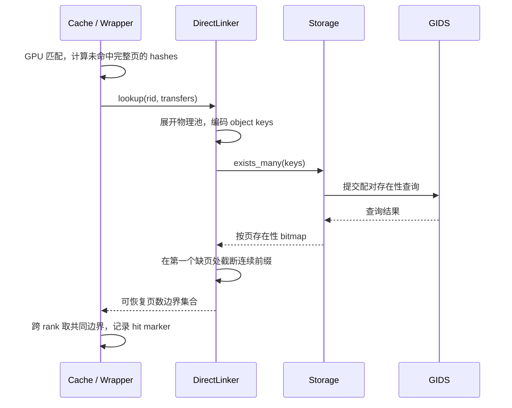

当前 OD 返回 `1..end` 的连续候选页数。公共 UC 接口更一般：允许其他组件场景产生稀疏候选集合，Wrapper 对各 rank 做集合交集，再选最长共同边界。

特殊共享 interleave CP 配置下，代码可能由模型 TP 组 rank 1 实际查询，其他 rank 提供配合归约的候选范围；该分支查询异常按 miss 处理。这是特定拓扑优化，不是所有部署都由 rank 1 查询。

命中只表示可以恢复，尚未 GET，也没有分配目标 slots。返回的 `host_hit_length` 是借用调度字段，不代表 host cache。

## 7. GET：从外部命中到模型安全读取

先明确图里的对象，下面三个阶段使用相同别名，不把 Cache、Wrapper、pool 合并成一个参与者：

| 图中名称 | 实际对象或执行线程 |
| --- | --- |
| cache | `UnifiedRadixCache` 实例 |
| wrapper | `cache.linker`，即 `UnifiedCacheLinkerWrapper` 实例 |
| component | Cache 中的 FULL 等树组件；分配工作调用已有 allocator |
| od | `wrapper.cache_linker`，即 `OceanDiskDirectLinker` 实例 |
| storage | `od.storage`，即 `OceanDiskStorage` 实例 |
| counter | `od.layer_done_counter`；TP worker 和 KV pool 共享这个对象 |
| load thread | `od._load_thread`，执行同一 od 对象的 `_load_worker()`，不是另一份 linker |
| pool | 模型使用的 GPU KV pool；不是 DevicePoolGroup |

**阶段 A：单个请求准备恢复，OD 暂存任务。** 此处入口是请求接纳逻辑调用的 `cache.init_load_back()`。

此前前缀匹配已经发现 OceanDisk 有可恢复的页面，Wrapper 保存了该请求的 hit marker。调度器尝试接纳这个请求、需要恢复外部缓存时，Cache 将调用转给 `wrapper.load_back(req)`。

这一阶段先解决“读哪些页、放到哪里”：FULL component 根据页 hashes 调用分配器取得目标 GPU slots，再构造 `PoolTransfer`。**准备 slots 是分配可用的 GPU KV 存储位置；插入树是将“前缀 → slots”的映射登记到缓存树，两者都不会把外部 KV 数据读回来。** Wrapper 协调 components 完成插入，处理已有的重复前缀，并按插入结果筛选实际需要加载的页面和 slots；随后保护目标节点，避免加载期间内存被回收。数据真正读回后，计算侧还需通过逐层 events 确认就绪再读取。

最后，Wrapper 把任务交给 `od.load()`。OD 将逻辑任务展开为 KV、Indexer 物理池任务，存入 `pending_loads` 字典。**阶段 A 结束时，树侧目标位置与保护已安排，后端任务已暂存，但还没有发起 GET，也没有算出本次目标的最终 GPU 指针。** `load_back()` 随后返回，调度器继续自身流程；阶段 B 由后面的独立调用触发。

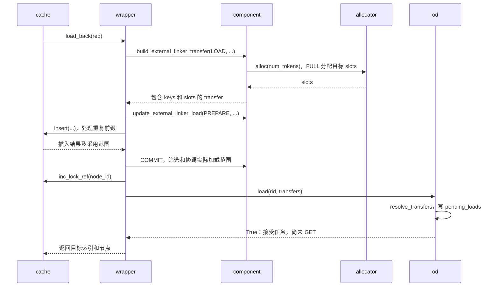

**阶段 B：调度器创建 new_batch 后启动加载。** 为控制图宽，下图从后端方法入口画起；实际调用仍是 `Scheduler → cache.ready_to_load_host_cache() → wrapper.start_layer_wise_loading() → od.start_layer_wise_loading()`。

请求选择循环结束且有可运行请求时，调度器创建 `new_batch`，在 `prepare_for_extend()` 之前执行上述启动调用。OD 一次取出当前 `pending_loads` 中的任务，可能包含一个或多个请求，为这批加载创建 index 和各层 Future，再结合 slots 与池布局生成具体 GPU 地址和 I/O 描述。

Storage 先提交第 0 层 GET，并把该层可等待的 events 通过回调发布到 counter；随后返回处理其余层的 continuation。OD 将它放入 `load_queue`，由独立加载线程执行后续提交和读取收尾。**启动方法返回 index，不等于所有层已经读完；这个 index 随模型 batch 传递，用于阶段 C 选定要等待的加载批次。** 后台线程收尾后还会发布请求 ID 完成通知，供树侧解除保护。

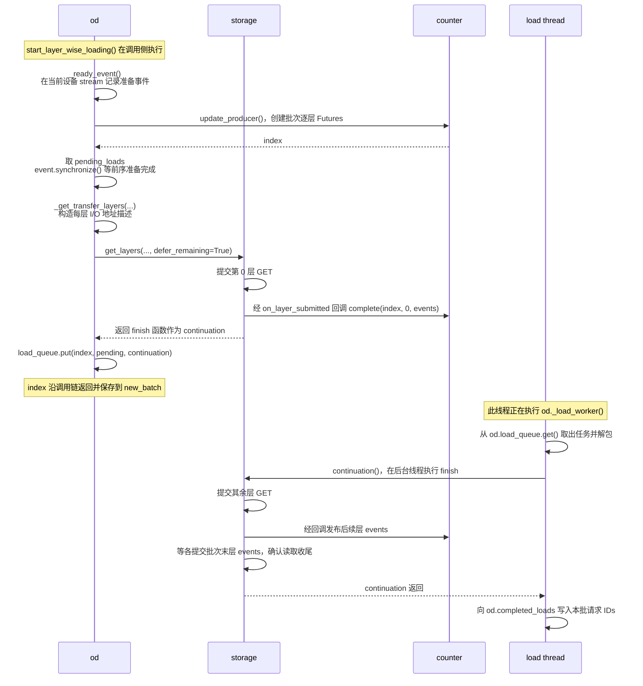

storage 和 counter 不是各自独立的线程；图中的调用由当前执行线程完成。阶段 B 的前半在启动加载的调用侧执行，continuation 部分在 load thread 执行。**load thread 正在执行的就是同一个 od 对象的 `_load_worker()`：取任务后直接调用 Storage 返回的 finish 函数，不需要再调用一次 OD 的 load 方法。** 图中的队列取出、解包和完成通知写入均画成该线程内部动作，队列仍是 od 的成员。

**阶段 C：计算侧获取 buffer，通过共享 counter 等待数据。** 该阶段可与后台读取交错，不是必须等阶段 B 全部结束才开始。

TP worker 在模型前向前，用 batch 保存的 index 调用 `counter.set_consumer(index)`，明确本次前向对应哪批加载。attention 需要某层历史 KV 时调用 pool getter，pool 不会立即返回 buffer，而是先进入同一个 counter 的 `wait_until(本地层号)`。

等待分两步：先从该层 Future 取得 events，若尚未发布就等发布；再同步这些 events，确认该层所需 GET 已完成。之后 getter 才返回 GPU buffer，attention 继续使用数据。**这一步保证“读取前数据已就绪”；阶段 B 的后台线程收尾和完成队列则保证“何时可以清理加载任务、解除内存保护”，两者用途不同。** 如果当前层已经就绪，等待会很快返回，不必再等后续所有层。

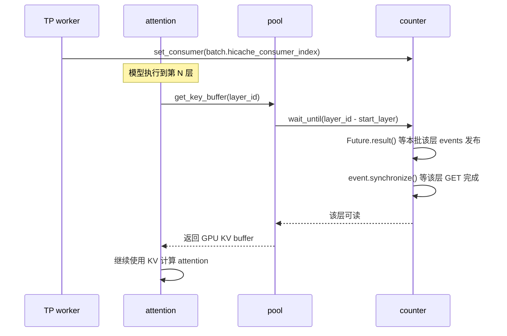

最后由调度侧的 `cache.check_hicache_events()` 协调各 rank 完成数量，调用 `wrapper.drain_loads()`；Wrapper 从 `od.pop_completed_load()` 取请求 IDs，再调用 `cache.dec_lock_ref()`。**加载线程只发布完成通知，操作树解锁的是 Wrapper。** Indexer buffer 有自己的 getter，最终也调用同一个 counter，详见第 7.5 节。

这里有三个不同的“完成”：

| 时点 | 能说明什么 |
| --- | --- |
| `load()` 返回 True | 任务被接受，还没证明数据可用 |
| 某层 Future 获得 events | 该层已有可等待事件，还没证明事件完成 |
| `wait_until(layer)` 同步 events 返回 | 该层所需物理 I/O 已满足可用条件 |

节点锁负责防回收；counter 和 events 负责防止提前读取。树节点先发布，并不表示其中 KV 已经可以使用。插入时遇到其他请求已补齐的重复前缀，会筛选实际采用范围，后端不能总是假设收到完整原始加载范围。

worker 处理结束后提供请求 ID 列表。`check_hicache_events()` 汇总各 rank 可消费的完成数量，再由 Wrapper 解锁。加载异常会传给尚未完成的层 Future；批次完成通知也承担清理作用，不能仅凭收到 ID 就推断 GET 成功可用。

### 7.1 代码讲解：load(rid, transfers) 为什么接收 PoolTransfer？

`rid` 只标识请求，`PoolTransfer` 才描述“读哪些页、放到哪些 GPU slots”。它包含池名 `name`、页 hash 列表 `keys` 和目标索引 `device_indices`，不包含 KV payload 或已经算好的 GPU 指针。参数为列表，是为了容纳多类逻辑池的传输任务。

例如 `page_size=4`，`keys=[A,B]` 对应索引 `[128,129,130,131,256,257,258,259]`：A 读到前四个 slots，B 读到后四个 slots。

```python
def load(self, rid: str, transfers: list[PoolTransfer]) -> bool:
    self._ensure_open()
    expanded = self.pool_group.resolve_transfers(
        transfers, allow_partial=True, allow_missing_kv=True
    )
    if not expanded:
        return False
    if rid in self.pending_loads:
        raise RuntimeError(f"OceanDisk load already queued for {rid!r}.")
    self.pending_loads[rid] = expanded
    return True
```

逐句解释：

1. `_ensure_open()` 检查后端没有关闭。
2. `resolve_transfers()` 根据已有 Group 的来源关系展开物理池任务并转换索引。DSA 的逻辑 KV 任务会展开到 KV、Indexer；这里不分配新 slots。
3. `allow_partial=True` 允许只提供部分来源池任务；`allow_missing_kv=True` 不强制要求本次含有非空 KV 任务，以容纳树侧去重后的部分加载。
4. 展开后无任务则返回 False；重复请求 ID 则报错，避免覆盖待加载任务。
5. `pending_loads[rid] = expanded` 保存的是任务描述；返回 True 只表示接受。

实际地址构造和 GET 在后续 `start_layer_wise_loading()` 中启动。因此讲这段时应说“接收并排队读取任务”，不是“此处已经把数据读入 GPU”。

### 7.2 调度时序：逐个请求收集，统一启动读取

**加载由调度器主动触发：本轮请求选好、`new_batch` 创建后，在 `prepare_for_extend()` 和模型前向之前启动。** 不是后台自动启动，也不是队列攒够某个数量后启动。

触发代码在 `managers/scheduler.py` 第 4034 行附近：

```python
if self.enable_hierarchical_cache or self.enable_unified_cache_external_linker:
    new_batch.hicache_consumer_index = (
        self.tree_cache.ready_to_load_host_cache()
    )

new_batch.prepare_for_extend()
```

执行 `ready_to_load_host_cache()` 时，就通过 Cache → Wrapper 调到后端的 `start_layer_wise_loading()`。返回的编号保存到模型 batch，用于前向时选择应等待的加载批次。

```text
本轮开始
  → 处理 A：外部命中，load(A) 暂存任务
  → 处理 B：外部命中，load(B) 暂存任务
  → 处理 C：无外部命中，不产生加载任务
  → 选好本轮请求 A、B、C，创建 new_batch
  → ★ ready_to_load_host_cache()：启动收集的 A、B 加载任务
  → prepare_for_extend()
  → 后续模型前向，使用 KV 前逐层等待
```

如果本轮没有待加载任务，这个入口仍可被调用；后端检查 `pending_loads` 为空，返回 `-1`，不发起 GET。概括为：**选请求时收集任务，批次选好后启动加载，模型前向时逐层等数据。**

`load_back()` 与 `start_layer_wise_loading()` 是同一轮模型批次准备过程中的两个阶段：

```text
此前：前缀匹配发现外部命中，Wrapper 保存 hit marker

组建本轮批次：
  尝试加入请求 A
    → schedule_policy：req.needs_host_load_back()
    → cache.init_load_back() → Wrapper.load_back(A)
    → 准备目标位置和节点保护 → OD.load(A)
    → pending_loads[A] = 任务描述

  尝试加入请求 B
    → 同样准备，必要时 pending_loads[B] = 任务描述

  完成请求选择并创建 new_batch
    → scheduler：tree_cache.ready_to_load_host_cache()
    → Wrapper → OD.start_layer_wise_loading()
    → 取出 pending_loads，换成空字典供下一批使用
    → 先提交第 0 层 GET
    → load_queue.put((counter index, 本批字典, continuation))
    → 返回 index，保存为 new_batch.hicache_consumer_index
    → prepare_for_extend()，后续执行模型前向

后台 load worker：
  load_queue.get() → 执行 continuation，处理后续层读取
```

因此，“尝试加入请求”以单个请求为单位准备加载；“启动加载的位置”以收集的待加载任务为批次统一启动。没有外部命中的请求也能参与模型批次，但不产生相应 GET。

`pending_loads` 是请求到任务的字典，不是 worker 队列。`load()` 只写这个字典；`start_layer_wise_loading()` 才向 `load_queue` 提交批次工作。当前 OD 和 Mooncake 都这样分阶段；区别是 Mooncake 将整批任务和 ready event 入队后由 worker 开始读取，OD 先提交第 0 层再将 continuation 入队。两者无待加载任务时均返回 `-1`。

两个后端都有 load / offload 两个主要工作队列，另外还有完成结果队列，不能把它们概括成“总共只有两个队列”。

讲解时可打开 `managers/schedule_policy.py` 中 `needs_host_load_back()` 附近，以及 `managers/scheduler.py` 中 `ready_to_load_host_cache()` 调用处，分别对应“逐个准备”和“统一启动”。这些 host 名称在当前路径只是复用已有调度接口。

### 7.3 连贯例子：A、B 两个请求从命中到 GET 完成

这个例子适合现场串讲。假设 A、B 都有 OceanDisk 外部命中，并且都能进入本轮模型批次。真实请求可能没有外部命中，或因资源预算不足暂不接纳，不一定每个请求都会产生 GET。

**第一步：调度器处理 A，先查询，再安排恢复。**

调度器调用 `req.init_next_round_input(tree_cache)`，内部进行前缀匹配：Cache 先查 GPU 树，Wrapper 再查询 GPU 未命中部分在 OceanDisk 是否存在；若有可恢复前缀，记录 A 的 hit marker，并把命中结果写回请求。

这里的 `init_next_round_input()` 是 **Req 对象的方法，用来为请求准备下一轮输入及前缀缓存匹配状态**，定义在 `managers/schedule_batch.py`。在当前 PC 流程中，重点看它如何选定本轮可匹配的 token 范围、调用 `tree_cache.match_prefix()`，并将匹配结果更新到请求的 `prefix_indices`、`last_node`、`host_hit_length` 等字段。Wrapper 的外部查询和 hit marker 记录，是在这次 `match_prefix()` 调用内部完成的。

**这个函数负责查清“已有多少缓存、还有多少可以从外部恢复”，不在这里为外部恢复分配目标 slots，也不调用 OD.load() 或启动 GET。** 它内部的查询流程是：

```text
req.init_next_round_input(tree_cache)
  → 准备本轮输入与匹配范围
  → cache.match_prefix()：GPU 匹配 + Wrapper 外部查询
  → 更新请求匹配状态；有外部命中时 Wrapper 保存 hit marker
  ← 返回
```

查询返回后，调度器调用 `adder.add_one_req(A, ...)` 尝试接纳 A。接纳流程检查条件，并在需要恢复时准备目标位置和加载任务：

```text
adder.add_one_req(A, ...)
  → 检查接纳条件，需要恢复时调用 cache.init_load_back()
      → Wrapper.load_back(A)
          → FULL component 调用 allocator 分配目标 GPU slots
          → 协调 components，插入树并筛选实际采用的页面
          → 增加目标节点锁引用
          → OD.load(A, transfers)
              → 展开 KV / Indexer 物理池任务
              → pending_loads[A] = A 的任务
```

`transfers` 说明“读取哪些页、放到哪些 slots”。到这里任务只是暂存，还没有 GET。

**第二步：调度器接着处理 B。**

B 同样先匹配、再判断是否接纳并安排恢复。如果也需要加载，此时字典是：

```text
pending_loads：
  A → A 的加载任务
  B → B 的加载任务
```

这些是 CPU 调度侧逐个处理请求的步骤，不是 A、B 各有一个线程同时执行匹配和分配。

**第三步：本轮请求选择完成，统一启动收集好的加载任务。**

调度器创建 `new_batch`，调用 `cache.ready_to_load_host_cache()`，通过 Wrapper 转入 OD 的 `start_layer_wise_loading()`：

```text
取出整个 pending_loads，换成空字典供下一批收集
  → 为本次加载创建 counter index
  → 汇总 A、B 的 transfers，生成各层 I/O 描述
  → 根据各池布局计算 pointer / size / storage offset
  → Storage 打包原生 metadata，先提交第 0 层 GET
  → load_queue.put((index, 本批 pending 字典, continuation))
  → 返回 index，保存到 new_batch.hicache_consumer_index
```

后台 load worker 从 `load_queue` 取出这个批次任务，执行 continuation，提交其余层并等待完成。`pending_loads` 是收集任务的字典，`load_queue` 是给 worker 的队列；不是每调用一次 `load()` 就立即向队列添加一个任务。

**A、B 的加载描述被合批组织，不保证两个请求的底层 GET 同时执行。** 原生层还可能拆分提交；实际重叠程度由 Storage 和原生实现决定。如果启动时只有 A，就只处理 A；如果没有待加载请求，则返回 `-1`。

**第四步：模型运行，逐层等待数据。**

模型使用某层 KV 前，通过该批次 counter 等待对应 Future，再同步该层 GET events。等待满足后才读取 KV / Indexer。启动方法不必同步等完所有层才让模型继续；逐层等待机制保证数据使用时机。

**第五步：批次加载结束，树侧解除保护。**

worker 完成处理后，将 A、B 的请求 ID 放入 `completed_loads`。后续 `check_hicache_events()` 跨 rank 协调完成数量，Wrapper 消费请求 ID 并减少对应节点锁引用。失败时还要通过 counter 传播错误，完成通知本身不代表数据一定成功可用。

讲解时可沿这条主线回顾各对象职责：

```text
逐个请求查命中
  → component / allocator 分配 slots，Cache / Wrapper 处理树和保护节点
  → OD.load() 暂存任务到 pending_loads
  → 调度器统一触发 start_layer_wise_loading()
  → OD 组织物理 I/O，Storage 提交 GET，worker 继续后续层
  → 模型逐层等待并使用 KV
  → Wrapper 消费完成通知，解除节点保护
```

### 7.4 讲解图：A、B 的加载与 attention 是什么关系？

假设 A、B 被调度进同一个模型 batch，且都需要恢复外部 KV。左边是缓存加载，右边是模型执行；加载启动后，模型按层等待相应数据，不必先等所有层全部加载完成。

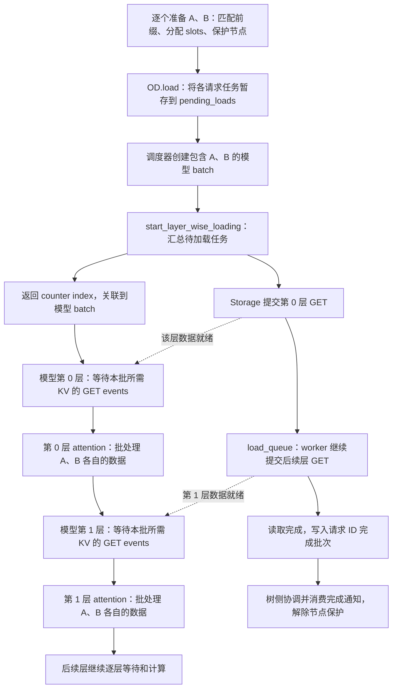

讲这张图时，强调以下区别：

- **模型 batch** 由调度器决定，表示 A、B 参与同一批模型执行；**加载批次** 汇总当前待恢复的任务，没有外部命中的请求不需要对应 GET。
- `start_layer_wise_loading()` 启动缓存读取，不直接调用 attention。counter index 把本次加载与模型消费时的等待关联起来。
- 模型使用第 N 层 KV 前，等待本批加载对应的第 N 层事件；不要求所有层先加载完。等待可能立即返回，也可能等待尚未完成的 I/O。
- A、B 在同一模型 batch 中接受 attention 处理，但仍是独立请求，使用各自的序列边界和 KV 映射，不会互相 attention 或混用 KV。
- “同一批处理”不等于两个独立线程在完全相同的时刻开始 attention；kernel 如何安排计算，由 attention 实现和 GPU 调度决定。底层 GET 也不因合批就保证同时执行。

可以用一句话讲清：**调度器把 A、B 组成模型 batch；后端启动所需 KV 的加载；模型逐层等数据、逐层计算，各请求的数据始终按自己的映射使用。**

### 7.5 OD 如何让计算侧知道数据就绪？谁在等待？

**ODLinker 创建一个 counter，TP worker 和 KV pool 保存同一个对象的引用。** 不是各自创建三个独立计数器：

```text
ODLinker.layer_done_counter ──────────────┐
TP worker.hicache_layer_transfer_counter ├─→ 同一个 counter 对象
KV pool.layer_transfer_counter ──────────┘
```

三方分工如下：

| 使用方 | 对共享 counter 做什么 |
| --- | --- |
| ODLinker / 加载侧 | 创建加载批次，为各层发布 GET events |
| TP worker | `set_consumer(index)`，选择本次模型前向应等待的加载批次 |
| KV pool | 返回某层 buffer 前调用 `wait_until(layer)`，等待该批该层可读 |

OD 调用 `Storage.get_layers()` 时传入回调：

```python
on_layer_submitted=lambda layer, events:
    self.layer_done_counter.complete(index, layer, events)
```

Storage 提交对应层 GET 后，通过回调把可等待的 events 放入 counter 的 Future：

```python
# counter.complete() 的核心操作
self.futures[index][layer].set_result(events)
```

计算侧访问 KV pool 的 getter 时，进入同一个 counter 的 `wait_until()`：

```python
events = futures[threshold].result()  # 等该层 events 被发布
for event in events:
    event.synchronize()             # 等对应 GET 完成
```

**当前这条路径是在计算侧 CPU 线程调用 `event.synchronize()` 等待，返回后才继续提交依赖这些 KV 的计算。** OD 不需要先同步等完这一层，再发一个“数据好了”的额外通知。它先交出 event，计算侧直接等待 event 完成；若一层有多个 I/O 批次，就要等对应 events 全部完成。Future 只负责交付 events 或异常，不能将 Future 完成误当作 GET 完成。

#### 独立加载线程为什么还要等？

ODLinker 初始化时还创建一个后台 CPU 加载线程：

```python
self._load_thread = threading.Thread(
    target=self._load_worker,
    daemon=True,
    name=f"oceandisk-load-tp{tp_rank}",
)
self._load_thread.start()
```

启动方法先提交第 0 层，再将后续 continuation 放入 `load_queue`。独立线程从队列取任务，执行 continuation，继续提交其余层，并等待该批读取收尾：

```text
计算侧 CPU 线程：
  pool getter → counter.wait_until(层号) → 等该层 events → 继续模型计算

后台加载 CPU 线程：
  load_queue.get() → continuation() → 提交其余层并等读取结束
    → completed_loads 写入本批请求 IDs

调度侧后续轮询：
  check_hicache_events() → Wrapper 消费完成通知 → 解除节点锁引用
```

这两类等待用途不同：

| 等待位置 | 目的 |
| --- | --- |
| 计算侧按层等待 event | 保证 attention 读取时，该层 KV / Indexer 已可用 |
| 后台加载线程等待读取收尾 | 保证在途 I/O 已处理完，可以通知树侧清理与解除保护 |

加载线程不直接操作缓存树解锁；它报告完成，由调度侧协调后交给 Wrapper。异常时完成队列也用于清理，加载错误仍需通过 counter 传给计算侧。真正的数据传输由原生 I/O 执行，Python 加载线程负责提交、等待和任务收尾，并非自己搬运 KV 字节。

## 8. PUT：默认逐层保存，以及普通保存模式

### 8.1 默认 PC 逐层保存：计算侧逐层提交任务，后台等数据就绪后保存

当前 OD 默认启用 `layerwise_save`。`registry.py` 在支持的模型条件下将 Wrapper 接到 TP worker；`tp_worker.py` 准备 forward session。计算侧 CPU 执行到该层 attention 的 Python 调用返回后，通过模型层钩子调用 saver。**这只表示计算侧程序走到了保存位置，不代表 GPU 已经执行完成，也不代表本层 KV / Indexer 已可供 PUT 读取。** 后台通过 ready event 确认源数据就绪后才提交 PUT。

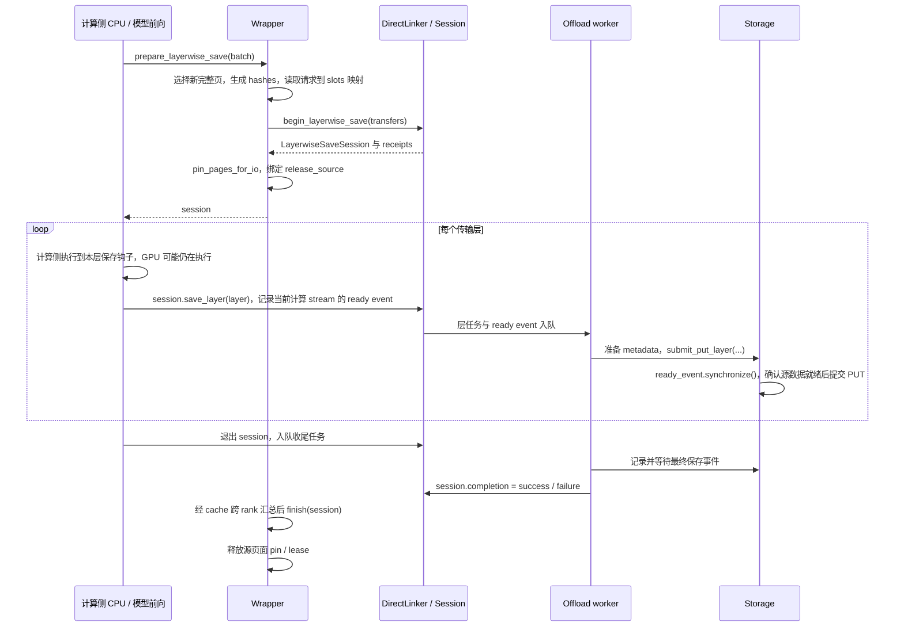

prepare 阶段主要处理完整新页，不是每次把全部历史 KV 重存一遍。当前还有 allocator 类型、forward mode、speculative decoding 和多模态等条件限制，具体看 `prepare_layerwise_save()` 的 guards。

ready event 保护“GPU 生产完成后再读源数据”；pin / lease 保护“PUT 结束前源页不能被重用”。计算侧记录 event 并入队后可继续执行，等待 ready event 的是后台 offload 线程。event 确认的是记录它的 stream 上此前工作的完成；其他生产 stream 必须已建立正确依赖。发生 forward 中断或 PUT 失败，也必须先排空已提交 I/O，再释放源页。

### 8.2 树侧 offload 如何确认这些保存

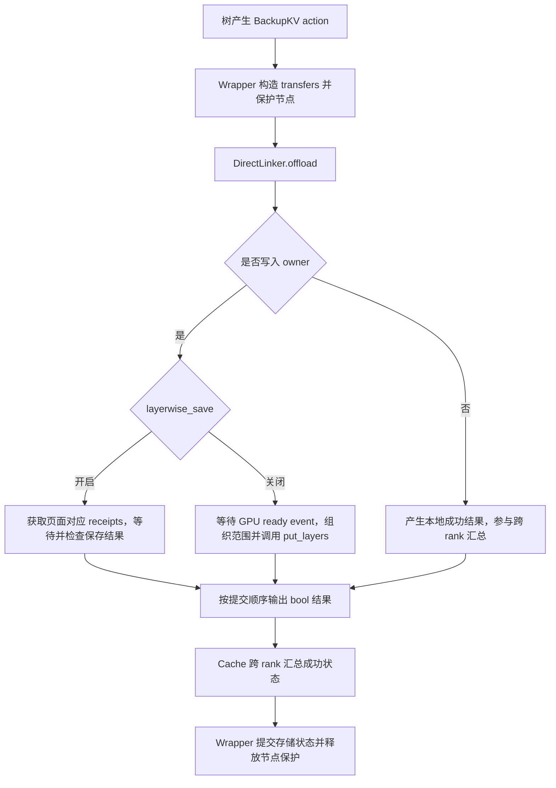

**逐层模式下，树侧 `offload()` 主要确认已有保存，不重复执行整页 PUT，也不自动重试失败的逐层 PUT。** 缺失 receipt 同样导致确认失败。

关闭逐层保存时，树侧 offload worker 才走普通 `Storage.put_layers()` 路径，等待所需保存完成后输出结果。非 owner 的本地成功不等于全局已保存，树侧还要与实际写入者的结果共同归约。

### 8.3 普通卸载：layerwise_save=False 的完整流程

**普通卸载由树侧 BackupKV 动作触发，后台 worker 构造所有层的 I/O 描述，再调用 `Storage.put_layers()` 保存。** 不走模型每层的 `save_layer()` 钩子，也不依赖逐层保存的 session / receipts。

以下按实际写入 owner 的正常路径讲解：

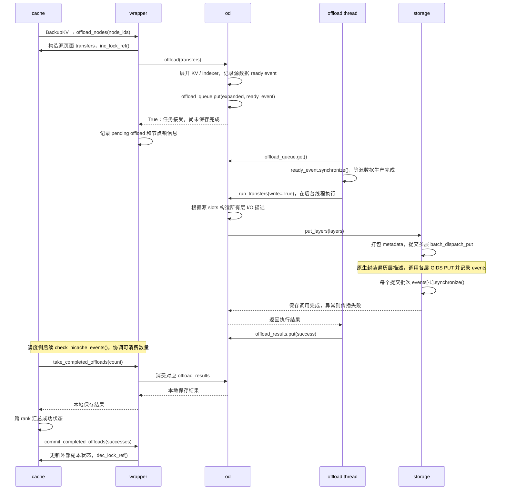

`od` 与 `storage` 是对象，不是各自的执行线程。图中 offload thread 执行同一 od 对象的 `_offload_worker()`，并在这个线程内调用 OD 和 Storage 的方法。生产 ready event 与 PUT 完成 event 是两种不同的事件。

```text
① 树侧产生 BackupKV action
   → Wrapper.offload_nodes(node_ids)
       → 从节点构造 PoolTransfer：页 keys + 已有源 GPU slots
       → inc_lock_ref() 保护源节点，防止源内存被回收
       → OD.offload(transfers)

② OD 接受并排队
   → Group.resolve_transfers() 展开 KV / Indexer 物理池任务
   → 记录 ready event，关联此前 GPU 源数据的生产工作
   → offload_queue.put((expanded, ready_event))
   → 返回 True：只表示接受任务
   → Wrapper 标记 pending，保存本次节点保护信息

③ 独立 offload 线程执行 _offload_worker()
   → 从 offload_queue 取任务
   → ready_event.synchronize()，等源 KV 数据生产完成
   → _run_transfers(transfers, write=True)
       → _transfer_layers() / _page_fragments()
       → 结合源 slots 和池布局构造各层 key / pointer / size / offset
       → Storage.put_layers(layers)

④ Storage 提交所有层的数据并等待完成
   → 在 PUT stream 上打包、上传原生 metadata
   → 按容量组织一个或多个提交批次
   → batch_dispatch_put() 传入多层描述及各层 event handles
   → 原生封装遍历各层描述，分别调用 kvcache_put() / gids_put_batch()
   → 对每个提交批次，等待 events[-1]，即其末层 event

⑤ worker 发布结果，树侧提交并解锁
   → offload_results.put(success)
   → Cache.check_hicache_events() 跨 rank 协调完成数量和结果
   → Wrapper.commit_completed_offloads(successes)
       → 更新节点外部副本状态
       → dec_lock_ref() 解除本次源节点保护
```

普通卸载使用的是已有 KV 数据的源 slots，不需要像 GET 那样新分配目标 slots。**“卸载”在这里是保存外部副本，不表示调用 offload 后立即释放 GPU 数据**；是否回收仍由缓存树及其引用状态决定。

#### 普通模式要等哪两种 event？

| 等待 | 在哪里执行 | 含义 |
| --- | --- | --- |
| 生产 ready event | offload worker 提交 PUT 前 | 确认此前 GPU 工作已产出源数据，可以读取 |
| PUT 完成 event | worker 调用的 `Storage.put_layers()` 内 | 确认保存工作收尾，可以报告结果 |

`put_layers()` 的实际同步代码是：

```python
for _, _, _, _, events in submitted:
    if events:
        events[-1].synchronize()
```

这里不是逐层调用 `synchronize()`，而是每个提交批次只同步末层 event。原生封装在对应层算子调用后，将 event 记录在同一 PUT stream 上；使用末层 event 确认前序工作，依赖 GIDS 正确将 I/O 完成依赖接入该 stream。

这也不意味着底层只调用一次 GIDS：上层可一次传多层描述，原生封装仍遍历描述逐层调用；更不意味着每一层必须写完后，CPU 才提交下一层。

#### 与逐层保存的最小对照

| 对比 | 普通模式 | layerwise 模式 |
| --- | --- | --- |
| 真正 PUT 的触发源 | 树侧 BackupKV / offload | 模型层保存钩子 |
| 源数据就绪等待 | 本次 offload 的 ready event | 每层任务的 ready event |
| 提交方式 | worker 构造所有层描述，调用 put_layers | worker 按层调用 submit_put_layer |
| 保存收尾等待 | 各提交批次末层 PUT event | session 末尾记录的 finish event |
| 树侧 offload 的作用 | 发起实际保存 | 核对已有保存 receipts，不重复 PUT |
| 主要源数据保护 | 节点锁引用 | session 页面 pin，以及树侧确认任务自己的节点锁引用 |

非 owner 不执行原生写入，提供本地确认结果参与跨 rank 汇总。普通 PUT 出错会报告失败，不能发布成功副本状态；在途工作需要排空后才可解除保护。这里的 event 完成含义是当前接口的保存完成约定，不额外承诺存储设备的掉电持久性。

代码走读入口：`Wrapper.offload_nodes()` / `_offload_node()` → `OceanDiskDirectLinker.offload()` / `_offload_worker()` → `OceanDiskStorage.put_layers()`。更详细的源码断点参考 [走读笔记第 4 节](code_walkthrough_notes.md)。

## 9. 正确性与生命周期：讲解中不可省略的部分

| 机制 | 要解决的问题 |
| --- | --- |
| 目标节点锁引用 | GET 期间目标 GPU 内存不能被回收重用 |
| 源节点锁 / 逐层保存页 pin | PUT 期间源数据不能被释放或覆盖 |
| GPU ready event | I/O 读取源 buffer 前，等待模型生产数据 |
| load counter + GET events | 模型消费前，确认该层 KV 和 Indexer 都可读 |
| FIFO offload 结果 | 完成 bool 没有任务 ID，必须与 Wrapper pending 顺序对应 |
| 跨 rank 汇总 | 本地完成不自动等于全局可提交 |
| reset / close 排空 | 释放树保护之前，保证没有遗留 I/O 继续访问页面 |

`cancel_queued_load()` 当前返回 False：树节点已发布，安全取消还需要原子回滚树状态，不能仅把任务从队列删除。

`reset()` 先排空任务和 streams，再重置后端状态；Wrapper 随后处理 session 与节点保护。`close()` 再停止 worker 并关闭 Storage。

当前 GIDS 未提供注销操作，Storage 关闭时同步 streams、释放可释放的 metadata，但保留已注册 buffer 引用和进程全局初始化约束。因此不能把 close 讲成“已注销全部显存并允许同进程重新初始化”。

原生注册描述对长度增加 512 B，并不实际分配额外显存；不能据此推断分配尾部真实存在可随意访问的空间。

## 10. 从 OD 范例推广：新增一个 linker 后端要做什么

### 10.1 先确定边界

先定义支持的模型、components、GPU 布局、并行拓扑和存储格式。设计 key 身份、范围读写格式、完整性判定和失败策略，避免把部分保存误认为完整命中。存储 SDK 是否接收 GPU pointer、是否需要注册内存，也要先确认。

基础后端只需完成普通 PC 契约；逐层保存是可选扩展，需要额外模型钩子和源页生命周期配合。

### 10.2 建议文件与职责

```text
storage/mybackend/
  my_direct_linker.py  # 接 UC Linker，组织逻辑到物理传输
  my_store.py          # 接 SDK，执行存储操作
```

| 复用或新增的位置 | 需要做什么 |
| --- | --- |
| `MyDirectLinker(UnifiedCacheLinker)` | 实现 lookup、加载排队与启动、保存、完成队列、取消及生命周期契约 |
| `MyStorage` | SDK 初始化、GPU 内存支持、连接、原生 I/O 描述、实际执行和错误反馈 |
| Group / Entry | 目标布局已有支持则复用；只有新 GPU 布局才扩展 assembler strategy |
| `mem_cache/registry.py` | 增加后端选择分支并保持 SDK 延迟导入 |
| `arg_groups/fields/memory.py` | 增加 `unified_cache_external_linker_backend` choices 和必要配置 |
| 测试与运行说明 | 声明依赖、支持范围、启动方式，验证失败和资源清理 |

普通后端通常不需要改缓存树的匹配、插入、锁引用或跨 rank 提交流程；也不必为了仅支持 UC 路径而实现整套 HiCache host-cache API。

### 10.3 必须履行的接口契约

| 接口 | 关键含义 |
| --- | --- |
| `lookup()` | 返回本 rank 所有合法前缀页数边界，不只返回最大值 |
| `load()` | 接受任务；支持树侧筛选后的部分 transfer，不提前宣布数据可用 |
| `start_layer_wise_loading()` | 启动待加载批次并返回 counter index |
| `layer_done_counter` | 对接现有消费者选择和逐层等待，传播失败 |
| `num_completed_loads()` / `pop_completed_load()` | 按批次提供请求 IDs，以便树侧清理 |
| `offload()` | 接受保存任务；返回 True 不代表持久化完成 |
| `num_completed_offloads()` / `pop_completed_offload()` | 按接受顺序交付结果；必要内容全部成功才确认 |
| `cancel_queued_load()` | 只有确保树和内存状态一致时才允许真正取消，否则保守返回 False |
| `reset()` / `close()` | 返回前确保在途 I/O 不会访问随后释放的 GPU 页面 |

内部可以并发提交，但对外结果顺序和生命周期必须符合契约。OD 的 paired KV / Indexer ABI、512 B 存储对齐、指定 rank 策略属于具体适配，不能作为所有新后端的通用要求直接复制。

### 10.4 推荐验证顺序

1. fake storage：检查 keys、slots、每层地址、任务结果顺序和失败传播。
2. 生命周期：慢 GET/PUT、重复前缀、请求结束、reset / close，确认页面不会提前重用。
3. 多 rank：验证命中交集、写入 owner 和全局保存确认。
4. 真实 GPU 与存储：首次计算并保存，再移除 GPU 驻留副本，请求相同前缀，验证外部命中与输出。
5. 若加逐层保存：额外验证生产 event、源页 pin、forward 中断、PUT 失败及图回放。

这些是验证建议，本文编写过程没有执行真实 GIDS / GPU 集成测试。

## 11. 现场讲解时打开哪些源码

以下链接相对本文所在仓库根目录，可在支持相对链接的 Markdown 查看器中打开：

| 讲解主题 | 文件与入口 |
| --- | --- |
| 后端选择和 counter 接线 | [registry.py](python/sglang/srt/mem_cache/registry.py)：`_create_unified_radix_cache()` |
| 树侧契约和编排 | [unified_cache_linker.py](python/sglang/srt/mem_cache/unified_cache/unified_cache_linker.py)：ABC、`match()`、`load_back()`、`prepare_layerwise_save()` |
| 树侧完成事件 | [unified_radix_cache.py](python/sglang/srt/mem_cache/unified_radix_cache.py)：`init_cache_linker()`、`check_hicache_events()` |
| DSA 池布局和地址计算 | [linker_pool_assembler.py](python/sglang/srt/mem_cache/hybrid_cache/linker_pool_assembler.py)：`_build_dsa_device_pool_group()`、Group / Entry |
| OD 逻辑到物理 I/O | [oceandisk_direct_linker.py](python/sglang/srt/mem_cache/storage/oceandisk/oceandisk_direct_linker.py)：初始化、lookup、GET 描述、load / offload workers、session |
| OD 原生执行 | [oceandisk_storage.py](python/sglang/srt/mem_cache/storage/oceandisk/oceandisk_storage.py)：注册内存、metadata、exists / get / put |
| connection 选择 | [connection_router.py](python/sglang/srt/mem_cache/storage/oceandisk/connection_router.py)：`ConnectionRouter.select()` |
| forward session 准备 | [tp_worker.py](python/sglang/srt/managers/tp_worker.py)：`layerwise_cache_linker` 接线 |
| 模型层保存钩子 | [deepseek_v2.py](python/sglang/srt/models/deepseek_v2.py)：逐层 `save_layer()` 调用 |
| 图执行时的层钩子 | [layerwise_kv_graph.py](python/sglang/srt/model_executor/runner_utils/layerwise_kv_graph.py)：层等待与保存回调 |
| 配置选项 | [memory.py](python/sglang/srt/arg_groups/fields/memory.py)：external linker 开关与后端 choices |

建议现场用同一个例子贯穿：页 A → GPU slots 128～131 → KV token 行 / Indexer page 行 → 各层指针 → Storage 原生参数 → event → 树侧解锁。这样每个类都能落到明确的输入和输出。

需要展开更多接口细节时，参考 [UnifiedCacheLinker 运行与扩展指南](unified_cache_linker_guide.md)；需要原生 metadata 和范围 I/O 细节时，参考 [OceanDisk PUT / GET / EXISTS 说明](oceandisk_put_get_exists_details.md) 中的 PC 相关部分。
